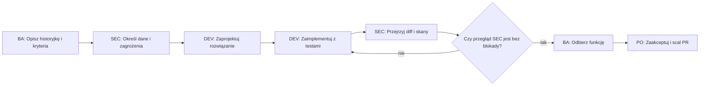

# Jak pracujemy

Projekt prowadzi trzyosobowy zespół ról — **[BA]** analityk biznesowy, **[DEV]** developer, **[SEC]** specjalista
ds. bezpieczeństwa — oraz **Product Owner (PO)**, który podejmuje decyzje biznesowe i akceptuje wyniki.
Każda zmiana przechodzi przez trzy perspektywy, a ślad pracy zostaje w repozytorium: w dokumentach, issues,
commitach i PR-ach.

| Rola | Odpowiada za | Czego nie robi |
|---|---|---|
| [BA] | wymagania, historyjki, kryteria akceptacji, priorytety MoSCoW, macierz śledzenia, odbiór funkcji | nie pisze kodu; niejasne wymaganie — pyta PO, nie zgaduje |
| [DEV] | projekt rozwiązania, ADR, kod, testy, CI, Docker, dokumentacja techniczna, CHANGELOG | nie zmienia zakresu bez zgody BA/PO; nie wyłącza testów ani kontroli bezpieczeństwa |
| [SEC] | klasyfikacja danych, threat model, przegląd PR (OWASP/ASVS), rejestr ryzyk, SECURITY.md | ma **prawo weta**: PR z ryzykiem wysokim lub krytycznym nie przechodzi bez poprawki albo akceptacji ryzyka przez PO zapisanej w [rejestrze](docs/bezpieczenstwo/RYZYKA.md) |
| PO | zakres, priorytety, akceptacja ryzyk i wydań, **merge** | — |

Gdy PO nie odpowiada, [BA] przyjmuje bezpieczne, minimalne założenie i zapisuje je jako „do potwierdzenia”
w [docs/analiza/ZALOZENIA.md](docs/analiza/ZALOZENIA.md). Sprzeczne rekomendacje ról (np. DEV chce prościej,
SEC zgłasza ryzyko) trafiają do PO z obiema opcjami i konsekwencjami; decyzja ląduje w ADR albo w rejestrze ryzyk.

## Proces dla każdej funkcji

1. **[BA] Analiza** — pytania do PO (maks. 5 naraz); historyjka „Jako … chcę …, aby …” z kryteriami
   Given/When/Then, wymaganiami niefunkcjonalnymi i priorytetem; sprawdzenie Definition of Ready.
2. **[SEC] Wymagania bezpieczeństwa** — klasa danych ([klasyfikacja](docs/bezpieczenstwo/KLASYFIKACJA_DANYCH.md)),
   mini-STRIDE dla nowego przepływu, zabezpieczenia jako dodatkowe kryteria akceptacji, wpis do rejestru ryzyk.
3. **[DEV] Projekt** — krótki opis; decyzja istotna albo trudno odwracalna → ADR w `docs/architektura/adr/`;
   zmiany modelu danych i API najpierw w dokumentacji.
4. **[DEV] Implementacja** — małe commity, testy dla każdego kryterium (także „rola X dostaje 403”).
5. **[SEC] Przegląd** — checklista z szablonu PR; wynik ✅ / ⚠️ / ❌ z uzasadnieniem; fałszywe alarmy skanerów
   oznaczane pojedynczo z uzasadnieniem (`# nosec Bxxx` i komentarz nad linią), nigdy hurtowo.
6. **[BA] Odbiór** — kryteria punkt po punkcie, komunikaty i UX, aktualizacja [macierzy śledzenia](docs/analiza/SLEDZENIE.md).
7. **PR** — opis według szablonu, wpis w [CHANGELOG](CHANGELOG.md); **merge tylko po akceptacji PO**.

## Definition of Ready

Historyjka jest gotowa do realizacji, gdy:
- cel i odbiorca są jasne („Jako … chcę …, aby …”);
- kryteria akceptacji są testowalne (Given/When/Then), także kryteria bezpieczeństwa;
- znane są zależności, dane wejściowe i ich klasa, role i uprawnienia;
- ma priorytet MoSCoW i identyfikator `US-nnn` w [backlogu](docs/analiza/HISTORYJKI.md).

## Definition of Done

Funkcja jest skończona, gdy:
- wszystkie kryteria akceptacji (funkcjonalne i bezpieczeństwa) są spełnione i pokryte testami;
- CI jest zielone: lint, testy, skany bezpieczeństwa bez nowych ustaleń wysokich lub krytycznych;
- dokumentacja jest zaktualizowana (wymagania, API, model danych, ADR jeśli dotyczy, CHANGELOG);
- przegląd SEC i odbiór BA są zapisane w PR;
- w repozytorium, testach i logach nie ma sekretów, danych osobowych ani danych produkcyjnych;
- PO zaakceptował.

## Konwencje

| Obszar | Zasada |
|---|---|
| Język | dokumentacja i interfejs po polsku; kod i nazwy w kodzie po angielsku (z wyjątkiem istniejących nazw domenowych); commity po angielsku, jak dotychczasowa historia ([Z-20](docs/analiza/ZALOZENIA.md)) |
| Commity | [Conventional Commits](https://www.conventionalcommits.org/): `feat:`, `fix:`, `docs:`, `test:`, `refactor:`, `chore:`, `security:`, `ci:`; w treści identyfikator historyjki, np. `security: only the author or an admin edits own equipment (US-001)` |
| Gałęzie | `feature/<id>-<krótka-nazwa>`; gałęzie sesji asystenta AI mają prefiks `claude/` i jedną gałąź na sesję ([Z-21](docs/analiza/ZALOZENIA.md)) |
| Wersje | [SemVer](https://semver.org/), zmiany w [CHANGELOG.md](CHANGELOG.md) według [Keep a Changelog](https://keepachangelog.com/pl/1.1.0/) |
| Identyfikatory | wymagania `FR-nnn` / `NFR-nnn`, historyjki `US-nnn`, ryzyka `R-nn`, ADR `NNNN`, procesy `P{n}`, reguły `BR-{P}{nn}` |
| Diagramy | tylko Mermaid (renderują się na GitHubie) |

## Narzędzia i uruchomienie lokalne

Instalacja narzędzi deweloperskich: `pip install -r requirements-dev.txt` oraz `pip install pre-commit && pre-commit install`.
Uzasadnienie wyboru narzędzi: [ADR-0002](docs/architektura/adr/0002-narzedzia-jakosci-i-bezpieczenstwa.md).

| Kontrola | Narzędzie | Lokalnie | W CI |
|---|---|---|---|
| Lint | ruff | `ruff check .` | blokuje |
| Testy Python | Django test runner | `cd web && DJANGO_DEBUG=true DJANGO_ALLOWED_HOSTS='*' python manage.py test --parallel 4` | blokuje (PostgreSQL) |
| Testy JS | node --test | `node --test web/twin/tests/js/*.test.mjs` | blokuje |
| Migracje | makemigrations --check | pre-commit | blokuje |
| Pokrycie | coverage | `cd web && coverage run --rcfile=../pyproject.toml manage.py test --parallel 4 && coverage combine --rcfile=../pyproject.toml && coverage report --rcfile=../pyproject.toml` | raport + próg 80% logiki domenowej (blokuje) |
| SAST | bandit | `bandit -r web tools -x '*/tests/*,*/migrations/*' --severity-level medium --confidence-level medium` | blokuje od wagi średniej |
| SAST | semgrep (OWASP, Django) | `semgrep scan --config p/owasp-top-ten --config p/django` | blokuje ([triaż](docs/bezpieczenstwo/TRIAZ_SKANOW.md)) |
| SCA | pip-audit, Dependabot | `pip-audit -r requirements.txt` | blokuje |
| Sekrety | gitleaks | pre-commit | blokuje |
| Kontener | trivy (Dockerfile, obraz) | `trivy config .`, `trivy image twinema:scan` | blokuje (obraz: wysokie i krytyczne z poprawką) |
| Wdrożenie | Django deploy check | `python manage.py check --deploy` | blokuje |

## Zgłaszanie

- Nowa funkcja lub zmiana: issue z szablonu **Historyjka użytkownika**.
- Błąd: szablon **Błąd** (bez danych produkcyjnych w treści i załącznikach).
- Podatność: **nie** przez publiczne issue — zob. [SECURITY.md](SECURITY.md).
