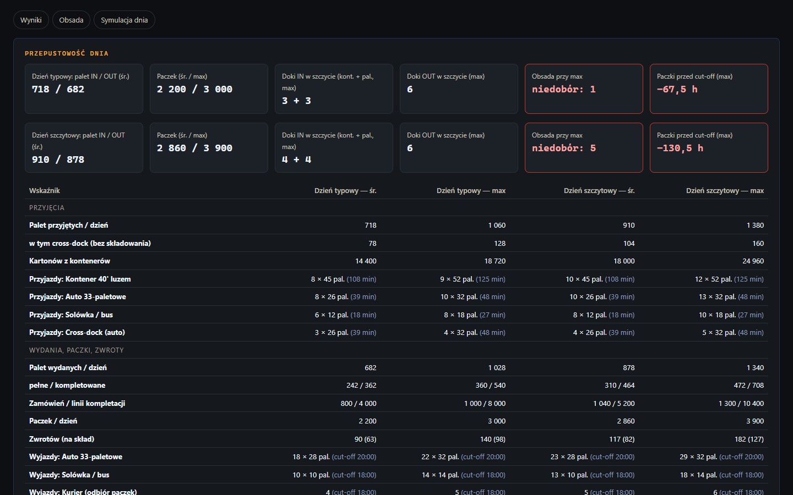
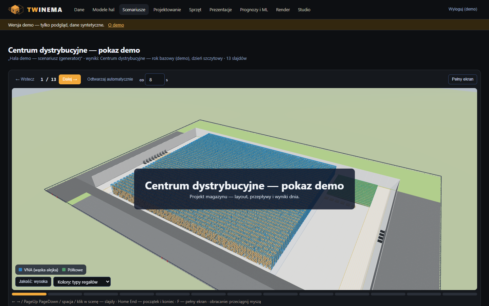

# TWINEMA

**A warehouse designer checks whether a new distribution centre can handle a peak day — before it is built — and
shows the result to the board in 3D instead of in a spreadsheet.**

*[Polski](README.md) · The application UI and the analysis documents in `docs/` are in Polish.*


🔗 **Demo:** [twinema.twapp.pl](https://twinema.twapp.pl) — no password needed: „Obejrzyj prezentację 3D” (watch the
3D presentation) or „Wejdź do systemu” (enter the app as the read-only `demo` account). All demo data is synthetic.

## Problem → solution

The decision to build or re-layout a warehouse is usually made on spreadsheets and a flat floor plan. There is no
easy way to check where trucks will get stuck at the docks during the peak, whether there are enough people and
forklifts, or to show any of it to the board. TWINEMA lets the designer:

- **draw the hall in the browser** — racks, docks, aisles and zones on a 2D plan with a live 3D preview, with
  live validation of collisions, aisle widths, rack heights against the building and the plot boundary;
- **describe a working day as a scenario** — volumes (trucks, pallets, orders) as min / mean / max, independent
  of the layout, so the same day can be tested on several layout variants;
- **simulate the day** — a discrete-event simulation run many times, giving KPIs as mean and worst case (P95),
  bottlenecks with a hint on what to add, and a comparison of variants on identical input;
- **forecast the design day** from historical warehouse tasks (import from an EWM export, simple ML models);
- **present the result** — an animated 3D day, a slide presentation for the board and a public link that does not
  expose the source data; optionally a rendered film and a PDF deck.


| Scenario results | 3D presentation |
|---|---|
|  |  |

## How it was built

The project is run as if by a three-person team — **[BA]** business analyst, **[DEV]** developer, **[SEC]**
security — with a Product Owner accepting scope, risks and every merge
([CONTRIBUTING.md](CONTRIBUTING.md), in Polish). The repository contains the analysis that a real pre-implementation
phase would produce:

- process documentation P1–P8 with process diagrams, SIPOC, data model (ERD + entity dictionary), user flow and
  integrations ([overview](docs/00-przeglad.md));
- vision, stakeholders, AS-IS / TO-BE processes, functional and non-functional requirements, MoSCoW backlog and a
  traceability matrix ([docs/analiza](docs/analiza/));
- architecture (C4 context and containers, API, ADRs), test strategy and an operations runbook;
- security: data classification, STRIDE threat model, risk register, GDPR notes and an OWASP ASVS level 1 checklist.

## Quality and security in CI

Every pull request to `main` runs blocking checks: ruff, Django checks and migrations, ~800 Python tests on
PostgreSQL, 81 JS tests, a domain-logic coverage gate of 80%, Playwright end-to-end tests with an enforced CSP, and
the [Security](.github/workflows/security.yml) workflow — gitleaks (secrets), pip-audit (dependencies), bandit
and semgrep (SAST, OWASP Top 10 + Django rules) and trivy (Dockerfile and image). Dependabot keeps pip,
GitHub Actions and Docker images up to date. Security headers (CSP with nonces, Permissions-Policy, etc.) are
covered by tests; administrators must use TOTP two-factor login.

## Running locally

Requirements: Python 3.11+ (production: 3.13), Git, Node 22 only for the JS tests.

```bash
git clone https://github.com/TomaszWu14/twinema-public.git && cd twinema-public
python -m venv .venv && source .venv/bin/activate     # Windows Git Bash: source .venv/Scripts/activate
PYTHONUTF8=1 pip install -r requirements-dev.txt
cd web
export DJANGO_DEBUG=true DJANGO_ALLOWED_HOSTS='*' DEMO_PASSWORD='demo-haslo-123'
sh scripts/fetch_vendor.sh      # once: three.js and ECharts into static/ (SHA-256 verified)
python manage.py migrate
python manage.py seed_demo      # roles, demo hall, scenario, 3,000 materials, stock, demo account
python manage.py createsuperuser
python manage.py runserver 8090
python manage.py run_jobs       # second terminal: job queue worker (simulations, large imports)
```

Open http://127.0.0.1:8090/ and log in as the administrator or `demo` / `demo-haslo-123` (read-only role).
A good start: **Scenariusze (Scenarios) → demo scenario → „Uruchom symulację” (Run simulation) → „Animacja dnia”
(Day animation)**. PowerShell instructions and all environment variables: [README.md](README.md),
[`.env.example`](.env.example).

Tests and lint:

```bash
cd web && python manage.py check && python manage.py test --exclude-tag e2e && ruff check ..
node --test twin/tests/js/*.test.mjs
```

## Stack and why

| Component | Role | Why |
|---|---|---|
| Python 3.13, Django 5.2 LTS | app, ORM, admin, roles | LTS release with security support until 2028; one monolith, one deployment |
| Plain Python for the logic | discrete-event simulation, ML, geometry, layout validation | testable without the database or Django |
| pydantic-settings | configuration from environment variables | a configuration error stops startup instead of running with wrong settings |
| PostgreSQL 17 (SQLite locally) | database | empty `DATABASE_URL` = SQLite, so local start needs no database server |
| three.js, ECharts | 3D scene, editor, day animation, charts | vendored at build time with SHA-256 checks — no CDN dependency at runtime |
| Blender 4.x (headless) on a separate PC | rendering film shots and deck images | the server has no GPU; the worker polls the server, so the server opens no ports |
| Anthropic Claude (optional) | drafting the film script | only aggregated numbers leave the system; a human approves the text |
| Docker + Coolify | demo deployment | self-hosted server instead of a paid cloud: deploy from the repo, HTTPS and healthcheck |

## Scope and limitations

- **File-based data only** (xlsx/csv exports from the warehouse system) — no live integration, by design.
- **The tool evaluates variants, it does not design on its own** — the designer draws the layout, the system
  checks and simulates it.
- **Rendering** needs Blender on a separate PC; without the worker, render jobs wait in the queue.
- **Long computations** (simulation, AI draft) run in the request — large scenarios risk a server timeout.
- Full list of decisions and known issues: [docs/05-decyzje-i-ograniczenia.md](docs/05-decyzje-i-ograniczenia.md)
  (Polish).

## Project context

A portfolio project inspired by work in warehouse logistics; all data, names and scenarios in the repository are
synthetic. It is my own project and was not deployed at a company. I prepared the process analysis, data model,
requirements and decisions myself; the code was written with an AI assistant (Claude Code), and every change was
checked by tests in CI.

## License

[MIT](LICENSE)
