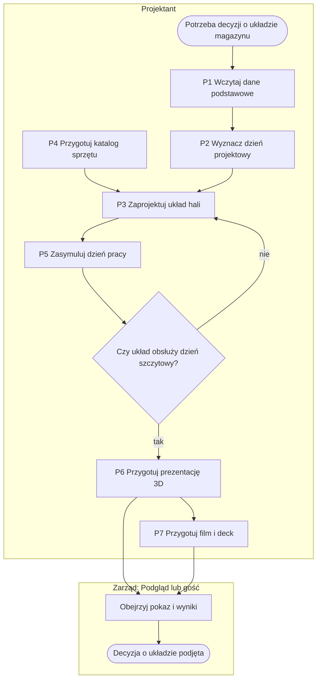

# TWINEMA

**Projektant magazynu sprawdza, czy nowa hala obsłuży dzień szczytowy — zanim powstanie — i pokazuje to zarządowi w 3D zamiast w arkuszu.**

*Warehouse design tool: lay out a distribution centre, simulate a peak day on that layout and present the result to the board in 3D. UI and docs in Polish.*

 <!-- DO UZUPEŁNIENIA: nagrać GIF 15–20 s (animacja dnia, ekran 603) -->

📹 [Prezentacja działania — 2 min](<DO UZUPEŁNIENIA: link YouTube>)

🔗 **Demo:** [twinema.twapp.pl](https://twinema.twapp.pl) — konto `demo` (rola Podgląd, tylko odczyt), hasło: \<DO UZUPEŁNIENIA\>. Dane w demo są syntetyczne.

## Problem → rozwiązanie

Decyzja o budowie magazynu zapada na arkuszach i płaskim rzucie — nie ma jak sprawdzić, gdzie w szczycie
utkną auta przy dokach, czy wystarczy ludzi i wózków, ani pokazać tego zarządowi. TWINEMA pozwala narysować
halę w przeglądarce (z walidacją kolizji, alejek, wysokości i działki na żywo), opisać dzień pracy jako
scenariusz wolumenów niezależny od układu i zasymulować go na kilku wariantach hali. Wynik to KPI ze średnią
i najgorszym przypadkiem, wąskie gardła z podpowiedzią, co dodać, animacja dnia w 3D i prezentacja dla
zarządu z linkiem, który nie ujawnia danych źródłowych.


## Dokumentacja analityczna

Dokumentacja przedwdrożeniowa procesów, danych, ekranów i integracji — odtworzona z kodu, językiem biznesowym.

| Dokument | Co zawiera |
|---|---|
| [00 — Przegląd](docs/00-przeglad.md) | cel biznesowy, zakres, aktorzy, mapa procesów, SIPOC, założenia do potwierdzenia |
| [P1 — Dane podstawowe](docs/01-procesy/P1-dane-podstawowe.md) | import materiałów, mastera lokalizacji i stanów, kartoteka, dane demo |
| [P2 — Historia ruchów i prognoza](docs/01-procesy/P2-historia-ruchow-i-prognoza.md) | import zadań, dzień projektowy, kalibracja, prognoza, modele ML |
| [P3 — Model hali](docs/01-procesy/P3-model-hali.md) | utworzenie, edycja i walidacja układu, odwzorowanie adresowania |
| [P4 — Katalog sprzętu](docs/01-procesy/P4-katalog-sprzetu.md) | sprzęt, osprzęt, krzywa udźwigu, import, stawki kosztowe |
| [P5 — Scenariusz i symulacja](docs/01-procesy/P5-scenariusz-i-symulacja.md) | scenariusz, symulacja dnia, wąskie gardła, porównanie |
| [P6 — Prezentacja 3D](docs/01-procesy/P6-prezentacja-3d.md) | slajdy, link wewnętrzny i publiczny |
| [P7 — Film i deck](docs/01-procesy/P7-film-i-deck.md) | tekst, zatwierdzenie, render, montaż z napisami, deck PDF |
| [P8 — Dostęp i demo](docs/01-procesy/P8-dostep-i-demo.md) | role, logowanie, publiczne demo z wejściem gościa |
| [Model danych](docs/02-dane/model-danych.md) | ERD, słownik encji z cyklem życia, glosariusz, skutki usuwania |
| [User flow](docs/03-user-flow/user-flow.md) | mapa ekranów, przejścia, warunki dostępu |
| [Integracje](docs/04-integracje.md) | diagram kontekstu, tabela interfejsów |
| [Decyzje i ograniczenia](docs/05-decyzje-i-ograniczenia.md) | dziennik decyzji, wymagania niefunkcjonalne, ograniczenia, dług techniczny, do anonimizacji |

Proces główny — od danych do decyzji o układzie magazynu:



P1, P2 i P4 można wykonać w dowolnej kolejności; P2 i P7 są opcjonalne; P8 (dostęp i role) obejmuje wszystkie
procesy. Opis: [przegląd](docs/00-przeglad.md#proces-główny-end-to-end).

Materiały z okresu budowy: [założenia z burzy mózgów](docs/ZALOZENIA.md),
[plan faz](docs/PLAN.md), [pochodzenie kodu](PROVENANCE.md),
[zrzuty ekranu](docs/screenshots/README.md).

## Proces zespołu: analiza, rozwój, bezpieczeństwo

Projekt jest prowadzony jak przez trzyosobowy zespół — **[BA]** analityk, **[DEV]** developer, **[SEC]**
bezpieczeństwo — z Product Ownerem akceptującym zakres, ryzyka i każdy merge. Proces, Definition of Ready/Done
i konwencje: [CONTRIBUTING.md](CONTRIBUTING.md); zgłaszanie podatności: [SECURITY.md](SECURITY.md);
zmiany: [CHANGELOG.md](CHANGELOG.md); stan wyjściowy: [audyt](docs/AUDYT.md).

| Obszar | Dokumenty |
|---|---|
| [BA] Analiza | [wizja](docs/analiza/WIZJA.md) · [interesariusze](docs/analiza/INTERESARIUSZE.md) · [procesy AS-IS/TO-BE](docs/analiza/PROCESY.md) · [wymagania FR/NFR](docs/analiza/WYMAGANIA.md) · [backlog MoSCoW](docs/analiza/HISTORYJKI.md) · [słownik](docs/analiza/SLOWNIK.md) · [założenia](docs/analiza/ZALOZENIA.md) · [macierz śledzenia](docs/analiza/SLEDZENIE.md) |
| [DEV] Architektura | [C4: kontekst i kontenery](docs/architektura/ARCHITEKTURA.md) · [model danych](docs/architektura/MODEL_DANYCH.md) · [API](docs/architektura/API.md) · [ADR](docs/architektura/adr/) · [strategia testów](docs/testy/STRATEGIA_TESTOW.md) · [runbook](docs/operacje/RUNBOOK.md) · [czyszczenie historii](docs/operacje/CZYSZCZENIE_HISTORII.md) |
| [SEC] Bezpieczeństwo | [klasyfikacja danych](docs/bezpieczenstwo/KLASYFIKACJA_DANYCH.md) · [threat model STRIDE](docs/bezpieczenstwo/THREAT_MODEL.md) · [rejestr ryzyk](docs/bezpieczenstwo/RYZYKA.md) · [RODO](docs/bezpieczenstwo/RODO.md) · [checklista ASVS](docs/bezpieczenstwo/CHECKLISTA_ASVS.md) |

## Jak uruchomić

Wymagania: Python 3.11+ (produkcja: 3.13), Git (z Git Bash na Windows). Przetestowane od zera na Windows 11
w Git Bash i PowerShell z Pythonem 3.11.

**Git Bash / Linux / macOS**

```bash
git clone https://github.com/TomaszWu14/twinema-public.git && cd twinema-public
python -m venv .venv
source .venv/Scripts/activate          # Linux/macOS: source .venv/bin/activate
PYTHONUTF8=1 pip install -r requirements-dev.txt
cd web
export DJANGO_DEBUG=true DJANGO_ALLOWED_HOSTS='*' DEMO_PASSWORD='demo-haslo-123'
sh scripts/fetch_vendor.sh              # raz: three.js i ECharts do static/ (sprawdzane SHA-256)
python manage.py migrate
python manage.py seed_demo              # role, hala demo, scenariusz, 3000 materiałów, stany, konto demo
python manage.py createsuperuser
python manage.py runserver 8090
python manage.py run_jobs                # w drugim terminalu: worker kolejki (symulacje, duże importy)
```

**PowerShell**

```powershell
git clone https://github.com/TomaszWu14/twinema-public.git; cd twinema-public
python -m venv .venv
.venv\Scripts\Activate.ps1
$env:PYTHONUTF8 = "1"; pip install -r requirements-dev.txt
cd web
$env:DJANGO_DEBUG = "true"; $env:DJANGO_ALLOWED_HOSTS = "*"; $env:DEMO_PASSWORD = "demo-haslo-123"
& "$(Split-Path (Split-Path (Get-Command git).Source))\bin\sh.exe" scripts/fetch_vendor.sh
python manage.py migrate
python manage.py seed_demo
python manage.py createsuperuser
python manage.py runserver 8090
python manage.py run_jobs                # w drugim terminalu: worker kolejki (symulacje, duże importy)
```

Otwórz http://127.0.0.1:8090/ i zaloguj się kontem administratora albo `demo` / `demo-haslo-123`
(rola Podgląd). Dobry start: **Scenariusze → scenariusz demo → „Uruchom symulację” → „Animacja dnia”**.

`PYTHONUTF8=1` jest potrzebne na Windows z polskimi ustawieniami regionalnymi — bez niego `pip` czyta
`requirements.txt` w kodowaniu cp1250 i przerywa instalację.

<details>
<summary>Testy, historia zadań, render, wdrożenie</summary>

**Testy** — 676 testów (logika symulacji, ML i geometrii bez bazy) + lint:

```bash
cd web && python manage.py check && python manage.py test && ruff check ..
```

**Historia zadań magazynowych (dla modułów Projektowanie i Prognozy):** wygeneruj syntetyczny eksport
`python ../tools/ewm_demo_tasks.py demo.xlsx --weeks 30 --scale 0.05` i wgraj go w **Zadania EWM**
(prognoza wymaga co najmniej 16 pełnych tygodni).

**Render i film (opcjonalnie):** worker na PC z Blenderem 4.x odpytuje serwer — na serwerze ustaw
`RENDER_WORKER_TOKEN` (≥ 32 znaki), na PC: `TWINEMA_URL`, `TWINEMA_WORKER_TOKEN` i `python tools/render_worker.py`.
Film nie ma lektora: tekst ujęcia jest wypalony w obrazie jako napis, a długość ujęcia to czas na jego
przeczytanie. Montaż wymaga ffmpeg ≥ 6.1 u workera; opcjonalny podkład muzyczny: `TWINEMA_MUSIC` / `--music`
(normalizowany do −14 LUFS, jak na YouTube). Szkic tekstów z Claude — klucz `ANTHROPIC_API_KEY`.
Przy gotowym filmie Studio daje MP4, napisy SRT i „Opis na YouTube” z rozdziałami. Wszystkie zmienne: [`.env.example`](.env.example).

**Wdrożenie (Docker + Coolify):** obraz z `Dockerfile`, port 8000, healthcheck `/health/`. `DEMO_SEED=true`
odpala `seed_demo` przy każdym starcie (idempotentnie): hala, scenariusz, stany, symulacja obu dni i prezentacja 3D
z publicznym linkiem; `seed_demo --reset` odtwarza dane demo. `DEMO_PUBLIC=true` otwiera demo bez logowania:
`/` prowadzi na **`/demo/`** („Obejrzyj prezentację 3D”, „Wejdź do systemu” — konto `demo` w roli Podgląd, tylko
odczyt), a `DEMO_VIDEO_URL` dodaje tam przycisk filmu.

</details>

## Stack i dlaczego taki

| Element | Rola | Dlaczego |
|---|---|---|
| Python 3.13, Django 5.2 LTS | aplikacja, ORM, panel administracyjny, role | wydanie LTS — wsparcie bezpieczeństwa do 2028; jeden monolit, jedno wdrożenie |
| Czysty Python w logice | symulacja zdarzeniowa, ML, geometria, walidacja układu | testowalne bez bazy i bez Django — 676 testów w CI ([D11](docs/05-decyzje-i-ograniczenia.md#d11-logika-obliczeniowa-bez-django)) |
| pydantic-settings | konfiguracja ze zmiennych środowiskowych | błąd konfiguracji zatrzymuje start zamiast działać na złych ustawieniach |
| PostgreSQL 17 (lokalnie SQLite) | baza | puste `DATABASE_URL` = SQLite, więc start lokalny i CI bez serwera bazy |
| three.js, ECharts | scena 3D, edytor, animacja dnia, wykresy | pobierane przy budowie z sumą SHA-256 — bez zależności od CDN w działaniu ([D12](docs/05-decyzje-i-ograniczenia.md#d12-biblioteki-js-w-repozytorium-nie-z-cdn)) |
| Blender 4.x (bez okna) na osobnym PC | render ujęć do filmu i decku | serwer nie ma GPU; worker sam odpytuje serwer, więc serwer nie otwiera portów ([D5](docs/05-decyzje-i-ograniczenia.md#d5-kolejka-renderów-bez-celery-worker-odpytuje-serwer)) |
| Anthropic Claude (opcjonalnie) | szkic tekstów filmu | na zewnątrz idą tylko zagregowane liczby ([D13](docs/05-decyzje-i-ograniczenia.md#d13-do-ai-tylko-zagregowane-liczby-tekst-zatwierdza-człowiek)) |
| openpyxl + defusedxml | import i eksport xlsx | odczyt XLSX bez podatności XXE |
| django-axes, gitleaks, ruff | bezpieczeństwo i jakość | blokada zgadywania haseł, skan sekretów przed commitem, lint w CI |
| Docker + Coolify | wdrożenie demo | \<DO UZUPEŁNIENIA: dlaczego Coolify\> |

## Zakres i ograniczenia

- **Dane tylko z plików** (xlsx/csv z systemu magazynowego) — bez integracji na żywo, świadomie ([D1](docs/05-decyzje-i-ograniczenia.md#d1-dane-tylko-z-plików-bez-integracji-na-żywo)).
- **Narzędzie ocenia warianty, nie projektuje samo** — układ rysuje projektant, system sprawdza i symuluje.
- **Film** — bez lektora (napisy w obrazie + opcjonalna muzyka, [D14](docs/05-decyzje-i-ograniczenia.md#d14-film-bez-lektora-napisy-w-obrazie-i-opcjonalna-muzyka)); montaż sprawdzony na prawdziwym ffmpeg, ale bez pełnej próby z renderem z Blendera.
- **Render** wymaga Blendera na osobnym PC; bez workera zlecenia czekają w kolejce.
- **Długie obliczenia** (symulacja, szkic AI) liczone w żądaniu — przy dużych scenariuszach ryzyko limitu czasu serwera.
- Pełna lista i znane problemy: [decyzje i ograniczenia](docs/05-decyzje-i-ograniczenia.md#znane-ograniczenia).

## Kontekst projektu

Projekt portfolio inspirowany pracą przy magazynie; wszystkie dane, nazwy i scenariusze w repozytorium są
syntetyczne. \<DO UZUPEŁNIENIA: czas realizacji, Twoja rola, sposób pracy — w tym udział narzędzi AI\>

## Licencja

[MIT](LICENSE)
