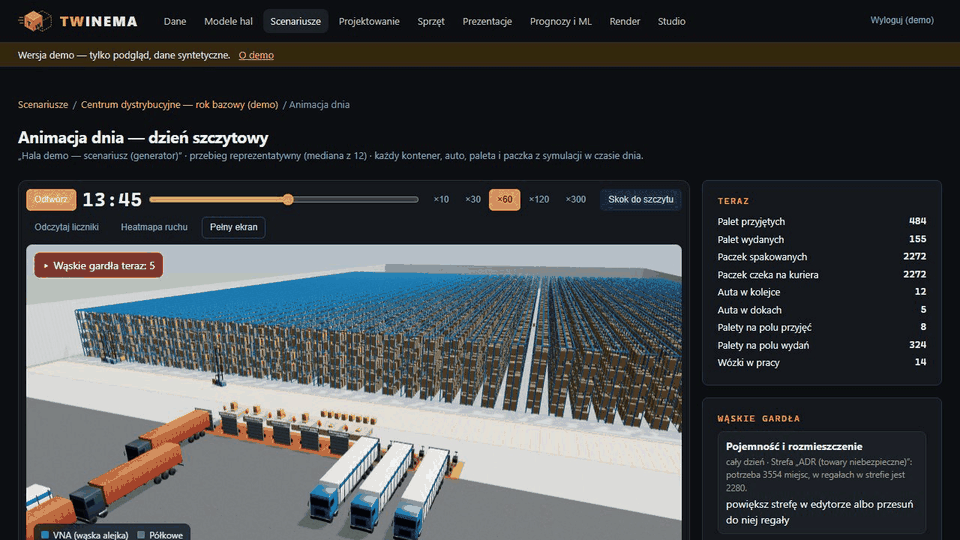
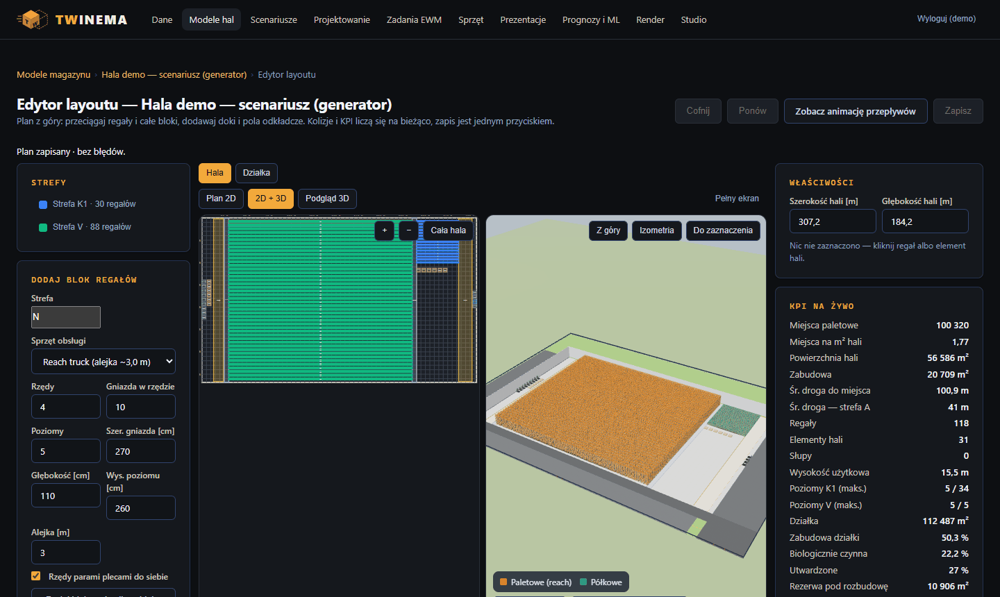

# TWINEMA

**Projektant magazynu sprawdza, czy nowa hala obsłuży dzień szczytowy — zanim powstanie — i pokazuje to zarządowi w 3D zamiast w arkuszu.**

*Warehouse design tool: lay out a distribution centre, simulate a peak day on that layout and present the result to the board in 3D. UI and docs in Polish.*

 <!-- DO UZUPEŁNIENIA: nagrać GIF 15–20 s (animacja dnia, ekran 603) -->

📹 [Prezentacja działania — 2 min](<DO UZUPEŁNIENIA: link YouTube>)

🔗 **Demo:** [twinema.twapp.pl](https://twinema.twapp.pl) — konto `demo` (rola Podgląd, tylko odczyt), hasło: \<DO UZUPEŁNIENIA\>. Dane w demo są syntetyczne.

## Problem → rozwiązanie

Decyzja o budowie magazynu zapada na arkuszach i płaskim rzucie — nie ma jak sprawdzić, gdzie w szczycie
utkną auta przy dokach, czy wystarczy ludzi i wózków, ani pokazać tego zarządowi. TWINEMA pozwala narysować
halę w przeglądarce (z walidacją kolizji, alejek, wysokości i działki na żywo), opisać dzień pracy jako
scenariusz wolumenów niezależny od układu i zasymulować go na kilku wariantach hali. Wynik to KPI ze średnią
i najgorszym przypadkiem, wąskie gardła z podpowiedzią, co dodać, animacja dnia w 3D i prezentacja dla
zarządu z linkiem, który nie ujawnia danych źródłowych.



## Dokumentacja analityczna

| Dokument | Co zawiera |
|---|---|
| [01 — Problem i zakres](docs/01-problem-i-zakres.md) | problem, interesariusze, co jest w zakresie, co poza nim i dlaczego |
| [02 — Proces](docs/02-proces.md) | proces projektowania hali przed i po wdrożeniu, aktorzy, punkty decyzyjne (Mermaid) |
| [03 — User flow](docs/03-user-flow.md) | mapa ~55 ekranów i przejść, ścieżki alternatywne i ślepe (Mermaid + tabela) |
| [04 — Model danych](docs/04-model-danych.md) | ERD 32 encji, opis encji, reguły integralności: co pilnuje baza, a co aplikacja |
| [05 — Wymagania](docs/05-wymagania.md) | 35 wymagań funkcjonalnych i 7 niefunkcjonalnych z kryteriami akceptacji i miejscem w kodzie |
| [06 — Decyzje](docs/06-decyzje.md) | dziennik 13 decyzji: kontekst, opcje, uzasadnienie, skutki — ze wskazaniem źródła |
| [07 — Ograniczenia](docs/07-ograniczenia.md) | czego system nie robi, znane problemy, co dalej |

Materiały z okresu budowy: [założenia z burzy mózgów](docs/ZALOZENIA.md) (44 decyzje),
[plan faz](docs/PLAN.md), [ADR-0001](docs/adr/0001-kopia-nie-przeniesienie.md), [pochodzenie kodu](PROVENANCE.md).

## Jak uruchomić

Wymagania: Python 3.11+ (produkcja: 3.13), Git (z Git Bash na Windows). Przetestowane od zera na Windows 11
w Git Bash i PowerShell z Pythonem 3.11.

**Git Bash / Linux / macOS**

```bash
git clone https://github.com/TomaszWu14/twinema-public.git && cd twinema-public
python -m venv .venv
source .venv/Scripts/activate          # Linux/macOS: source .venv/bin/activate
PYTHONUTF8=1 pip install -r requirements-dev.txt
cd web
export DJANGO_DEBUG=true DJANGO_ALLOWED_HOSTS='*' DEMO_PASSWORD='demo-haslo-123'
sh scripts/fetch_vendor.sh              # raz: three.js i ECharts do static/ (sprawdzane SHA-256)
python manage.py migrate
python manage.py seed_demo              # role, hala demo, scenariusz, 3000 materiałów, stany, konto demo
python manage.py createsuperuser
python manage.py runserver 8090
```

**PowerShell**

```powershell
git clone https://github.com/TomaszWu14/twinema-public.git; cd twinema-public
python -m venv .venv
.venv\Scripts\Activate.ps1
$env:PYTHONUTF8 = "1"; pip install -r requirements-dev.txt
cd web
$env:DJANGO_DEBUG = "true"; $env:DJANGO_ALLOWED_HOSTS = "*"; $env:DEMO_PASSWORD = "demo-haslo-123"
& "$(Split-Path (Split-Path (Get-Command git).Source))\bin\sh.exe" scripts/fetch_vendor.sh
python manage.py migrate
python manage.py seed_demo
python manage.py createsuperuser
python manage.py runserver 8090
```

Otwórz http://127.0.0.1:8090/ i zaloguj się kontem administratora albo `demo` / `demo-haslo-123`
(rola Podgląd). Dobry start: **Scenariusze → scenariusz demo → „Uruchom symulację” → „Animacja dnia”**.

`PYTHONUTF8=1` jest potrzebne na Windows z polskimi ustawieniami regionalnymi — bez niego `pip` czyta
`requirements.txt` w kodowaniu cp1250 i przerywa instalację.

<details>
<summary>Testy, historia zadań, render, wdrożenie</summary>

**Testy** — 666 testów (logika symulacji, ML i geometrii bez bazy) + lint:

```bash
cd web && python manage.py check && python manage.py test && ruff check ..
```

**Historia zadań magazynowych (dla modułów Projektowanie i Prognozy):** wygeneruj syntetyczny eksport
`python ../tools/ewm_demo_tasks.py demo.xlsx --weeks 30 --scale 0.05` i wgraj go w **Zadania EWM**
(prognoza wymaga co najmniej 16 pełnych tygodni).

**Render i film (opcjonalnie):** worker na PC z Blenderem 4.x odpytuje serwer — na serwerze ustaw
`RENDER_WORKER_TOKEN` (≥ 32 znaki), na PC: `TWINEMA_URL`, `TWINEMA_WORKER_TOKEN` i `python tools/render_worker.py`.
Montaż filmu wymaga ffmpeg; lektor i szkic narracji — kluczy `ELEVENLABS_API_KEY` i `ANTHROPIC_API_KEY`.
Wszystkie zmienne: [`.env.example`](.env.example).

**Wdrożenie (Docker + Coolify):** obraz z `Dockerfile`, port 8000, healthcheck `/health/`. `DEMO_SEED=true`
odpala `seed_demo` przy każdym starcie (idempotentnie); `seed_demo --reset` odtwarza dane demo.

</details>

## Stack i dlaczego taki

| Element | Rola | Dlaczego |
|---|---|---|
| Python 3.13, Django 5.2 LTS | aplikacja, ORM, panel administracyjny, role | wydanie LTS — wsparcie bezpieczeństwa do 2028; jeden monolit, jedno wdrożenie |
| Czysty Python w logice | symulacja zdarzeniowa, ML, geometria, walidacja układu | testowalne bez bazy i bez Django — 666 testów w CI ([D11](docs/06-decyzje.md)) |
| pydantic-settings | konfiguracja ze zmiennych środowiskowych | błąd konfiguracji zatrzymuje start zamiast działać na złych ustawieniach |
| PostgreSQL 17 (lokalnie SQLite) | baza | puste `DATABASE_URL` = SQLite, więc start lokalny i CI bez serwera bazy |
| three.js, ECharts | scena 3D, edytor, animacja dnia, wykresy | pobierane przy budowie z sumą SHA-256 — bez zależności od CDN w działaniu ([D12](docs/06-decyzje.md)) |
| Blender 4.x (bez okna) na osobnym PC | render ujęć do filmu i decku | serwer nie ma GPU; worker sam odpytuje serwer, więc serwer nie otwiera portów ([D5](docs/06-decyzje.md)) |
| ElevenLabs, Anthropic Claude (opcjonalnie) | lektor, szkic narracji | na zewnątrz idzie tylko tekst kwestii i zagregowane liczby ([D13](docs/06-decyzje.md)) |
| openpyxl + defusedxml | import i eksport xlsx | odczyt XLSX bez podatności XXE |
| django-axes, gitleaks, ruff | bezpieczeństwo i jakość | blokada zgadywania haseł, skan sekretów przed commitem, lint w CI |
| Docker + Coolify | wdrożenie demo | \<DO UZUPEŁNIENIA: dlaczego Coolify\> |

## Zakres i ograniczenia

- **Dane tylko z plików** (xlsx/csv z systemu magazynowego) — bez integracji na żywo, świadomie ([D1](docs/06-decyzje.md)).
- **Narzędzie ocenia warianty, nie projektuje samo** — układ rysuje projektant, system sprawdza i symuluje.
- **Film z lektorem** — zbudowany i przetestowany jednostkowo, ale nie przeszedł pełnej próby z prawdziwym lektorem i renderem.
- **Render** wymaga Blendera na osobnym PC; bez workera zlecenia czekają w kolejce.
- **Długie obliczenia** (symulacja, szkic AI) liczone w żądaniu — przy dużych scenariuszach ryzyko limitu czasu serwera.
- Pełna lista i znane problemy: [07-ograniczenia.md](docs/07-ograniczenia.md).

## Kontekst projektu

Projekt portfolio inspirowany pracą przy magazynie; wszystkie dane, nazwy i scenariusze w repozytorium są
syntetyczne. \<DO UZUPEŁNIENIA: czas realizacji, Twoja rola, sposób pracy — w tym udział narzędzi AI\>

## Licencja

[MIT](LICENSE)
