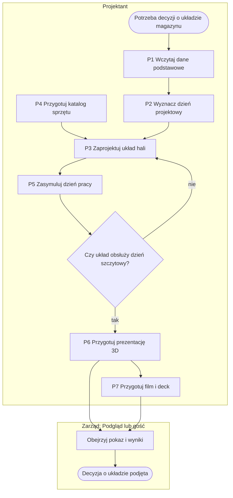

# Przegląd rozwiązania

## Cel biznesowy

TWINEMA pozwala zaprojektować i sprawdzić układ magazynu, zanim zapadnie decyzja o budowie albo przebudowie hali.
System łączy dane obecnego magazynu (asortyment, lokalizacje, stany, historię ruchów) z modelem hali 2D/3D
i symuluje dzień typowy oraz szczytowy, wskazując wąskie gardła, potrzebną obsadę, flotę i widełki kosztów.
Wynik można pokazać decydentom w przeglądarce — jako prezentację 3D z publicznym linkiem albo film z napisami —
bez udostępniania danych źródłowych.

## Zakres

### Co system robi

| Obszar | Zakres | Proces |
|---|---|---|
| Dane podstawowe | import materiałów, mastera lokalizacji i stanów z plików z raportem odrzuceń; kartoteka materiałów; nośniki i klasy palet; dane demo | [P1](01-procesy/P1-dane-podstawowe.md) |
| Historia ruchów | import zadań magazynowych, profil i dzień projektowy P90/P95/P99, kalibracja norm, prognoza wzrostu, segmentacja materiałów | [P2](01-procesy/P2-historia-ruchow-i-prognoza.md) |
| Model hali | generator, import z pliku, edytor 2D/3D z walidacją na żywo, działka, odwzorowanie adresowania, warianty | [P3](01-procesy/P3-model-hali.md) |
| Sprzęt i koszty | katalog wózków i urządzeń z krzywą udźwigu i osprzętem, import, stawki kosztowe | [P4](01-procesy/P4-katalog-sprzetu.md) |
| Scenariusz i symulacja | wolumeny dnia typowego i szczytowego (min/śr./max), obsada, normy, flota; symulacja wielu przebiegów, KPI średnia i P95, wąskie gardła, animacja, porównanie | [P5](01-procesy/P5-scenariusz-i-symulacja.md) |
| Prezentacja 3D | slajdy w przeglądarce, link wewnętrzny i publiczny z datą ważności | [P6](01-procesy/P6-prezentacja-3d.md) |
| Film i deck | teksty ujęć (ręcznie, z szablonu lub z AI), render, montaż z napisami, deck PDF, napisy, opis do serwisu wideo | [P7](01-procesy/P7-film-i-deck.md) |
| Dostęp i demo | role, logowanie z blokadą, publiczne demo z wejściem gościa | [P8](01-procesy/P8-dostep-i-demo.md) |

### Czego system świadomie nie robi

| Poza zakresem | Powód |
|---|---|
| Integracja na żywo z systemem magazynowym | dane wyłącznie z plików ([D1](05-decyzje-i-ograniczenia.md#d1-dane-tylko-z-plików-bez-integracji-na-żywo)) |
| Sterowanie pracą magazynu (zlecenia, potwierdzenia) | narzędzie projektowe, nie system magazynowy |
| Projekt budowlany, konstrukcja, pełne przepisy przeciwpożarowe | system sprawdza tylko ograniczenia potrzebne do oceny układu |
| Automatyczna optymalizacja układu | system ocenia warianty narysowane przez Projektanta i podpowiada poprawki |
| Dokładny kosztorys | koszty są widełkami ze stawek przybliżonych |
| Samodzielna rejestracja i odzyskiwanie hasła | konta zakłada Administrator |
| Interfejs w innym języku niż polski | zasada projektu |

## Aktorzy

| Aktor | Rodzaj | Odpowiedzialność | Odpowiednik w systemie |
|---|---|---|---|
| Projektant | użytkownik | wprowadza dane, buduje model hali, definiuje scenariusze, uruchamia symulacje, przygotowuje i udostępnia prezentacje | rola `Projektant` |
| Administrator | użytkownik | zakłada konta i nadaje role, utrzymuje klasy systemowe sprzętu; ma też wszystkie prawa Projektanta | rola `Administratorzy` lub superużytkownik |
| Podgląd (decydent, zarząd) | użytkownik | ogląda wyniki, animacje i prezentacje bez danych źródłowych i bez edycji | rola `Podgląd` |
| Gość | osoba bez konta | ogląda publiczny pokaz 3D albo wchodzi do demo jako Podgląd | publiczny link, konto demo |
| System magazynowy | system zewnętrzny (pasywny) | źródło eksportów plików; nie łączy się z TWINEMA | — |
| Stanowisko renderujące | system zewnętrzny | pobiera zlecenia renderu i montażu, odsyła obrazy i filmy | `tools/render_worker.py` |
| Usługa AI | system zewnętrzny (opcjonalny) | pisze szkic tekstów filmu z zagregowanych liczb | Claude API |
| System (TWINEMA) | system | waliduje, liczy, symuluje, generuje szablony i pliki | aplikacja |

## Proces główny end-to-end

Diagram pokazuje typową kolejność. Procesy P1, P2 i P4 są niezależne od siebie i można je wykonywać w dowolnej
kolejności (dane łączą się przez kody, [D9](05-decyzje-i-ograniczenia.md#d9-klucze-integracji-jako-tekst-zamiast-kluczy-obcych));
P2 jest opcjonalny — scenariusz można zdefiniować ręcznie. P7 jest opcjonalny. P8 (dostęp) obejmuje wszystkie
procesy i nie jest pokazany jako krok.

## Mapa procesów

| Nr | Proces | Właściciel | Wejście | Wyjście | Podprocesy |
|---|---|---|---|---|---|
| [P1](01-procesy/P1-dane-podstawowe.md) | Przygotowanie danych podstawowych | Projektant | pliki materiałów, lokalizacji, stanów | kartoteka, master lokalizacji, stan bieżący | P1.1 Import pliku danych · P1.2 Utrzymanie katalogu i kartoteki · P1.3 Wczytanie danych demo |
| [P2](01-procesy/P2-historia-ruchow-i-prognoza.md) | Historia ruchów, dzień projektowy i prognoza wzrostu | Projektant | eksport zadań magazynowych | dzień projektowy, normy, prognoza, segmenty | P2.1 Import zadań · P2.2 Dzień projektowy i kalibracja · P2.3 Prognoza i symulacja nowej hali · P2.4 Modele ML |
| [P3](01-procesy/P3-model-hali.md) | Zaprojektowanie układu hali | Projektant | parametry hali, pliki, master lokalizacji | zwalidowany model hali | P3.1 Utworzenie modelu · P3.2 Edycja i walidacja · P3.3 Odwzorowanie adresowania |
| [P4](01-procesy/P4-katalog-sprzetu.md) | Katalog sprzętu i stawki kosztowe | Projektant (klasy systemowe: Administrator) | karty katalogowe, pliki sprzętu, stawki | sprzęt i stawki do walidacji i symulacji | P4.1 Import pliku sprzętu · P4.2 Utrzymanie stawek |
| [P5](01-procesy/P5-scenariusz-i-symulacja.md) | Scenariusz i symulacja dnia pracy | Projektant | scenariusz, model hali | wynik z KPI, wąskimi gardłami, animacją | P5.1 Zdefiniowanie scenariusza · P5.2 Symulacja i diagnoza · P5.3 Ocena i porównanie |
| [P6](01-procesy/P6-prezentacja-3d.md) | Prezentacja 3D i jej udostępnienie | Projektant | model hali, wynik | pokaz obejrzany przez odbiorcę | P6.1 Przygotowanie slajdów · P6.2 Udostępnienie publicznym linkiem |
| [P7](01-procesy/P7-film-i-deck.md) | Film z napisami i deck PDF | Projektant | model hali, teksty ujęć | film MP4, deck PDF, napisy, opis | P7.1 Przygotowanie i zatwierdzenie tekstu · P7.2 Render i montaż |
| [P8](01-procesy/P8-dostep-i-demo.md) | Dostęp, role i publiczne demo | Administrator | konta, konfiguracja demo | kontrolowany dostęp, działające demo | P8.1 Logowanie i kontrola dostępu · P8.2 Publiczne demo |

## SIPOC

| Dostawcy (S) | Wejścia (I) | Proces (P) | Wyjścia (O) | Odbiorcy (C) |
|---|---|---|---|---|
| System magazynowy (przez eksport) | pliki materiałów, mastera lokalizacji, stanów, zadań | P1, P2 — wczytanie i analiza danych | kartoteka, stan bieżący, dzień projektowy, normy, prognoza | Projektant |
| Projektant, dostawcy sprzętu (karty katalogowe) | parametry hali, plany, karty katalogowe, stawki | P3, P4 — model hali i katalog sprzętu | zwalidowany układ hali, sprzęt, stawki | Projektant, symulacja |
| Projektant | wolumeny dnia, obsada, normy, flota | P5 — symulacja | KPI średnia i P95, wąskie gardła z podpowiedzią, animacja, koszty, porównanie | Projektant, zarząd |
| Projektant, stanowisko renderujące, usługa AI | wybrany układ i wynik, teksty, ujęcia | P6, P7 — pokaz i film | prezentacja 3D, publiczny link, film MP4, deck PDF, napisy | zarząd, osoby z zewnątrz, serwis wideo |
| Administrator | konta, role, konfiguracja demo | P8 — dostęp | kontrolowany dostęp, demo publiczne | wszyscy użytkownicy i goście |

## Konwencja numeracji

| Element | Format | Przykład |
|---|---|---|
| Proces główny | P{n} | P5 |
| Podproces | P{n}.{m} | P5.2 |
| Krok w tabeli | numer w procesie; w podprocesie {n}.{m} | 4.3 |
| Wyjątek / ścieżka alternatywna | W{n} w obrębie procesu | P5 W7 |
| Reguła biznesowa | BR-{n}{mm} — pierwsza cyfra to numer procesu | BR-512 = reguła 12 procesu P5 |
| Wymaganie funkcjonalne | WF-{n}{mm} | WF-503 |
| Ekran | E-{n} | E-601 |
| Diagram przepływu ekranów | UF-{n} | UF-6 |
| Interfejs | I-{n} | I-6 |
| Decyzja | D{n} | D14 |
| Dług techniczny | T-{n} | T-1 |
| Miejsce do anonimizacji | A-{n} | A-8 |
| Założenie do potwierdzenia | Z-{n} | Z-6 |

## Dokumenty

| Dokument | Zawartość |
|---|---|
| [01-procesy/](01-procesy/) | procesy P1–P8: diagramy, kroki, podprocesy, wyjątki, reguły, wymagania |
| [02-dane/model-danych.md](02-dane/model-danych.md) | ERD, słownik encji, glosariusz, skutki usuwania |
| [03-user-flow/user-flow.md](03-user-flow/user-flow.md) | mapa ekranów, przejścia, warunki dostępu |
| [04-integracje.md](04-integracje.md) | diagram kontekstu, tabela interfejsów |
| [05-decyzje-i-ograniczenia.md](05-decyzje-i-ograniczenia.md) | decyzje, ograniczenia, dług techniczny, do anonimizacji |

## Założenia wymagające potwierdzenia

Poniższych kwestii nie da się ustalić z kodu. Dokumentacja opisuje zachowanie systemu takie, jakie jest; te
punkty wymagają decyzji albo informacji od właściciela biznesowego.

| Nr | Kwestia | Co wiadomo z kodu | Do potwierdzenia |
|---|---|---|---|
| Z-1 | Stan obecny i uzasadnienie biznesowe | brak opisu pracy przed wdrożeniem | jak dziś przygotowuje się wariant, ile to trwa, jakie są koszty błędnej decyzji |
| Z-2 | Odbiorcy i właściciele procesów w organizacji | role techniczne: Administrator, Projektant, Podgląd; odbiorcy (zarząd, osoba z zewnątrz) zakładani, niezweryfikowani | kto konkretnie pełni role i kto jest właścicielem każdego procesu |
| Z-3 | Uprawnienia roli Podgląd do obliczeń | Podgląd może liczyć symulację dnia i kalibrację, ale nie porównanie modeli | czy Podgląd ma uruchamiać jakiekolwiek obliczenia |
| Z-4 | Skutek usunięcia sprzętu dla floty mieszanej | grupy floty są usuwane, komunikat mówi o powrocie do ustawień ogólnych | które zachowanie jest zamierzone |
| Z-5 | Wolumeny danych produkcyjnych | limity: 300 000 wierszy / 25 MB na plik danych, 300 MB na plik zadań | rzeczywista liczba materiałów, lokalizacji i zadań w obiektach docelowych |
| Z-6 | Czas obliczeń | symulacja, import danych, ML i szkic z AI liczą się w trakcie żądania z limitem 120 s | czy przy rzeczywistych danych mieszczą się w limicie; czy wymagane jest liczenie w tle |
| Z-7 | Format eksportu z systemu magazynowego | kolumny rozpoznawane po nazwach polskich, angielskich i technicznych | z jakiego systemu i w jakim układzie przychodzą eksporty; czy zawsze mają wymagane kolumny |
| Z-8 | Strefa czasowa | domyślnie Europa/Warszawa, wybierana przy imporcie zadań | czy obiekty działają w innych strefach |
| Z-9 | Wiarygodność parametrów i kosztów | klasy systemowe sprzętu i stawki kosztowe są przybliżone (syntetyczne) | kto i jak często aktualizuje stawki; czy dokładność widełek wystarcza do decyzji |
| Z-10 | Metoda symulacji | rozkład trójkątny min/śr./max, domyślnie 12 przebiegów, miara ryzyka P95 | czy ta dokładność i miara ryzyka są akceptowane przez decydentów |
| Z-11 | Retencja i ochrona danych | 20 ostatnich wyników na scenariusz; brak mechanizmu kopii zapasowych i okresu przechowywania | okres przechowywania danych, kopie zapasowe, wymogi ochrony danych |
| Z-12 | Demo publiczne | jedno wspólne konto gościa; link publiczny demo ważny 10 lat | czy to akceptowalne poza celami prezentacyjnymi |
| Z-13 | Zarządzanie kontami | konta i role zakłada Administrator w panelu administracyjnym | procedura nadawania i odbierania uprawnień |
| Z-14 | Stanowisko renderujące i film | wymaga osobnego komputera z Blenderem i ffmpeg; moduł niesprawdzony z prawdziwym renderem | czy film jest w zakresie wdrożenia i kto utrzymuje stanowisko |
| Z-15 | Muzyka w filmie | dowolny plik wskazany w konfiguracji stanowiska | źródło i licencja muzyki |
| Z-16 | Usługa AI | wysyłane są wyłącznie zagregowane liczby; funkcja opcjonalna | zgoda na korzystanie z zewnętrznego dostawcy AI |
| Z-17 | Wymagania niefunkcjonalne | brak zapisanych wymagań dostępności i wydajności | liczba równoczesnych użytkowników, dostępność, czas odpowiedzi |
| Z-18 | Oznaczenia poziomów regałów | konwencja liter poziomów pochodzi z projektu źródłowego (A-6) | czy jest ogólna, czy specyficzna dla jednego obiektu |
| Z-19 | Język interfejsu | tylko polski | czy przewidziano inne języki |
