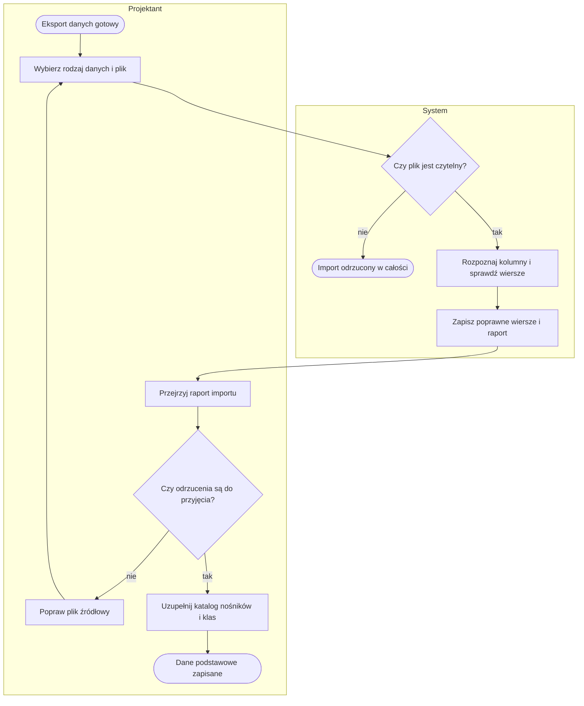
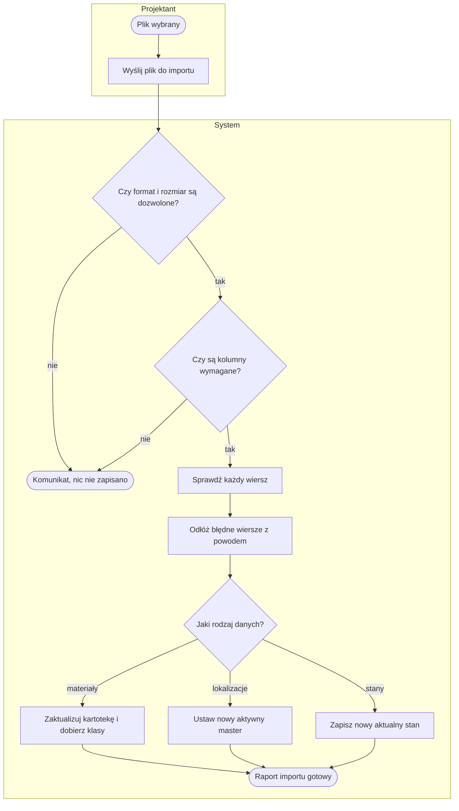
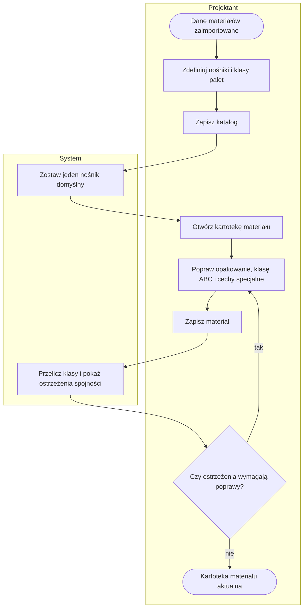
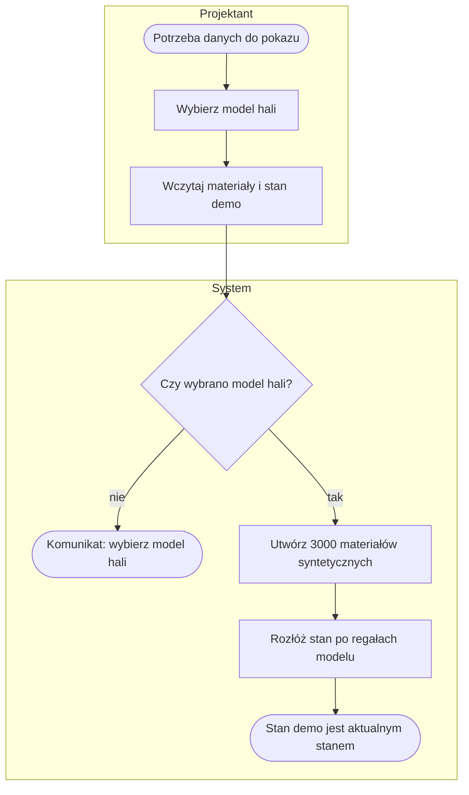
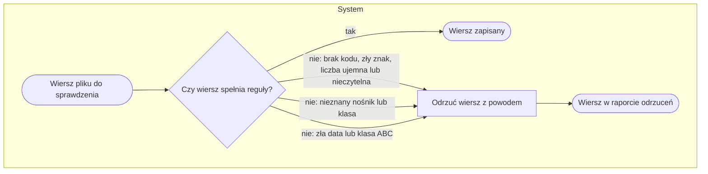

# P1. Przygotowanie danych podstawowych

| | |
|---|---|
| **Właściciel** | Projektant |
| **Cel biznesowy** | Wprowadzić do systemu aktualny obraz asortymentu, miejsc składowania i stanów magazynu — z kontrolą jakości każdego wiersza — tak, aby układ hali i symulacja opierały się na realnych gabarytach, wagach i wypełnieniu. |
| **Zdarzenie inicjujące** | Eksport danych z systemu magazynowego gotowy (pliki materiałów, lokalizacji, stanów) |
| **Rezultat końcowy** | Dane podstawowe zapisane: kartoteka materiałów, aktywny master lokalizacji, aktualny stan; dla każdego importu raport zapisanych i odrzuconych wierszy |
| **Procesy powiązane** | wyjście: [P3](P3-model-hali.md) (wykrywanie układu z mastera, palety w scenie 3D), [P5](P5-scenariusz-i-symulacja.md) (pojemność, kartony na paletę), [P2](P2-historia-ruchow-i-prognoza.md) (grupy asortymentu) |

Dane płyną wyłącznie przez pliki — bez połączenia z systemem magazynowym
([decyzja D1](../05-decyzje-i-ograniczenia.md#d1-dane-tylko-z-plików-bez-integracji-na-żywo)). Każdy plik
można wgrać niezależnie i w dowolnej kolejności.

## Przebieg procesu

Diagram przedstawia przebieg główny: od pobrania wzoru pliku przez kontrolę pliku i wierszy do raportu importu oraz uzupełnienia katalogów. Szczegóły w podprocesach [P1.1](#p11-import-pliku-danych), [P1.2](#p12-utrzymanie-katalogu-i-kartoteki-materiałów) i [P1.3](#p13-wczytanie-danych-demo).

## Tabela kroków

| Nr | Krok | Aktor | Wejście | Wyjście | Reguła biznesowa |
|---|---|---|---|---|---|
| 1 | Pobierz wzór pliku | Projektant | rodzaj danych | wzór CSV z nagłówkami po polsku | BR-101 |
| 2 | Wybierz rodzaj danych i plik | Projektant | plik materiałów, lokalizacji albo stanów | żądanie importu | BR-102 |
| 3 | Sprawdź plik | System | plik | plik przyjęty albo odrzucony | BR-102, BR-103 |
| 4 | Rozpoznaj kolumny | System | nagłówek pliku | przypisanie kolumn do pól | BR-104, BR-105 |
| 5 | Sprawdź wiersze | System | wiersze pliku | wiersze poprawne i odrzucone z powodem | BR-106, BR-107 |
| 6 | Zapisz poprawne wiersze i raport | System | wiersze poprawne | dane zapisane, raport importu | BR-108 – BR-111 |
| 7 | Przejrzyj raport importu | Projektant | raport | decyzja: poprawić plik albo przyjąć | — |
| 8 | Popraw plik źródłowy | Projektant | lista odrzuceń z numerem wiersza i powodem | poprawiony plik | — |
| 9 | Uzupełnij katalog nośników i klas | Projektant | nośniki, klasy wysokości i wagi | katalog zapisany | BR-112, BR-113 |
| 10 | Popraw dane materiału | Projektant | kartoteka materiału | materiał zapisany, ostrzeżenia spójności | BR-114 |
| 11 | Wczytaj dane demo | Projektant | wybrany model hali | materiały i stan demo rozłożony po regałach | BR-115 |

## Podprocesy

### P1.1. Import pliku danych

Obejmuje kroki 2–6.

**Kolumny wymagane i rozpoznawane:**

| Rodzaj | Kolumny wymagane | Przykładowe kolumny dodatkowe |
|---|---|---|
| Materiały | kod materiału | nazwa, grupa, jednostka, sztuk w kartonie, wymiary i waga kartonu i sztuki, kartonów na paletę, warstw, nośnik, klasa wysokości i wagi, klasa ABC, temperatura kontrolowana, towar niebezpieczny (ADR), gabaryt, wysoka wartość |
| Lokalizacje | kod lokalizacji | typ miejsca, poziom, wysokość, szerokość, głębokość, nośność, objętość, blokada pobrania, blokada umieszczania |
| Stany | kod lokalizacji, kod materiału | ilość, jednostka, jednostka magazynowa (HU), partia, data ważności |

### P1.2. Utrzymanie katalogu i kartoteki materiałów

Obejmuje kroki 9–10.

### P1.3. Wczytanie danych demo

Krok 11 — dane syntetyczne do pokazu lub nauki bez prawdziwego eksportu.

## Ścieżki alternatywne i wyjątki

| Wyjątek | Warunek wystąpienia | Obsługa | Skutek dla procesu |
|---|---|---|---|
| W1. Brak pliku | nie wybrano pliku | „Wybierz plik do importu.” | import nie startuje |
| W2. Za duży plik | plik > 25 MB albo > 300 000 wierszy | komunikat z prośbą o podzielenie pliku | nic nie zapisano |
| W3. Zły format | rozszerzenie inne niż xlsx, xlsm, csv, txt; plik pusty | komunikat z listą obsługiwanych formatów | nic nie zapisano |
| W4. Brak kolumny wymaganej | w nagłówku nie rozpoznano kolumny wymaganej | „Brak wymaganych kolumn: … Pobierz wzór pliku z ekranu Dane.” | nic nie zapisano |
| W5. Błędne wiersze | wiersz łamie reguły BR-106 / BR-107 | wiersz odrzucony z numerem i powodem; pozostałe zapisane | import częściowy, komunikat ostrzegawczy „zapisano X z Y, odrzucono Z” |
| W6. Powtórzony kod w pliku | ten sam kod materiału lub lokalizacji kilka razy | ostatni wiersz wygrywa | brak komunikatu |
| W7. Niespójne opakowanie | sztuki nie mieszczą się w kartonie, warstwa większa niż nośnik, paleta za wysoka lub za ciężka | ostrzeżenie w panelu „Spójność danych” | zapis możliwy |
| W8. Kilka nośników domyślnych | zaznaczono więcej niż jeden | zostaje najnowszy, ostrzeżenie | katalog zapisany z jednym domyślnym |
| W9. Stan wskazuje nieznany materiał lub lokalizację | kody w pliku stanów nie istnieją w pozostałych danych | brak kontroli | stan zapisany; spójność nie jest pilnowana ([D9](../05-decyzje-i-ograniczenia.md#d9-klucze-integracji-jako-tekst-zamiast-kluczy-obcych)) |
| W10. Dane demo zastępują stan | wczytanie danych demo | nowy import stanów | stan demo staje się aktualnym stanem dla całego systemu |

## Reguły biznesowe

- **BR-101:** dla każdego rodzaju danych dostępny jest wzór pliku CSV z nagłówkami po polsku (separator średnik).
- **BR-102:** akceptowane pliki: xlsx, xlsm, csv, txt; rozmiar ≤ 25 MB; ≤ 300 000 wierszy; w pliku Excel czytany jest pierwszy arkusz; separator CSV rozpoznawany automatycznie (średnik, przecinek, tabulator).
- **BR-103:** plik niespełniający BR-102 albo pusty → import odrzucony w całości, nic nie jest zapisane.
- **BR-104:** kolumny rozpoznawane po nazwach i synonimach (po polsku i angielsku), bez względu na kolejność i wielkość liter; każda kolumna może zostać przypisana do jednego pola.
- **BR-105:** brak kolumny wymaganej (materiały: kod; lokalizacje: kod lokalizacji; stany: kod lokalizacji i kod materiału) → import odrzucony w całości.
- **BR-106:** kod (materiału, lokalizacji) → wielkie litery, 1–50 znaków z zestawu litery, cyfry, kropka, podkreślenie, ukośnik, myślnik; inaczej wiersz odrzucony.
- **BR-107:** liczba nieczytelna albo ujemna → wiersz odrzucony; data ważności w formacie RRRR-MM-DD albo DD.MM.RRRR (i pokrewnych), inaczej odrzucony; klasa ABC tylko A, B, C albo puste; nośnik i klasa muszą istnieć w katalogu.
- **BR-108:** poprawne wiersze zapisywane są razem w jednej operacji; raport zawiera liczbę wszystkich, zapisanych i odrzuconych wierszy, rozpoznane kolumny i do 200 przykładowych odrzuceń.
- **BR-109:** import materiałów aktualizuje istniejące materiały tylko w polach obecnych w pliku; brakujące klasy wysokości i wagi system dobiera z wyliczonej palety.
- **BR-110:** import lokalizacji tworzy nowy master i oznacza go jako jedyny aktywny; poprzednie stają się nieaktywne.
- **BR-111:** najnowszy import stanów jest aktualnym stanem magazynu (scena 3D, pojemność w symulacji, kartony na paletę).
- **BR-112:** domyślny może być tylko jeden nośnik; startowe nośniki: EUR 120×80 (domyślny), przemysłowa 120×100, półpaleta 80×60; startowe klasy wysokości do 100/140/180 cm i wagi do 300/600/1000 kg.
- **BR-113:** klasa palety = najmniejsza klasa, której limit jest ≥ wartości; powyżej największej — bez klasy.
- **BR-114:** niespójność opakowania (sztuki w kartonie z tolerancją 2%, warstwa na nośniku z tolerancją 10%, wysokość i waga palety wobec nośnika) → ostrzeżenie, nigdy blokada zapisu.
- **BR-115:** dane demo → 3000 materiałów syntetycznych i stan rozłożony po regałach wybranego modelu z wypełnieniem 70% (zakres 5–100%).

## Wymagania funkcjonalne

**WF-101.** Jako Projektant chcę zaimportować plik z dowolną kolejnością kolumn i nazwami z mojego systemu, aby nie przerabiać eksportu ręcznie.
- *Given* plik materiałów z kolumną „Indeks” zamiast „Kod”, *When* importuję plik, *Then* system rozpoznaje kolumnę jako kod materiału i raport pokazuje to przypisanie.
- *Given* plik stanów bez kolumny kodu materiału, *When* importuję plik, *Then* widzę komunikat o brakującej kolumnie i nic nie jest zapisane.

**WF-102.** Jako Projektant chcę, aby błędne wiersze nie blokowały całego importu, aby poprawić tylko to, co trzeba.
- *Given* plik z 1000 wierszy, z czego 3 mają ujemną ilość, *When* importuję plik, *Then* zapisanych jest 997 wierszy, a raport pokazuje 3 odrzucone z numerem wiersza i powodem.

**WF-103.** Jako Projektant chcę, aby nowy import lokalizacji zastępował poprzedni master, aby system zawsze korzystał z jednego aktualnego mastera.
- *Given* aktywny master z poprzedniego importu, *When* importuję nowy plik lokalizacji, *Then* nowy master jest aktywny, a poprzedni nieaktywny.

**WF-104.** Jako Projektant chcę widzieć ostrzeżenia o niespójnym opakowaniu, aby poprawić dane przed symulacją.
- *Given* materiał, którego 24 sztuki nie mieszczą się objętościowo w kartonie, *When* otwieram kartotekę, *Then* widzę ostrzeżenie w panelu „Spójność danych”, a zapis nadal jest możliwy.

**WF-105.** Jako Projektant chcę wczytać dane demo dla wybranej hali, aby pokazać system bez prawdziwych danych.
- *Given* model hali z regałami, *When* wczytuję dane demo, *Then* powstaje 3000 materiałów i stan zajmujący około 70% miejsc, widoczny w scenie 3D.

## Podstawa w kodzie

`web/masterdata/views.py`, `importers.py` (formaty, limity, synonimy kolumn, reguły wierszy), `services.py`
(zapis, aktywny master, aktualny stan, dane demo), `packaging.py` (spójność opakowania, klasy), `models.py`,
`demo.py`, `migrations/0003_domyslne_nosniki_klasy.py`, `web/twin/models.py` (master lokalizacji).
