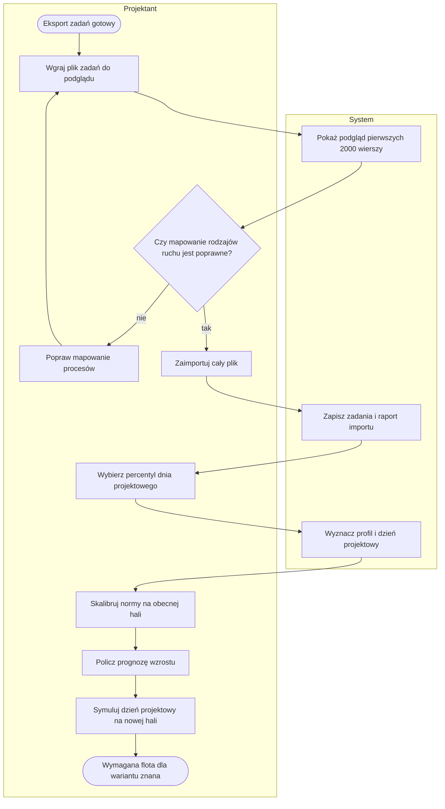
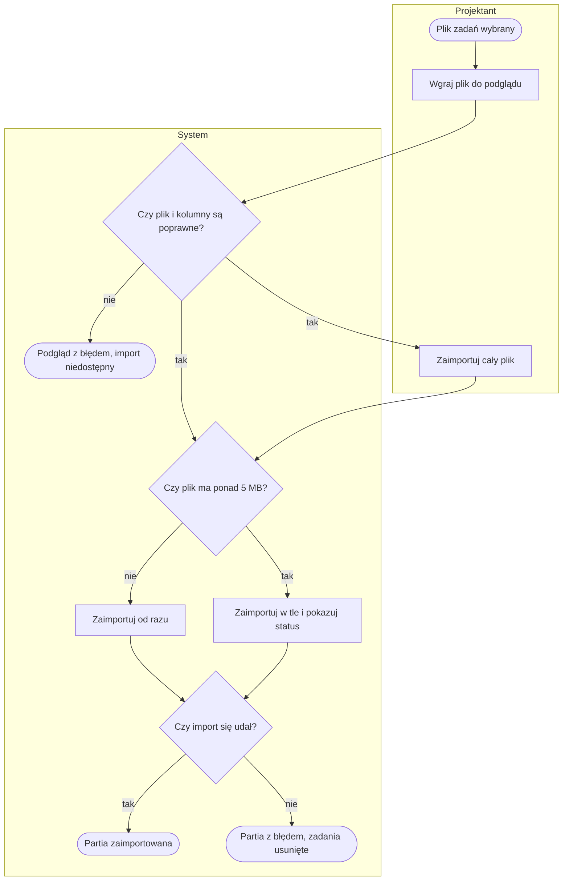
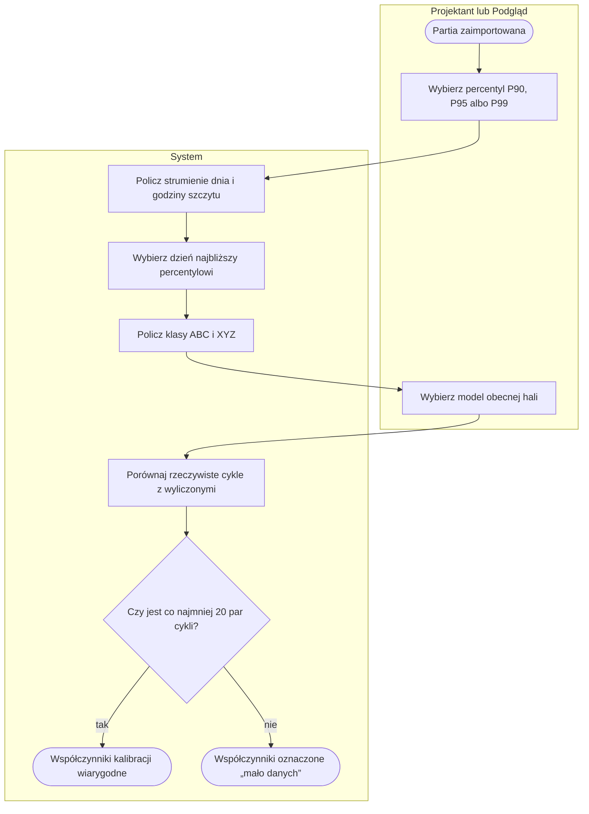
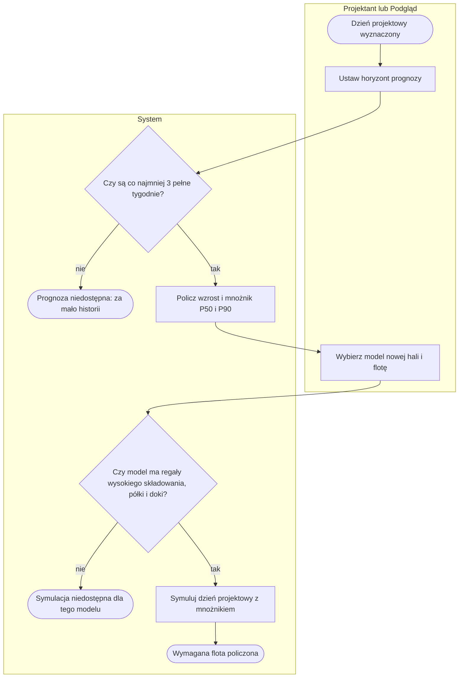
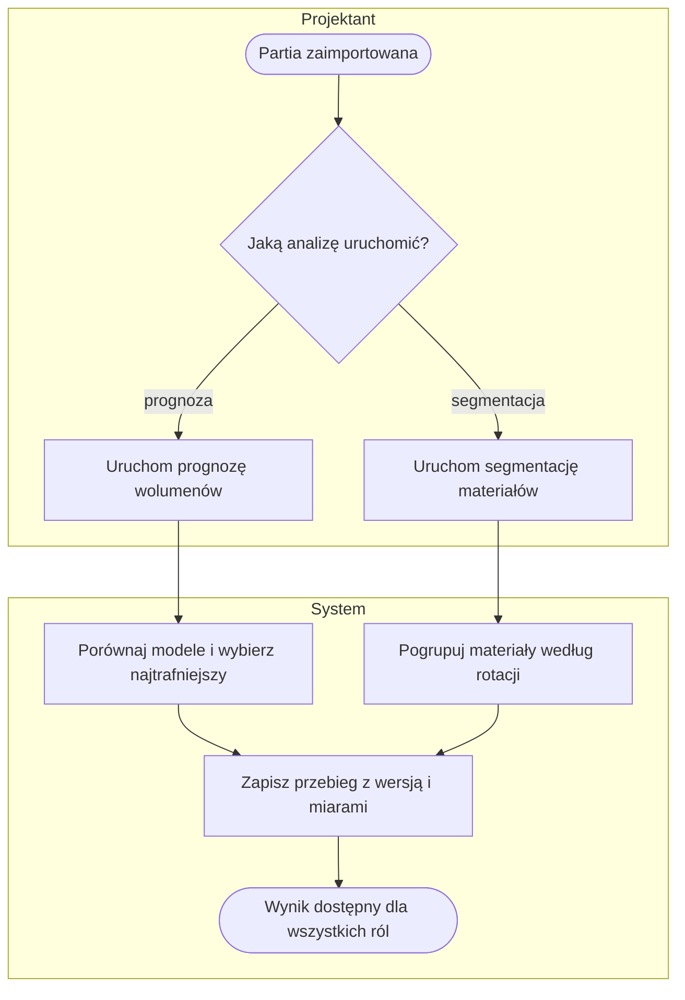
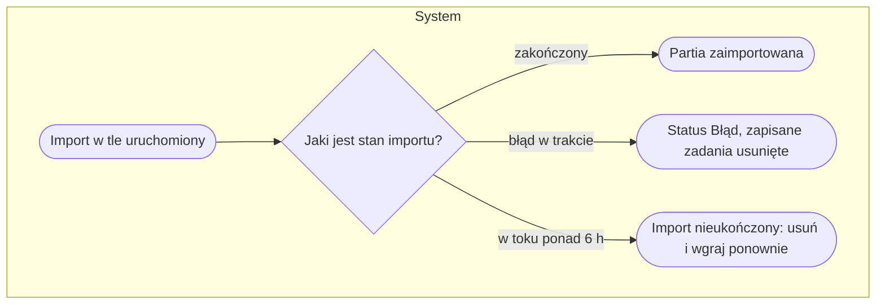

# P2. Historia ruchów, dzień projektowy i prognoza wzrostu

| | |
|---|---|
| **Właściciel** | Projektant |
| **Cel biznesowy** | Oprzeć projekt nowej hali na rzeczywistym ruchu obecnego magazynu: wyznaczyć dzień projektowy (np. P95), skalibrować normy na obecnej hali, oszacować wzrost wolumenów i sprawdzić, ile sprzętu potrzeba w nowym układzie. |
| **Zdarzenie inicjujące** | Eksport zadań magazynowych z systemu magazynowego gotowy (historia potwierdzonych ruchów) |
| **Rezultat końcowy** | Dzień projektowy wyznaczony, współczynniki kalibracji i mnożnik wzrostu znane, wymagana flota dla wariantów hali policzona |
| **Procesy powiązane** | wejście: [P1](P1-dane-podstawowe.md) (grupy asortymentu, gabaryty kartonów), [P3](P3-model-hali.md) (model obecnej i nowej hali); wyjście: [P5](P5-scenariusz-i-symulacja.md) (założenia scenariusza), [P6](P6-prezentacja-3d.md) |

Ten proces jest opcjonalny: scenariusz w [P5](P5-scenariusz-i-symulacja.md) można zbudować bez historii,
z założeń Projektanta.

## Przebieg procesu

Diagram przedstawia przebieg główny: bezpieczny podgląd pliku zadań, import, wyznaczenie dnia projektowego, kalibrację, prognozę i symulację nowej hali. Szczegóły w podprocesach [P2.1](#p21-import-zadań-magazynowych), [P2.2](#p22-dzień-projektowy-i-kalibracja), [P2.3](#p23-prognoza-wzrostu-i-symulacja-nowej-hali) i [P2.4](#p24-modele-uczenia-maszynowego).

## Tabela kroków

| Nr | Krok | Aktor | Wejście | Wyjście | Reguła biznesowa |
|---|---|---|---|---|---|
| 1 | Wgraj plik zadań do podglądu | Projektant | plik zadań, strefa czasu pliku, opcjonalne nadpisania mapowania | plik w podglądzie (nic w bazie) | BR-201, BR-202 |
| 2 | Pokaż podgląd | System | pierwsze 2000 wierszy | rozpoznane kolumny, mapowanie proces → rodzaj ruchu, próbka 15 zadań, błędne wiersze | BR-203, BR-204, BR-205 |
| 3 | Sprawdź mapowanie | Projektant | podgląd | decyzja: poprawić albo importować | — |
| 4 | Popraw mapowanie procesów | Projektant | lista „kod procesu = rodzaj ruchu” | nadpisania mapowania | BR-206 |
| 5 | Zaimportuj cały plik | Projektant | plik z podglądu | partia zadań | BR-207 |
| 6 | Zapisz zadania i raport | System | wiersze pliku | zadania, statystyki, porównanie lokalizacji z modelem hali | BR-208, BR-209 |
| 7 | Wybierz percentyl | Projektant, Podgląd | P90, P95 albo P99 | parametr dnia projektowego | BR-210 |
| 8 | Wyznacz profil i dzień projektowy | System | potwierdzone zadania | strumienie ruchu, dzień projektowy, ABC×XYZ, profil zleceń | BR-210 – BR-213 |
| 9 | Skalibruj normy na obecnej hali | Projektant, Podgląd | model obecnej hali, zadania dnia projektowego | współczynniki korekty dla wózków i kompletacji | BR-214 |
| 10 | Policz prognozę wzrostu | Projektant, Podgląd | tygodnie historii, horyzont 1–20 lat | wzrost roczny i mnożnik P50/P90 | BR-215, BR-216 |
| 11 | Symuluj dzień projektowy na nowej hali | Projektant, Podgląd | model nowej hali, mnożnik, flota, współczynniki | wykorzystanie i sugerowana liczba wózków, czekanie | BR-217, BR-218 |
| 12 | Porównaj warianty hali | Projektant | do 4 modeli | tabela: pojemność, wymagana flota, czekanie | BR-219 |
| 13 | Uruchom modele uczenia maszynowego | Projektant | partia zadań | prognoza z oceną trafności, segmentacja materiałów | BR-220, BR-221 |

## Podprocesy

### P2.1. Import zadań magazynowych

Obejmuje kroki 1–6.

**Rodzaje ruchu:** przyjęcie / odłożenie, uzupełnienie, kompletacja, wydanie / załadunek, przesunięcie.

### P2.2. Dzień projektowy i kalibracja

Obejmuje kroki 7–9.

Strumienie dnia: palety przyjęte, palety wydane, linie kompletacji, uzupełnienia, przesunięcia, zlecenia,
ruchy razem — dla każdego średnia, mediana, wybrany percentyl, maksimum i godzina szczytu.

### P2.3. Prognoza wzrostu i symulacja nowej hali

Obejmuje kroki 10–12.

### P2.4. Modele uczenia maszynowego

Krok 13. Moduł „Prognozy i ML” daje dwie analizy na tej samej partii zadań.

## Ścieżki alternatywne i wyjątki

| Wyjątek | Warunek wystąpienia | Obsługa | Skutek dla procesu |
|---|---|---|---|
| W1. Brak lub zły plik | brak pliku, plik > 300 MB, rozszerzenie inne niż csv, txt, xlsx, xlsm | komunikat (np. „podziel eksport na okresy”) | podgląd nie powstaje |
| W2. Brak kolumn wymaganych | brak lokalizacji (źródłowej i docelowej) albo daty / czasu potwierdzenia | czerwony komunikat z podpowiedzią nazwy kolumny; przycisk importu ukryty | trzeba wgrać inny plik |
| W3. Błędne wiersze | brak obu lokalizacji, nieczytelna ilość lub data | wiersz pominięty i policzony | import częściowy |
| W4. Wiersze anulowane | status anulowania w pliku | wiersz policzony, niezaimportowany | brak wpływu na profil |
| W5. Zadanie bez potwierdzenia | brak daty potwierdzenia | zadanie zapisane, liczone jako „bez potwierdzenia” | nie wchodzi do profilu dnia ani animacji |
| W6. Podgląd wygasł | plik podglądu starszy niż 24 h | „Plik podglądu wygasł albo nie istnieje — wgraj go ponownie.” | trzeba wgrać ponownie |
| W7. Błąd w trakcie importu | błąd krytyczny przy zapisie | status „Błąd”, komunikat z numerem wiersza, zapisane zadania usunięte | partię trzeba usunąć i wgrać ponownie |
| W8. Import przerwany restartem serwera | import w tle „w toku” ponad 6 h | komunikat o restarcie serwera | usunięcie i ponowny import; brak anulowania w trakcie |
| W9. Mała próbka | mniej niż 20 dni roboczych; mniej niż 12 pełnych tygodni | ostrzeżenie o niskiej wiarygodności percentyla / prognozy | wynik dostępny z zastrzeżeniem |
| W10. Model nieobsługiwany przez symulację | model bez regałów wysokiego składowania, półek kartonowych albo doków | komunikat, że symulacja dotyczy hali z generatora | porównanie pokazuje tylko pojemność |
| W11. Porównanie bez obliczeń | rola Podgląd otwiera porównanie wariantów niepoliczonych wcześniej | lista „jeszcze niepoliczone — porównanie liczy Projektant” | wynik widoczny po obliczeniu przez Projektanta |
| W12. Usunięcie partii | Projektant usuwa import (z potwierdzeniem) | usunięte zadania i wszystkie przebiegi uczenia maszynowego tej partii | klasy ABC „z historii” w kartotece materiałów mogą zniknąć |

## Reguły biznesowe

- **BR-201:** plik zadań: csv, txt, xlsx, xlsm, do 300 MB; czytany strumieniowo; nic nie trafia do bazy przed decyzją „Importuj cały plik”.
- **BR-202:** daty bez strefy czasowej w pliku są interpretowane w strefie wybranej przy wgraniu (czas lokalny albo UTC).
- **BR-203:** wymagane kolumny: lokalizacja źródłowa lub docelowa oraz data lub czas potwierdzenia; kolumny rozpoznawane po nazwach polskich, angielskich i technicznych systemu magazynowego.
- **BR-204:** podgląd analizuje pierwsze 2000 wierszy i pokazuje próbkę 15 zadań oraz do 50 błędnych wierszy.
- **BR-205:** rodzaj ruchu wyznaczany w kolejności: nadpisanie użytkownika → słownik wyjątków → działanie magazynowe (gdy kod procesu nie zaczyna się od typowej cyfry) → pierwsza cyfra procesu (1 → przyjęcie, 2 → wydanie albo kompletacja przy kolejce kompletacji) → przesunięcie.
- **BR-206:** nadpisanie mapowania w formacie „kod procesu = rodzaj ruchu”; błędna linia jest pomijana z ostrzeżeniem.
- **BR-207:** plik ≤ 5 MB importowany od razu, większy w tle ze statusem odświeżanym co 5 s (W kolejce → Import trwa → Zaimportowano albo Błąd).
- **BR-208:** błąd krytyczny w trakcie importu → wszystkie zapisane zadania partii są usuwane, status „Błąd”.
- **BR-209:** raport partii porównuje lokalizacje z zadań z regałami wybranego modelu hali (w modelu / spoza modelu).
- **BR-210:** dzień roboczy = dzień z ruchem ≥ 10% mediany dni z ruchem; percentyl P90, P95 albo P99 (domyślnie P95).
- **BR-211:** dzień projektowy = dzień roboczy z sumą ruchów najbliższą wybranemu percentylowi; przy remisie późniejszy.
- **BR-212:** klasa ABC według pobrań: progi skumulowane 80% i 95%; klasa XYZ według zmienności dziennej: X < 0,5 ≤ Y < 1,0 ≤ Z.
- **BR-213:** założenia przeliczenia: 1 zadanie przyjęcia lub wydania = 1 paleta; 1 zadanie kompletacji = 1 linia; zlecenie = dokument.
- **BR-214:** kalibracja: współczynnik = mediana (cykl rzeczywisty ÷ cykl wyliczony) osobno dla wózków i kompletacji; przerwy > 15 min pomijane; < 20 par → oznaczenie „mało danych”.
- **BR-215:** prognoza wzrostu: tygodnie pełne z dni roboczych; strumień z < 3 tygodniami pomijany; < 12 tygodni → ostrzeżenie; ocena trafności (MAPE) na ostatnich 8 tygodniach wymaga ≥ 14 tygodni.
- **BR-216:** mnożnik wolumenu = (1 + wzrost roczny) ^ lata, w wariantach P50 i P90; horyzont 1–20 lat.
- **BR-217:** symulacja dnia projektowego: mnożnik 0,1–10, flota 1–60 szt. na typ, współczynniki kalibracji 0,3–10; wartości spoza zakresu przycinane.
- **BR-218:** sugerowana liczba wózków = praca [h] ÷ (16 h × 85%); wykorzystanie > 85% wyróżnione; zadania kończone po 21:00 sygnalizują za małą flotę.
- **BR-219:** porównanie wariantów: do 4 modeli; obliczenia uruchamia tylko Projektant, Podgląd widzi wyniki policzone wcześniej; wymagana flota szukana w maks. 4 rundach symulacji.
- **BR-220:** prognoza w module uczenia maszynowego wymaga ≥ 16 tygodni; wybierany jest model o najniższym MAPE na ostatnich 8 tygodniach spośród modelu bazowego i modeli wygładzania (z sezonowością roczną dopiero przy ≥ 112 tygodniach).
- **BR-221:** segmentacja materiałów: 2–8 segmentów (domyślnie 4) według rotacji, zmienności i udziału dni z ruchem; wymaga ≥ 3 materiałów z ruchem na segment; wynik zapisuje klasę ABC materiałów widoczną w kartotece.

## Wymagania funkcjonalne

**WF-201.** Jako Projektant chcę zobaczyć podgląd pliku zadań przed importem, aby sprawdzić rozpoznanie kolumn i rodzajów ruchu bez zapisywania danych.
- *Given* plik zadań z kolumnami lokalizacji i daty potwierdzenia, *When* wgrywam plik do podglądu, *Then* widzę rozpoznane kolumny, mapowanie procesów i 15 przykładowych zadań, a w bazie nie ma nowych danych.
- *Given* plik bez kolumny daty potwierdzenia, *When* wgrywam go do podglądu, *Then* widzę czerwony komunikat o brakującej kolumnie i nie mogę uruchomić importu.

**WF-202.** Jako Projektant chcę nadpisać rodzaj ruchu dla wybranych kodów procesów, aby dopasować interpretację do konfiguracji mojego magazynu.
- *Given* kod procesu interpretowany jako przesunięcie, *When* dopisuję nadpisanie „kod = kompletacja” i odświeżam podgląd, *Then* kod jest liczony jako kompletacja.

**WF-203.** Jako Projektant chcę zaimportować duży plik w tle, aby nie czekać na zakończenie z otwartą stroną.
- *Given* plik 50 MB, *When* importuję cały plik, *Then* raport pokazuje status odświeżany co 5 s, a po zakończeniu liczbę zadań i błędnych wierszy.

**WF-204.** Jako Projektant chcę wyznaczyć dzień projektowy jako wybrany percentyl, aby projektować na trudny, ale realny dzień, a nie na średnią.
- *Given* partia z co najmniej 20 dniami roboczymi, *When* wybieram P95, *Then* widzę dzień o sumie ruchów najbliższej P95 i jego profil godzinowy.
- *Given* partia z mniej niż 20 dniami roboczymi, *When* otwieram profil, *Then* widzę ostrzeżenie o niskiej wiarygodności.

**WF-205.** Jako Projektant chcę policzyć wzrost wolumenów z historii, aby zasymulować nową halę na wolumeny za kilka lat.
- *Given* co najmniej 12 pełnych tygodni historii, *When* liczę prognozę na 5 lat, *Then* dostaję mnożnik P50 i P90 i mogę z nim uruchomić symulację.
- *Given* mniej niż 3 pełne tygodnie, *When* liczę prognozę, *Then* widzę komunikat „Za mało historii”.

**WF-206.** Jako Projektant chcę porównać do 4 wariantów hali na tym samym dniu projektowym, aby wybrać wariant z najmniejszą wymaganą flotą przy tej samej pojemności.
- *Given* 3 modele hal, *When* uruchamiam porównanie, *Then* widzę dla każdego pojemność, wymaganą flotę, czekanie P95 i zadania po 21:00, z wyróżnieniem najlepszej wartości.

## Podstawa w kodzie

`web/twin/views/warehouse_tasks.py`, `web/twin/ewm_tasks.py`, `ewm_tasks_import.py` (import, mapowanie, statusy),
`web/twin/design_day.py` (profil, dzień projektowy, ABC×XYZ), `design_calibration.py`, `design_forecast.py`,
`design_sim.py`, `design_compare.py`, `web/twin/views/warehouse_design_*.py`, `warehouse_calibration.py`,
`warehouse_compare.py`, `warehouse_forecast.py`, `web/ml/` (prognoza, segmentacja, przebiegi).
