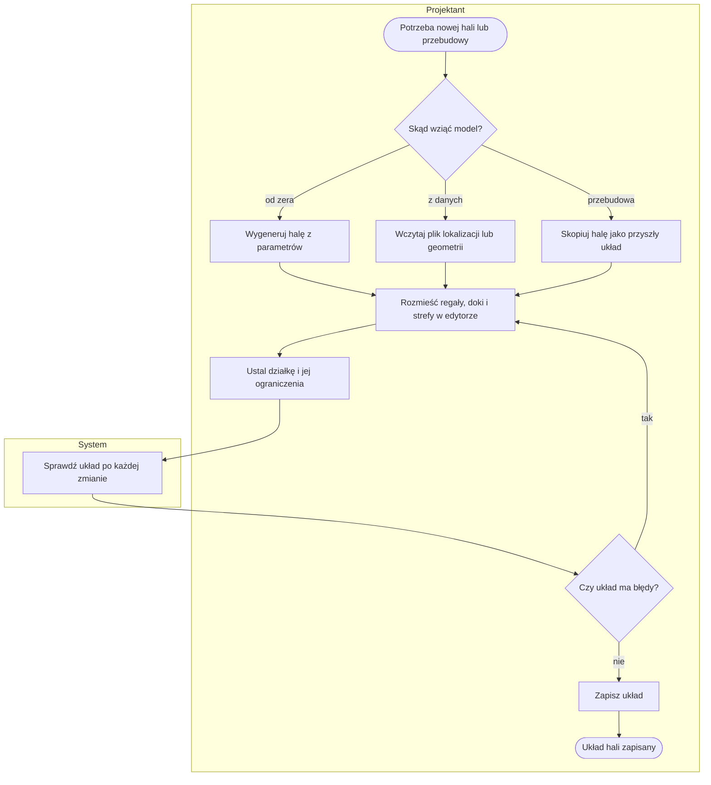
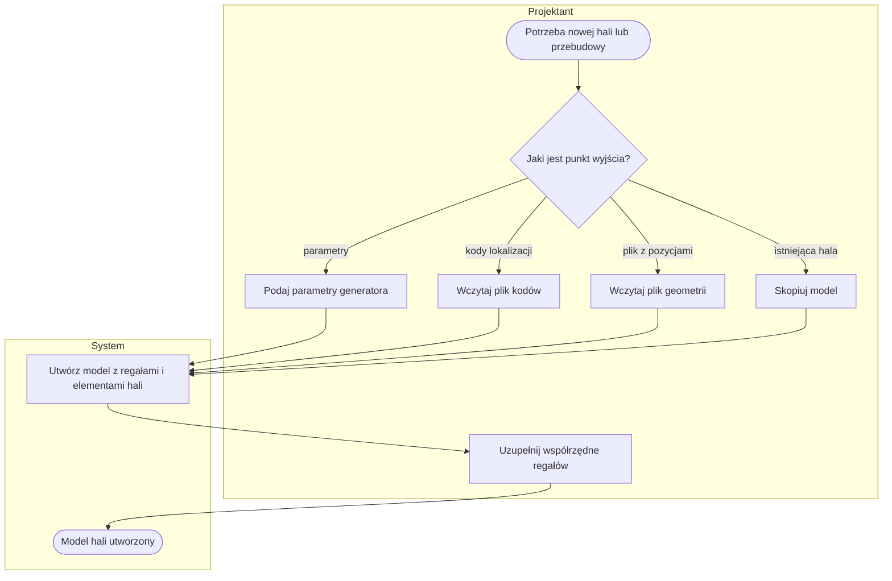
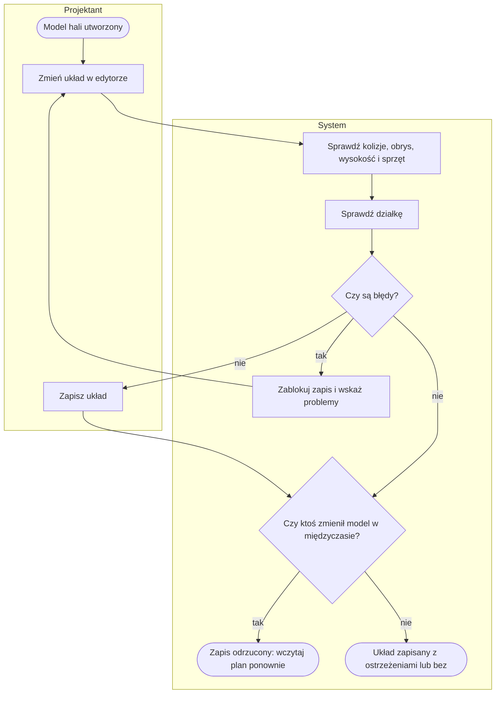
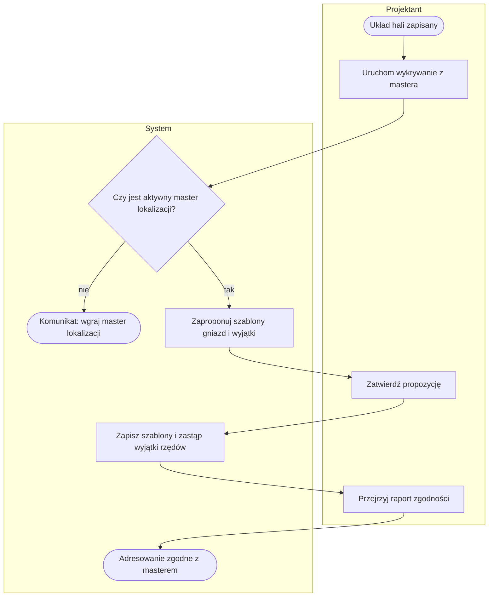
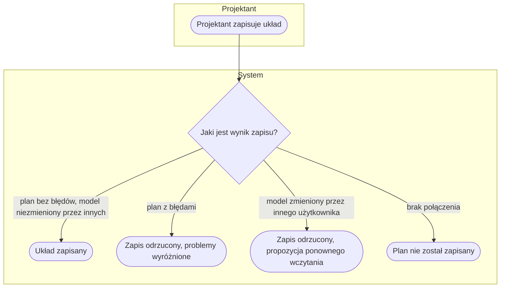

# P3. Zaprojektowanie układu hali

| | |
|---|---|
| **Właściciel** | Projektant |
| **Cel biznesowy** | Zbudować cyfrowy model hali — regały, doki, pola odkładcze, drogi, słupy i działkę — i mieć pewność, że układ jest fizycznie wykonalny i zgodny z ograniczeniami, zanim zostanie użyty w symulacji i pokazany zarządowi. |
| **Zdarzenie inicjujące** | Potrzeba nowej hali albo przebudowy istniejącej |
| **Rezultat końcowy** | Układ hali zapisany bez błędów (ostrzeżenia dopuszczalne), gotowy do symulacji i pokazu |
| **Procesy powiązane** | wejście: [P1](P1-dane-podstawowe.md) (master lokalizacji, stany), [P4](P4-katalog-sprzetu.md) (sprzęt obsługi regałów); wyjście: [P5](P5-scenariusz-i-symulacja.md), [P2](P2-historia-ruchow-i-prognoza.md), [P6](P6-prezentacja-3d.md), [P7](P7-film-i-deck.md) |

## Przebieg procesu

Diagram przedstawia przebieg główny: wybór sposobu utworzenia modelu, rozmieszczenie elementów w edytorze, kontrolę układu po każdej zmianie i zapis. Szczegóły w podprocesach [P3.1](#p31-utworzenie-modelu-hali), [P3.2](#p32-edycja-i-walidacja-układu) i [P3.3](#p33-odwzorowanie-adresowania-z-mastera-lokalizacji).

## Tabela kroków

| Nr | Krok | Aktor | Wejście | Wyjście | Reguła biznesowa |
|---|---|---|---|---|---|
| 1 | Wybierz sposób utworzenia modelu | Projektant | cel: nowa hala, dane z magazynu albo przebudowa | wybrana ścieżka | — |
| 2 | Wygeneruj halę z parametrów | Projektant, System | 13 parametrów (miejsca paletowe, lokalizacje kartonowe, wysokość, doki, stanowiska, proporcje) | model z regałami, dokami, stanowiskami i domyślną działką | BR-301 |
| 3 | Wczytaj plik lokalizacji lub geometrii | Projektant, System | plik kodów lokalizacji albo plik z pozycjami regałów | model z regałami | BR-302, BR-303 |
| 4 | Skopiuj halę jako przyszły układ | Projektant | istniejący model | kopia „{nazwa} — przyszły layout” | BR-304 |
| 5 | Uzupełnij współrzędne i adresowanie | Projektant | pozycje, kąty, szablony gniazd, numeracja | regały z adresami | BR-305 |
| 6 | Rozmieść regały, doki i strefy w edytorze | Projektant | plan 2D z podglądem 3D | zmieniony układ | BR-306 |
| 7 | Ustal działkę i jej ograniczenia | Projektant | wymiary działki, linie zabudowy, % zabudowy i zieleni, wysokość, wjazdy, plac i parking | działka | BR-311, BR-312 |
| 8 | Sprawdź układ po każdej zmianie | System | plan | lista błędów i ostrzeżeń, wskaźniki na żywo | BR-307 – BR-312 |
| 9 | Zapisz układ | Projektant | plan bez błędów | zapisany model | BR-313, BR-314 |
| 10 | Odwzoruj adresowanie z mastera lokalizacji | Projektant, System | aktywny master lokalizacji | szablony gniazd i wyjątki adresów, raport zgodności | BR-315 |
| 11 | Porównaj warianty projektu | Projektant, Podgląd | do 6 wariantów | tabela wskaźników z różnicą % | BR-316 |

## Podprocesy

### P3.1. Utworzenie modelu hali

Obejmuje kroki 1–5.

Po wczytaniu pliku kodów regały nie mają pozycji, więc Projektant uzupełnia współrzędne (albo wkleja listę
adresów z orientacją i punktem startu). Generator i plik geometrii tworzą regały od razu z pozycjami.

### P3.2. Edycja i walidacja układu

Obejmuje kroki 6–9.

**Błędy (blokują zapis) i ostrzeżenia (nie blokują):**

| Obszar | Błąd | Ostrzeżenie |
|---|---|---|
| Regały | nachodzą na siebie > 2 cm; powtórzony adres; wychodzą poza halę (tolerancja 5 cm); stoją w doku, bramie, polu odkładczym, stanowisku, korytarzu, drodze pożarowej, strefie ładowania; kolidują ze słupem | stoją na drodze pieszej lub drodze wózków |
| Wysokość i sprzęt | regał wyższy niż wysokość w świetle minus 0,5 m; najwyższa belka ponad podnoszenie sprzętu | palety cięższe niż udźwig sprzętu na danej wysokości |
| Alejki | — | alejka węższa niż wymagana przez sprzęt |
| Elementy hali | słup w doku lub bramie | element poza obrysem hali |
| Działka | hala poza liniami zabudowy; zabudowa ponad dopuszczalny %; budynek ponad dopuszczalną wysokość; zieleń poniżej minimum; wjazd tirów nie po stronie dojazdu | obszar pod halą lub poza działką; za mały plac przed dokiem; brak przejazdu od wjazdu do doku |

### P3.3. Odwzorowanie adresowania z mastera lokalizacji

Krok 10 — tylko Projektant i Administrator (operuje na kodach lokalizacji, czyli danych źródłowych).

Raport zgodności pokazuje dla każdego rzędu status: zgodne, rozbieżności, rząd bez szablonu, brak rzędu na
planie; można go pobrać jako xlsx.

## Ścieżki alternatywne i wyjątki

| Wyjątek | Warunek wystąpienia | Obsługa | Skutek dla procesu |
|---|---|---|---|
| W1. Plik lokalizacji za duży lub pusty | plik > 5 MB; brak pliku | komunikat | model nie powstaje |
| W2. Nierozpoznane kody | linie pliku niezgodne z formatem kodu lokalizacji | linie pominięte, liczba podana w komunikacie | model z częścią regałów |
| W3. Błędny plik geometrii | brak kolumn, pusta strefa lub numer, wymiary < 1, powtórzony regał | do 10 błędów z numerem linii | nic nie jest zapisane |
| W4. Plan z błędami | reguły BR-307 – BR-312 (część błędów) | przycisk „Zapisz” nieaktywny; serwer odrzuca plan | Projektant poprawia układ |
| W5. Równoległa zmiana | model zapisany przez kogoś innego od wczytania | „Ktoś zmienił ten model w międzyczasie. Wczytaj plan ponownie (Twoje zmiany nie zostały zapisane).” | zmiany trzeba nanieść ponownie |
| W6. Za duży plan lub podkład | plan > 2 MB; podkład > 10 MB albo > 12 000 px na bok; plik nie jest PNG ani JPG | komunikat z limitem | zapis odrzucony |
| W7. Opuszczenie edytora | niezapisane zmiany przy zamykaniu strony | prośba o potwierdzenie | możliwa utrata zmian |
| W8. Brak aktywnego mastera | wykrywanie adresowania bez wgranego mastera lokalizacji | komunikat z instrukcją | wykrywanie niedostępne |
| W9. Kopia hali | kopiowanie modelu | wyjątki adresów nie są kopiowane | adresowanie trzeba odtworzyć (np. ponownym wykrywaniem) |
| W10. Usunięcie hali | Projektant usuwa model (z potwierdzeniem) | usunięcie kaskadowe | znikają też wyniki symulacji, prezentacje 3D, prezentacje filmowe i zlecenia renderu; ekran potwierdzenia mówi tylko o regałach |
| W11. Edycja stref przesuwa regały poza halę | przesunięcie daje ujemne współrzędne | „nic nie zapisano” | zmiana odrzucona; kolizje po przesunięciu są tylko ostrzeżeniem |

## Reguły biznesowe

- **BR-301:** generator tworzy halę z 13 parametrów (m.in. miejsca paletowe 100–300 000, lokalizacje kartonowe 0–100 000, wysokość 4–45 m, doki kontenerowe 0–30, proporcje 0,5–4); liczba poziomów regałów wynika z wysokości hali, wysokości palety, 1 m wolnej przestrzeni pod tryskaczami i 0,25 m na belkę.
- **BR-302:** plik kodów lokalizacji (csv, txt, do 5 MB) — kod w formacie strefa-regał-gniazdo+poziom; liczba gniazd i poziomów wynika z kodów; nierozpoznane linie są pomijane i liczone.
- **BR-303:** plik geometrii — wymagane kolumny strefa, numer regału, X, Y, liczba gniazd, szerokość gniazda; dowolny błąd → nic nie jest zapisane; hala powiększana do obrysu regałów + 2 m.
- **BR-304:** kopia hali zachowuje wymiary, słupy, działkę, podkład, regały i elementy hali, bez wyjątków adresów; oryginał pozostaje bez zmian.
- **BR-305:** numeracja gniazd w formacie zakresów (np. „10-47,50”); maks. 1000 gniazd, bez powtórzeń i zakresów malejących.
- **BR-306:** edytor: przyciąganie co 0,1 m, cofnij / ponów do 100 kroków, skróty klawiszowe, podkład z rzutem z kalibracją skali dwoma punktami.
- **BR-307:** regały nachodzące na siebie > 2 cm, powtórzony adres, regał poza halą (tolerancja 5 cm) albo w obszarze wymagającym wolnej posadzki → błąd.
- **BR-308:** regał wyższy niż wysokość w świetle minus 0,5 m → błąd; najwyższa belka ponad maksymalne podnoszenie sprzętu z katalogu → błąd; nośność ponad udźwig na danej wysokości → ostrzeżenie.
- **BR-309:** wymagana szerokość alejki: wózek wysokiego składowania z wysuwanym masztem 3,0 m, wózek do wąskich alejek 1,8 m, regały półkowe 2,0 m, chyba że sprzęt z katalogu podaje własną wartość; węższa alejka → ostrzeżenie; regały plecami do siebie (szczelina ≤ 0,3 m) nie wymagają alejki.
- **BR-310:** regał na drodze pieszej lub drodze wózków → ostrzeżenie; regał lub słup w doku lub bramie → błąd.
- **BR-311:** działka: hala poza liniami zabudowy, zabudowa ponad dopuszczalny %, wysokość budynku (wysokość w świetle + 1 m dachu) ponad limit, zieleń poniżej minimum, wjazd tirów nie po stronie dojazdu → błąd.
- **BR-312:** działka: plac przed dokiem krótszy niż 35 m (tir) lub 20 m (bus, kurier), brak przejazdu od wjazdu tirów do doku, obszar pod halą lub poza działką → ostrzeżenie.
- **BR-313:** plan z co najmniej jednym błędem nie może być zapisany; plan z ostrzeżeniami — tak.
- **BR-314:** zapis wymaga, aby model nie został zmieniony od chwili wczytania planu (ochrona przed nadpisaniem cudzych zmian).
- **BR-315:** wykrywanie adresowania tworzy szablony gniazd i wyjątki tak, aby kody z planu odtwarzały kody z aktywnego mastera lokalizacji; zatwierdzenie zastępuje dotychczasowe wyjątki rzędów.
- **BR-316:** porównanie wariantów projektu: do 6 wariantów, pierwszy jest punktem odniesienia; wskaźniki liczone przez system, także dla wariantów z pliku zewnętrznego.

## Wymagania funkcjonalne

**WF-301.** Jako Projektant chcę wygenerować halę z kilku parametrów, aby szybko mieć punkt wyjścia do projektu nowego centrum.
- *Given* formularz generatora z parametrami domyślnymi, *When* tworzę model, *Then* powstaje hala z regałami, dokami, stanowiskami i działką, a komunikat podaje wymiary i liczbę miejsc paletowych.

**WF-302.** Jako Projektant chcę, aby edytor sprawdzał układ po każdej zmianie, aby od razu widzieć kolizje i naruszenia.
- *Given* dwa regały nachodzące na siebie o 10 cm, *When* przesuwam regał, *Then* w panelu „Problemy” widzę błąd kolizji, a przycisk „Zapisz” jest nieaktywny.
- *Given* alejka węższa niż wymaga sprzęt, *When* zmieniam układ, *Then* widzę ostrzeżenie i nadal mogę zapisać plan.

**WF-303.** Jako Projektant chcę, aby mój zapis nie nadpisał zmian innej osoby, aby nie stracić cudzej pracy.
- *Given* ktoś zapisał model po moim wczytaniu planu, *When* zapisuję swój plan, *Then* zapis jest odrzucony z propozycją ponownego wczytania.

**WF-304.** Jako Projektant chcę sprawdzić układ wobec ograniczeń działki, aby nie zaprojektować hali niemożliwej do zbudowania.
- *Given* działka z maksymalną zabudową 60%, *When* hala zajmuje 65% działki, *Then* widzę błąd „Zabudowa 65 % działki — ponad dopuszczalne 60 %”.
- *Given* dok bez 35 m wolnego placu, *When* sprawdzam układ, *Then* widzę ostrzeżenie o braku placu przed bramą.

**WF-305.** Jako Projektant chcę skopiować obecną halę jako przyszły układ, aby przebudowę projektować bez ruszania stanu obecnego.
- *Given* model obecnej hali, *When* tworzę kopię, *Then* powstaje model „{nazwa} — przyszły layout” otwarty w edytorze, a oryginał pozostaje bez zmian.

**WF-306.** Jako Projektant chcę odtworzyć adresowanie regałów z mastera lokalizacji, aby kody w modelu odpowiadały kodom w systemie magazynowym.
- *Given* aktywny master lokalizacji, *When* uruchamiam wykrywanie i zatwierdzam propozycję, *Then* raport zgodności pokazuje status każdego rzędu, a wynik mogę pobrać jako xlsx.

## Podstawa w kodzie

`web/twin/views/warehouse_generator.py`, `warehouse_model.py`, `warehouse_layout.py`, `warehouse_variant_edit.py`,
`warehouse_model_ewm.py`, `warehouse_variants.py`, `bay_templates.py`, `warehouse_racktype.py`,
`web/twin/design_generator.py`, `layout.py` (reguły układu), `site.py` (reguły działki), `design_catalog.py`,
`model_geometry.py`, `addressing.py`, `ewm_detect.py`, `ewm_compliance.py`, `web/twin/models.py`,
`web/twin/static/twin/js/layout-editor.js`.
