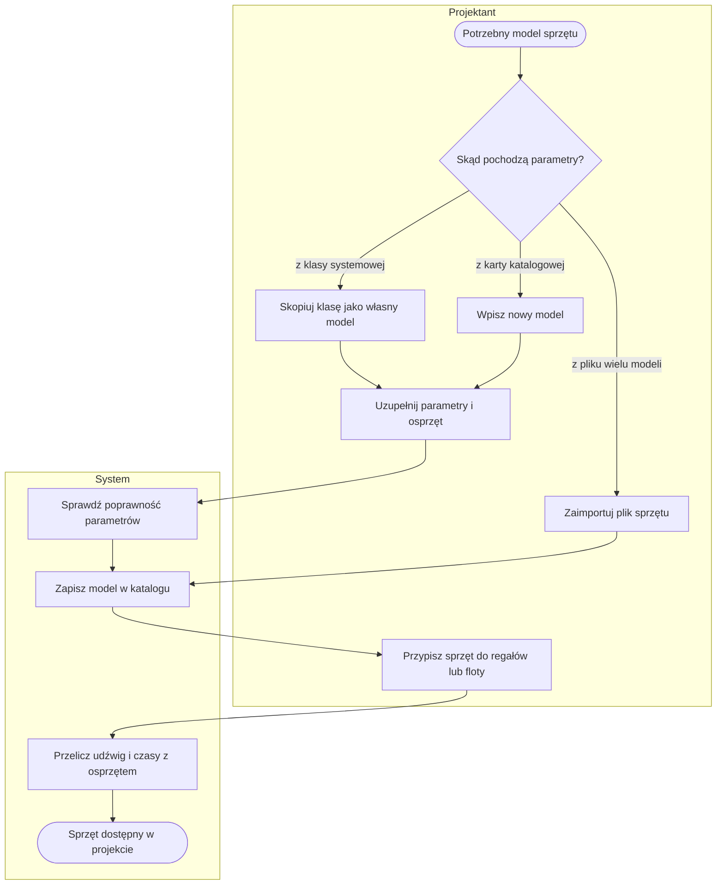
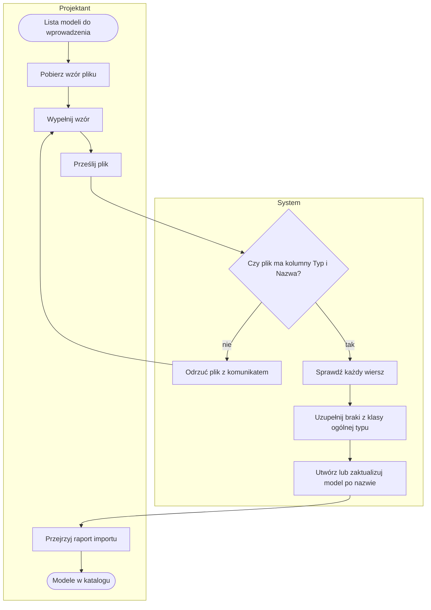
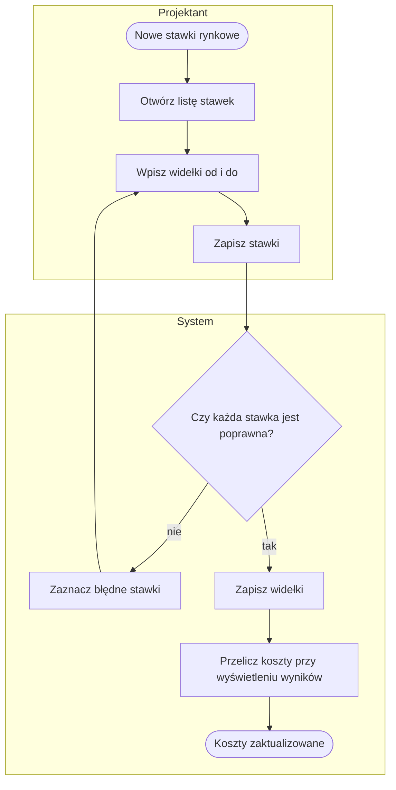
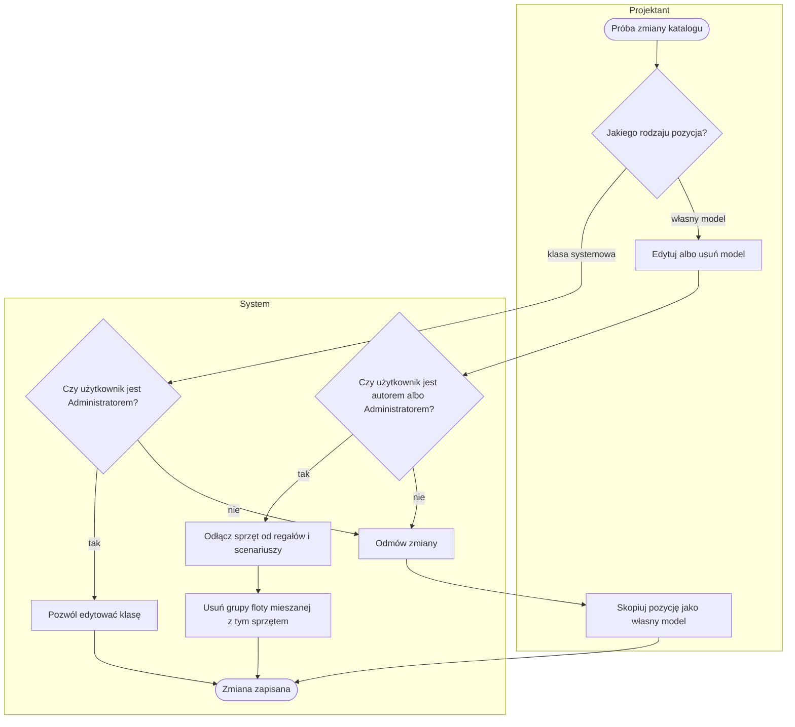

# P4. Katalog sprzętu i stawki kosztowe

| | |
|---|---|
| **Właściciel** | Projektant (klasy systemowe: Administrator) |
| **Cel biznesowy** | Utrzymać jedno źródło parametrów wózków i urządzeń (prędkości, wysokość podnoszenia, udźwig, alejka, bateria, koszty), z którego korzysta zarówno walidacja układu hali, jak i symulacja dnia oraz szacunek kosztów. |
| **Zdarzenie inicjujące** | Potrzeba użycia konkretnego modelu sprzętu w projekcie (nowa karta katalogowa, nowy wariant floty) albo aktualizacja stawek kosztowych |
| **Rezultat końcowy** | Model sprzętu dostępny w katalogu i przypisywalny do regałów ([P3](P3-model-hali.md)) oraz do floty scenariusza ([P5](P5-scenariusz-i-symulacja.md)); aktualne widełki kosztów |
| **Procesy powiązane** | wyjście do: [P3](P3-model-hali.md) (dobór sprzętu do regału, kontrola wysokości i udźwigu), [P5](P5-scenariusz-i-symulacja.md) (czas ruchu palety, bateria, koszty) |

## Przebieg procesu

Katalog zawiera dwa rodzaje pozycji: **klasy systemowe** (anonimowe, z wartościami przybliżonymi, zakładane
przy instalacji) oraz **własne modele** użytkownika (wpisane ręcznie, skopiowane z klasy albo zaimportowane z pliku).

Diagram pokazuje ścieżkę główną. Odrzucenie błędnych danych formularza i pliku opisują
[ścieżki alternatywne](#ścieżki-alternatywne-i-wyjątki); import — podproces [P4.1](#p41-import-pliku-sprzętu).

## Tabela kroków

| Nr | Krok | Aktor | Wejście | Wyjście | Reguła biznesowa |
|---|---|---|---|---|---|
| 1 | Zdecyduj o źródle parametrów | Projektant | karta katalogowa, plik albo klasa systemowa | wybrana ścieżka | — |
| 2 | Skopiuj klasę jako własny model | Projektant | klasa systemowa | własny model „(kopia)” do edycji | BR-403 |
| 3 | Wpisz nowy model | Projektant | typ, nazwa, parametry, koszty | formularz modelu | BR-401, BR-404 |
| 4 | Zaimportuj plik sprzętu | Projektant | plik xlsx/csv ze wzoru | modele utworzone lub zaktualizowane | BR-407 – BR-410 |
| 5 | Uzupełnij parametry i osprzęt | Projektant | formularz, lista osprzętu | kompletny model | BR-405, BR-406 |
| 6 | Sprawdź poprawność parametrów | System | formularz | dane poprawne albo lista błędów | BR-404, BR-405 |
| 7 | Zapisz model w katalogu | System | dane poprawne | pozycja katalogu | BR-401, BR-402 |
| 8 | Przypisz sprzęt do regałów lub floty | Projektant | model hali / scenariusz | regał lub grupa floty ze sprzętem | BR-411, BR-412 |
| 9 | Przelicz udźwig i czasy z osprzętem | System | parametry modelu, osprzęt | parametry robocze dla walidacji i symulacji | BR-406, BR-413 |

## Podprocesy

### P4.1. Import pliku sprzętu

Import pozwala wprowadzić wiele własnych modeli naraz. Brakujące parametry jezdne i robocze system uzupełnia
z klasy ogólnej tego samego typu i zapisuje w uwagach, skąd pochodzą.

| Nr | Krok | Aktor | Wejście | Wyjście | Reguła biznesowa |
|---|---|---|---|---|---|
| 4.1 | Pobierz wzór pliku | Projektant | — | wzór xlsx z arkuszem słowników (typy, osprzęt) | — |
| 4.2 | Prześlij plik | Projektant | plik xlsx/csv | plik do sprawdzenia | BR-407 |
| 4.3 | Sprawdź każdy wiersz | System | wiersze pliku | wiersze poprawne i odrzucone z powodem | BR-408 |
| 4.4 | Uzupełnij braki z klasy ogólnej | System | wiersz poprawny | wiersz pełny, uwaga o źródle wartości | BR-409 |
| 4.5 | Utwórz lub zaktualizuj model | System | wiersz pełny | nowy albo zaktualizowany własny model | BR-410 |
| 4.6 | Przejrzyj raport importu | Projektant | komunikaty | liczba nowych i zaktualizowanych, lista odrzuceń | BR-408 |

### P4.2. Utrzymanie stawek kosztowych

Stawki to widełki „od–do” (zł netto) dla elementów, których koszt nie wynika z katalogu sprzętu: miejsca
paletowe, doki, stanowiska, budynek, praca oraz wózek bez podanych kosztów. Zmiana stawek nie wymaga ponownej
symulacji — koszty w wynikach przeliczają się przy wyświetleniu.

| Nr | Krok | Aktor | Wejście | Wyjście | Reguła biznesowa |
|---|---|---|---|---|---|
| 4.7 | Otwórz listę stawek | Projektant | — | 9 stawek z wartościami bieżącymi | BR-414 |
| 4.8 | Wpisz widełki i zapisz | Projektant | wartości od, do | formularz stawek | BR-415 |
| 4.9 | Sprawdź i zapisz | System | formularz | zapisane stawki albo zaznaczone błędy | BR-415 |
| 4.10 | Przelicz koszty przy wyświetleniu | System | stawki, wynik symulacji | widełki CAPEX/OPEX w wyniku i porównaniu | BR-416 |

## Ścieżki alternatywne i wyjątki

| Wyjątek | Warunek | Obsługa | Skutek |
|---|---|---|---|
| W1. Edycja klasy systemowej | użytkownik bez roli Administrator próbuje edytować klasę systemową | strona braku uprawnień (403) | klasa bez zmian; ścieżka zastępcza: kopia jako własny model |
| W2. Usunięcie klasy systemowej | ktokolwiek próbuje usunąć klasę systemową | strona braku uprawnień (403) | klasy systemowej nie da się usunąć z aplikacji |
| W3. Błędne parametry formularza | prędkość ≤ 0, koszt ujemny, „do” < „od”, krzywa udźwigu w złym formacie | formularz z błędami przy polach | model niezapisany |
| W4. Plik za duży lub brak pliku | brak pliku albo rozmiar > 5 MB | komunikat „Wybierz plik xlsx/csv (do 5 MB)” | import nie startuje |
| W5. Plik bez wymaganych kolumn | brak kolumn „Typ” i „Nazwa” | komunikat z odesłaniem do wzoru | import nie startuje |
| W6. Wiersz odrzucony | brak nazwy, nieznany typ, brak udźwigu, wartość nieliczbowa lub ujemna, zły format krzywej, nieznany osprzęt | wiersz pominięty, ostrzeżenie z numerem wiersza i powodem (do 20 pozycji i licznik pozostałych) | pozostałe wiersze importują się |
| W7. Nazwa klasy systemowej w pliku | wiersz ma nazwę identyczną z klasą systemową | wiersz pominięty z prośbą o zmianę nazwy | klasa systemowa nienaruszona |
| W8. Usunięcie własnego modelu używanego w projektach | model przypisany do regałów, floty jednorodnej scenariusza lub grupy floty mieszanej | regały i flota jednorodna tracą przypisanie (wracają do ustawień ogólnych); **grupy floty mieszanej z tym sprzętem są usuwane** | komunikat podaje, ile grup floty mieszanej usunięto (US-002); usunięcie następuje bez ekranu potwierdzenia (zob. [Znane ograniczenia](../05-decyzje-i-ograniczenia.md#znane-ograniczenia)) |
| W9. Brak klasy ogólnej typu przy imporcie | dla typu nie ma klasy systemowej | braki nie są uzupełniane; prędkości jazdy domyślnie 5 km/h | model działa z wartościami zastępczymi |
| W10. Błędna stawka | wartość ujemna albo „do” < „od” | stawka zaznaczona, komunikat „Popraw zaznaczone stawki” | żadna stawka z formularza nie jest zapisana |
| W11. Zmiana cudzego modelu | Projektant nie jest autorem własnego modelu (albo model nie ma autora) | strona braku uprawnień (403); w imporcie wiersz pominięty z powodem | model bez zmian; ścieżka zastępcza: kopia jako własny model (US-001) |

## Reguły biznesowe

- **BR-401:** każda pozycja katalogu ma typ z listy 11 typów: wózek paletowy elektryczny, wózek czołowy, reach truck, VNA / wózek systemowy, AGV paletowy, AMR, wózek podnośnikowy, wózek do kompletacji, ciągnik, przenośnik, sorter.
- **BR-402:** klasa systemowa → edytuje ją tylko Administrator i nie można jej usunąć; własny model → tworzy każdy Projektant, a edytuje i usuwa jego autor albo Administrator (model bez autora — tylko Administrator; US-001, [ADR-0003](../architektura/adr/0003-wlasnosc-modeli-sprzetu.md)); inni Projektanci mogą go skopiować; rola Podgląd → tylko przegląda katalog.
- **BR-403:** kopia pozycji → powstaje własny model z dopiskiem „(kopia)” w nazwie, z parametrami źródła, przypisany do kopiującego; kopia klasy systemowej nie jest klasą systemową.
- **BR-404:** prędkości jazdy z ładunkiem i bez ładunku muszą być dodatnie; udźwig nominalny jest wymagany.
- **BR-405:** krzywa redukcji udźwigu to lista punktów [wysokość m, udźwig kg] o wartościach nieujemnych; poniżej pierwszego punktu obowiązuje udźwig nominalny, między punktami — interpolacja liniowa, powyżej ostatniego — wartość ostatniego punktu.
- **BR-406:** osprzęt (9 rodzajów, np. przesuw boczny, obrotnica, zaciski, widły teleskopowe) → zmniejsza udźwig i krzywą o sumę procentowych redukcji osprzętu oraz wydłuża (lub skraca) czas pobrania i odłożenia palety o sumę dodatków; czas obsługi nie spada poniżej 1 s.
- **BR-407:** import przyjmuje plik xlsx/csv do 5 MB z kolumnami „Typ” i „Nazwa”; pozostałe kolumny są opcjonalne i rozpoznawane także po nazwach zastępczych (np. „model”, „marka”, „udźwig”).
- **BR-408:** wiersz bez nazwy, z nieznanym typem lub osprzętem, bez udźwigu, z wartością nieliczbową lub ujemną albo z krzywą w złym formacie → odrzucony z powodem; reszta pliku jest importowana.
- **BR-409:** brakujące w wierszu prędkości, czasy, alejka, bateria, wymiary → uzupełniane z klasy systemowej tego typu o najniższym udźwigu; w uwagach zapisuje się, które pola i z której klasy pochodzą.
- **BR-410:** wiersz o nazwie istniejącego własnego modelu importującego → aktualizuje go; nazwa modelu innego autora albo modelu bez autora → wiersz pominięty z powodem „model innego użytkownika” (Administrator może aktualizować każdy); nowa nazwa → tworzy model; nazwa klasy systemowej → wiersz pominięty.
- **BR-411:** do regału paletowego można przypisać reach truck, wózek czołowy, podnośnikowy lub do kompletacji; do regału VNA — wózek VNA; regał półkowy obsługuje kompletacja ręczna bez sprzętu z katalogu. Generator hali i dane demo dobierają najmniejszą klasę systemową, która sięga najwyższej belki (gdy żadna nie sięga — najwyższą).
- **BR-412:** w scenariuszu flota jest jednorodna (jeden model sprzętu × liczba sztuk) albo mieszana (grupy: model × sztuk). Rola grupy w symulacji wynika z typu: VNA → regały VNA, wózki regałowe → regały paletowe, AGV/AMR/wózek paletowy/ciągnik → transport poziomy; przenośnik i sorter nie są flotą.
- **BR-413:** czas ruchu palety = dojazd pusty i jazda z ładunkiem na średnią drogę z układu hali + podniesienie i opuszczenie na średnią wysokość belki + pobranie i odłożenie; bez przyspieszeń i zakrętów (rząd wielkości).
- **BR-414:** stawki domyślne (zł netto, widełki syntetyczne): miejsce paletowe reach, miejsce VNA, miejsce półkowe, dok, stanowisko, m² hali, zakup wózka bez kosztu w katalogu, godzina pracy takiego wózka, godzina pracy człowieka z narzutami.
- **BR-415:** stawka i koszt sprzętu nie mogą być ujemne, a wartość „do” nie może być mniejsza niż „od”; brak „do” oznacza „do = od”.
- **BR-416:** koszt floty liczy się z widełek sprzętu z katalogu; gdy sprzęt nie ma kosztów — ze stawek dla wózka bez parametrów kosztu.

## Wymagania funkcjonalne

**WF-401.** Jako Projektant chcę skopiować klasę systemową jako własny model, aby szybko wpisać parametry konkretnego wózka z karty katalogowej.
- *Given* klasa systemowa reach truck, *When* klikam „Kopiuj”, *Then* powstaje własny model z dopiskiem „(kopia)” i otwiera się jego edycja.
- *Given* jestem Projektantem, *When* próbuję edytować klasę systemową, *Then* widzę stronę braku uprawnień.

**WF-402.** Jako Projektant chcę zaimportować wiele modeli z pliku, aby nie wpisywać ich ręcznie.
- *Given* plik ze wzoru z 10 poprawnymi wierszami, *When* go przesyłam, *Then* widzę „Import: 10 nowych, 0 zaktualizowanych modeli”.
- *Given* wiersz z nieznanym typem, *When* importuję plik, *Then* wiersz jest pominięty, a ostrzeżenie podaje jego numer i powód.
- *Given* wiersz bez prędkości jazdy, *When* importuję plik, *Then* model dostaje prędkości z klasy ogólnej typu, a uwagi mówią, skąd pochodzą.

**WF-403.** Jako Projektant chcę zdefiniować krzywą udźwigu i osprzęt, aby system wykrył regały, w których wózek nie podniesie palety.
- *Given* wózek o udźwigu 1600 kg z krzywą [[6, 1600], [10, 1000]], *When* przypisuję go do regału z belką na 10 m i nośnością miejsca 1200 kg, *Then* edytor hali pokazuje ostrzeżenie o udźwigu od danego poziomu.
- *Given* najwyższa belka powyżej maksymalnej wysokości podnoszenia, *When* sprawdzam układ, *Then* edytor pokazuje błąd.

**WF-404.** Jako Projektant chcę zmienić stawki kosztowe, aby szacunek kosztów odpowiadał bieżącym cenom.
- *Given* wyniki symulacji z kosztami, *When* zmieniam stawkę m² hali i zapisuję, *Then* koszty w wynikach są przeliczone bez ponownej symulacji.
- *Given* wpisuję „do” mniejsze niż „od”, *When* zapisuję, *Then* stawka jest zaznaczona jako błędna i nic nie zostaje zapisane.

## Podstawa w kodzie

`web/equipment/catalog.py` (typy, role floty, osprzęt, krzywa udźwigu, czas ruchu), `web/equipment/models.py`
(`Equipment`, `CostRate`), `web/equipment/views.py` (uprawnienia, kopia, usuwanie, stawki),
`web/equipment/importers.py` (import i wzór pliku), `web/equipment/services.py` (dobór klasy do regału),
`web/equipment/migrations/0002`, `0004`, `0006` (klasy systemowe i stawki domyślne), `web/twin/layout.py`
(kontrola wysokości i udźwigu), `web/scenario/services.py`, `web/scenario/costs.py` (flota i koszty).
