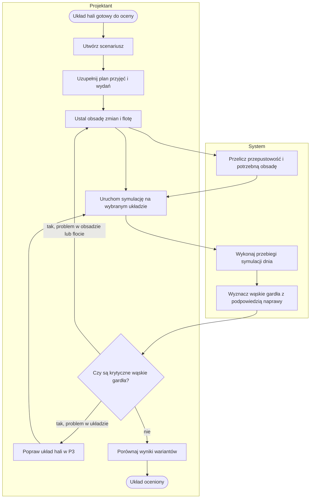
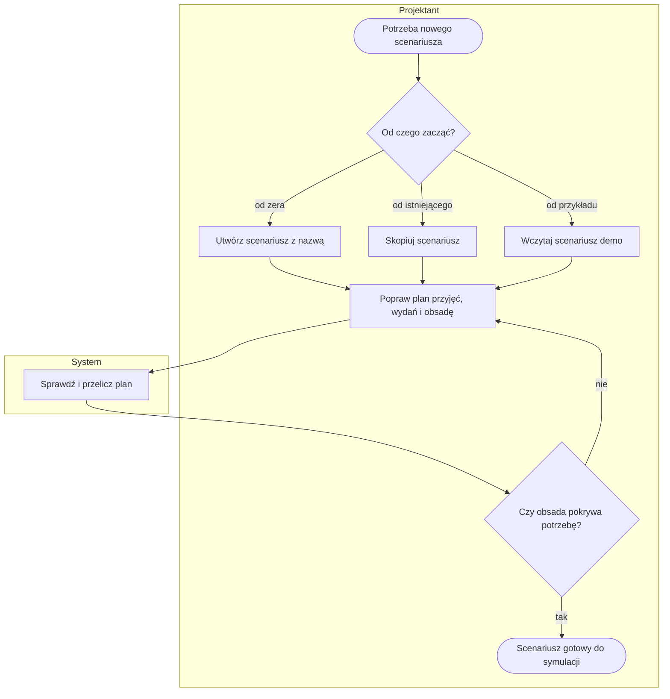
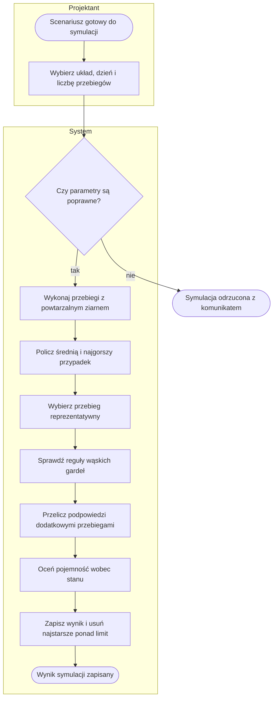
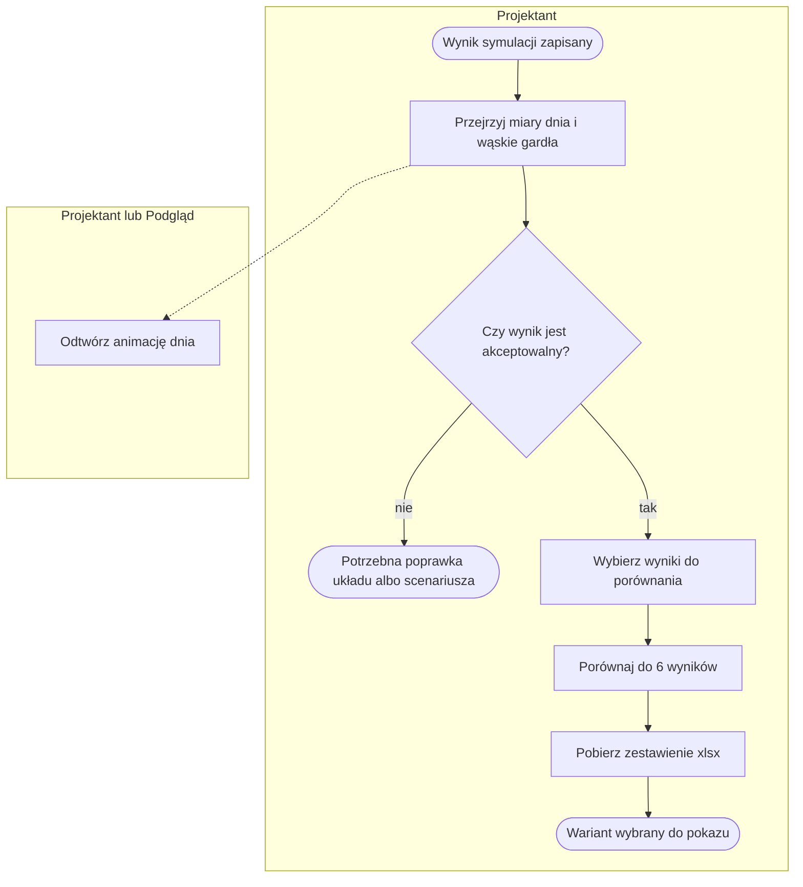
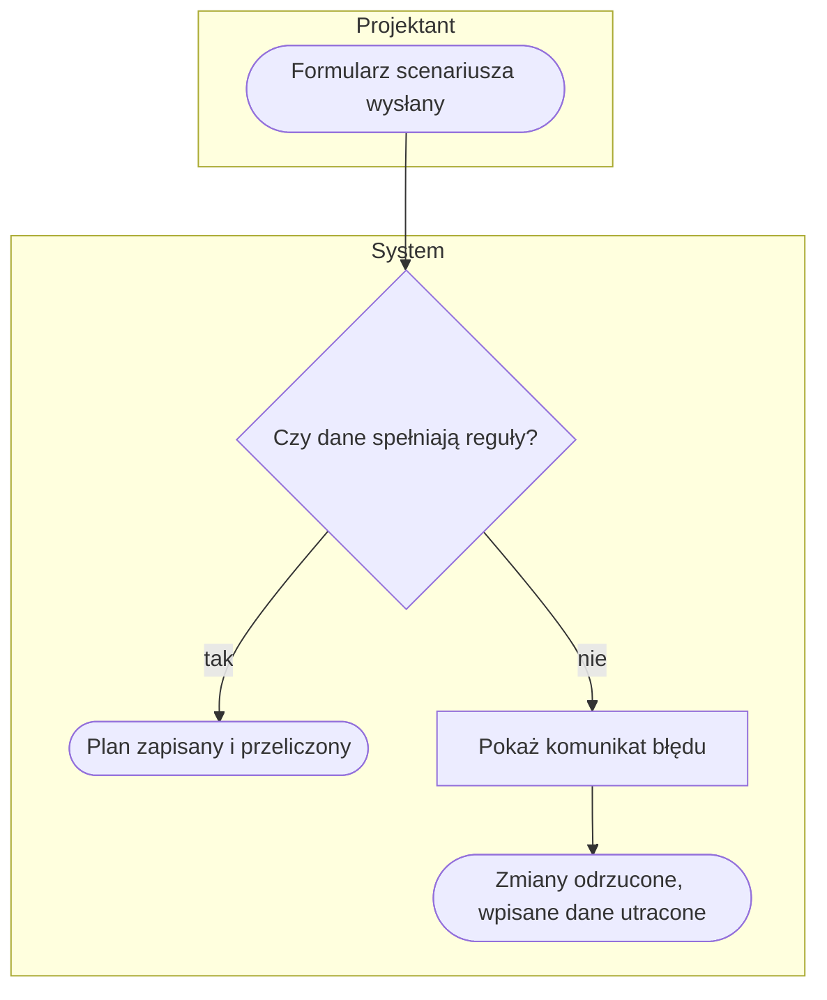

# P5. Scenariusz i symulacja dnia pracy

| | |
|---|---|
| **Właściciel** | Projektant |
| **Cel biznesowy** | Sprawdzić przed budową, czy wybrany układ hali obsłuży dzień typowy i szczytowy przy zakładanej obsadzie i flocie, oraz wskazać wąskie gardła z konkretną propozycją naprawy. |
| **Zdarzenie inicjujące** | Układ hali gotowy do oceny (model hali zapisany bez błędów — [P3](P3-model-hali.md)) |
| **Rezultat końcowy** | Układ oceniony: zapisany wynik symulacji z miarami dnia (średnia i najgorszy przypadek) oraz listą wąskich gardeł z podpowiedziami |
| **Procesy powiązane** | wejście: [P1](P1-dane-podstawowe.md) (stany do oceny pojemności), [P3](P3-model-hali.md) (układ), [P4](P4-katalog-sprzetu.md) (flota); wyjście: [P6](P6-prezentacja-3d.md) (pokaz wyniku) |

Scenariusz to założenia wolumenów, obsady i norm **niezależne od układu hali** — ten sam scenariusz
można przeliczyć na kilku układach i porównać je na identycznym wejściu
([decyzja D3](../05-decyzje-i-ograniczenia.md#d3-scenariusz-niezależny-od-układu-hali)).

## Przebieg procesu

Diagram przedstawia przebieg główny. Szczegóły w podprocesach [P5.1](#p51-zdefiniowanie-scenariusza),
[P5.2](#p52-symulacja-i-diagnoza-dnia) i [P5.3](#p53-ocena-i-porównanie-wyników).

## Tabela kroków

| Nr | Krok | Aktor | Wejście | Wyjście | Reguła biznesowa |
|---|---|---|---|---|---|
| 1 | Utwórz scenariusz | Projektant | nazwa scenariusza | scenariusz z dniem typowym i szczytowym, wypełniony przykładowymi wartościami | BR-501 |
| 2 | Uzupełnij plan przyjęć | Projektant | liczba i rodzaj dostaw na dzień | plan przyjęć dla każdego dnia | BR-502, BR-503 |
| 3 | Uzupełnij plan wydań, paczek i zwrotów | Projektant | liczba wyjazdów, paczek, zwrotów | plan wydań dla każdego dnia | BR-502, BR-503 |
| 4 | Ustal obsadę zmian | Projektant | procesy, godziny zmian, przerwy, liczba osób | obsada scenariusza | BR-504 |
| 5 | Wybierz flotę | Projektant | sprzęt z katalogu (jeden typ albo kilka grup) | flota scenariusza | BR-505 |
| 6 | Przelicz przepustowość i potrzebną obsadę | System | scenariusz, normy wydajności | zestawienie „obsada zakładana vs potrzebna” | BR-506 |
| 7 | Uruchom symulację | Projektant | model hali, dzień (typowy, szczytowy lub oba), liczba przebiegów | zlecenie obliczenia | BR-507 |
| 8 | Wykonaj przebiegi symulacji dnia | System | plan dnia, układ hali, obsada, flota | miary dnia: średnia i najgorszy przypadek | BR-508, BR-509 |
| 9 | Wyznacz wąskie gardła z podpowiedzią | System | miary dnia, przebieg reprezentatywny | lista wąskich gardeł z propozycją „+N” | BR-510 – BR-515 |
| 10 | Oceń pojemność układu wobec stanu | System | układ hali, aktualny stan magazynu | ocena wypełnienia i nośności | BR-516 |
| 11 | Zapisz wynik | System | wynik obliczeń | wynik symulacji (para scenariusz × układ) | BR-517 |
| 12 | Oceń wynik i zdecyduj o poprawkach | Projektant | wynik, wąskie gardła | decyzja: poprawka układu, poprawka obsady/floty albo akceptacja | — |
| 13 | Porównaj wyniki wariantów | Projektant | do 6 wyników | tabela różnic, plik xlsx | BR-518 |
| 14 | Odtwórz animację dnia | Projektant, Podgląd | wynik z zapisanym przebiegiem | animacja 3D dnia | BR-519 |

## Podprocesy

### P5.1. Zdefiniowanie scenariusza

Obejmuje kroki 1–6. Każdy zapis formularza od razu przelicza przepustowość i obsadę potrzebną — bez
uruchamiania symulacji.

| Wariant startu | Co powstaje | Podstawa |
|---|---|---|
| Od zera | scenariusz z dniem typowym i szczytowym; dzień szczytowy = typowy × 1,3 (oprócz liczby linii na zamówienie); przykładowe przyjęcia, wydania i zmiany | BR-501 |
| Kopia | nowy scenariusz „{nazwa} (kopia)” ze wszystkimi dniami, strumieniami dostaw i wydań, zmianami i flotą | — |
| Demo | scenariusz referencyjny z danymi syntetycznymi i halą demo; ponowne użycie odtwarza ten sam plan | BR-520 |

**Elementy planu dnia:**

| Część | Rodzaje | Parametry |
|---|---|---|
| Przyjęcia | kontener 40', auto 33-paletowe, solówka, cross-dock | przyjazdy min/śr/max, palet na dostawę min/śr/max, okno godzin, % palet jednorodnych, % kontroli, czas kontroli |
| Wydania | auto 33-paletowe, solówka, kurier, cross-dock | wyjazdy min/śr/max, palet min/śr/max, okno załadunku i godzina zamknięcia (cut-off) |
| Profil dnia | zamówienia, linie na zamówienie, paczki, zwroty | min/śr/max, % pełnych palet |
| Obsada | rozładunek, paletyzacja, kontrola, kompletacja, pakowanie, załadunek, zwroty | od–do, przerwa, liczba osób |

### P5.2. Symulacja i diagnoza dnia

Obejmuje kroki 7–11.

Przebieg reprezentatywny to przebieg o medianie „kłopotów” (czekanie aut + paczki po odbiorze kuriera).
Z niego pochodzą oś czasu, wąskie gardła i zdarzenia do animacji.

### P5.3. Ocena i porównanie wyników

Obejmuje kroki 12–14.

## Ścieżki alternatywne i wyjątki

| Wyjątek | Warunek wystąpienia | Obsługa | Skutek dla procesu |
|---|---|---|---|
| W1. Błędne wolumeny | trójka nie spełnia 0 ≤ min ≤ śr ≤ max, okno godzin poza 0–24 albo „od” ≥ „do”, procent poza 0–100 | komunikat z nazwą sekcji i numerem wiersza | zapis odrzucony; wpisane dane trzeba wprowadzić ponownie (znany problem — [05](../05-decyzje-i-ograniczenia.md#znane-ograniczenia)) |
| W2. Błędna zmiana | przerwa dłuższa niż zmiana | komunikat błędu | zapis odrzucony |
| W3. Brak nazwy scenariusza | pusta nazwa przy tworzeniu | „Wpisz nazwę scenariusza.” | scenariusz nie powstaje |
| W4. Błędne parametry symulacji | brak modelu hali albo liczba przebiegów poza 1–30 | komunikat z dopuszczalnym zakresem | symulacja nie startuje |
| W5. Wąskie gardło nienaprawialne podpowiedzią | dodatkowe zasoby w limicie (np. +6 osób, +5 doków, +6 wózków) nie usuwają problemu | podpowiedź opisowa (np. „rozłóż przyjazdy w oknach awizacji”, „dodaj zmianę”) | decyzja wraca do Projektanta |
| W6. Brak przeglądarki z grafiką 3D | przeglądarka bez WebGL | komunikat i tabela godzinowa jako tekst | animacja niedostępna, wynik dostępny w formie tekstowej |
| W7. Długie obliczenie | duża liczba przebiegów × dwa dni + przebiegi podpowiedzi | obliczenie w ramach jednego żądania | możliwe przekroczenie limitu czasu serwera ([założenie Z-6](../00-przeglad.md#założenia-wymagające-potwierdzenia)) |
| W8. Utrata starszych wyników | więcej niż 20 wyników na scenariusz | najstarsze wyniki są usuwane | prezentacja 3D oparta na usuniętym wyniku traci dane bez ostrzeżenia |
| W9. Usunięcie scenariusza albo układu | Projektant usuwa scenariusz lub model hali | usunięcie bez potwierdzenia (scenariusz) | wszystkie wyniki tej pary są usuwane |

## Reguły biznesowe

- **BR-501:** utworzenie scenariusza → system zakłada dzień typowy i szczytowy; wolumeny dnia szczytowego = typowy × 1,3 (bez zmiany liczby linii na zamówienie), wraz z przykładową obsadą.
- **BR-502:** każda wielkość podawana jako trójka min/śr/max → musi spełniać 0 ≤ min ≤ śr ≤ max; inaczej zapis odrzucony.
- **BR-503:** okno godzin dostaw lub wydań → 0 ≤ od < do ≤ 24; procenty (jednorodne palety, kontrola, pełne palety) w zakresie 0–100.
- **BR-504:** koniec zmiany ≤ początek → zmiana przechodzi przez północ; przerwa dłuższa niż zmiana → błąd.
- **BR-505:** flota może być jednorodna (jeden typ z katalogu) albo mieszana (kilka grup sprzętu); flota z katalogu zastępuje normy ogólne scenariusza parametrami sprzętu.
- **BR-506:** każdy zapis planu → system od razu przelicza przepustowość i zestawienie obsady zakładanej z potrzebną.
- **BR-507:** liczba przebiegów symulacji → 1–30, domyślnie 12; dzień: typowy, szczytowy albo oba.
- **BR-508:** każdy przebieg ma ziarno losowe wyznaczone z ziarna scenariusza → ten sam scenariusz daje powtarzalny wynik.
- **BR-509:** wynik zawiera średnią i najgorszy przypadek (P95, a dla miar „im mniej, tym gorzej” — P5).
- **BR-510:** czekanie aut przy dokach P95 > 20 min → wąskie gardło; > 60 min → krytyczne.
- **BR-511:** auta na przyjęciu czekają, a doki nie były zajęte jednocześnie → brakuje ludzi do rozładunku → podpowiedź „+N osób” (N ≤ 6); w pozostałych przypadkach podpowiedź „+N doków” (N ≤ 5), która skraca czekanie P95 do ≤ 20 min.
- **BR-512:** największa liczba palet naraz × 1,5 m² > narysowane pole odkładcze → wąskie gardło z podpowiedzią „+X m²”; brak narysowanego pola → krytyczne.
- **BR-513:** paczki po odbiorze kuriera > 1% paczek dnia → krytyczne wąskie gardło pakowania z podpowiedzią „+N osób” (N ≤ 8).
- **BR-514:** czekanie zadań na wózek P95 > 30 min → wąskie gardło floty; > 90 min → krytyczne; podpowiedź „+N wózków” (N ≤ 6) dla grupy, na którą zadania czekają najdłużej.
- **BR-515:** czekanie w procesie (poza pakowaniem) P95 > 60 min albo zadania bez obsady → wąskie gardło; zadania przychodzące po końcu ostatniej zmiany → krytyczne z podpowiedzią „dodaj zmianę od–do”; ≥ 180 min → krytyczne.
- **BR-516:** brak miejsc albo wypełnienie > 100% → błąd pojemności; > 90% → ostrzeżenie; palety cięższe niż nośność miejsc → ostrzeżenie.
- **BR-517:** zapis wyniku → zachowywanych jest 20 ostatnich wyników na scenariusz; starsze są usuwane.
- **BR-518:** porównanie → maksymalnie 6 wyników, różnica % względem pierwszego, wyróżnienie najlepszego; wyniki ponad 6 są pomijane bez komunikatu.
- **BR-519:** animacja dnia → tempo ×10–×300, „skok do szczytu”, wąskie gardła wyróżnione; dostępna także dla roli Podgląd.
- **BR-520:** scenariusz demo → dane syntetyczne; ponowne wczytanie odtwarza ten sam plan.

## Wymagania funkcjonalne

**WF-501.** Jako Projektant chcę utworzyć scenariusz z gotowymi wartościami przykładowymi, aby od razu mieć dzień typowy i szczytowy do poprawy zamiast pustego formularza.
- *Given* jestem zalogowany jako Projektant, *When* podam nazwę i utworzę scenariusz, *Then* scenariusz ma dzień typowy i szczytowy z planem przyjęć, wydań i obsady, a wolumeny dnia szczytowego są 1,3 razy większe.
- *Given* nie podałem nazwy, *When* tworzę scenariusz, *Then* widzę komunikat „Wpisz nazwę scenariusza.” i scenariusz nie powstaje.

**WF-502.** Jako Projektant chcę podawać wolumeny jako min/śr/max, aby symulacja uwzględniała zmienność dni, a nie tylko średnią.
- *Given* wpisuję min > śr, *When* zapisuję plan przyjęć, *Then* zapis jest odrzucony z komunikatem wskazującym wiersz.
- *Given* wpisuję poprawną trójkę, *When* zapisuję, *Then* przepustowość i obsada potrzebna są przeliczone od razu.

**WF-503.** Jako Projektant chcę uruchomić symulację scenariusza na wybranym układzie hali, aby zobaczyć miary dnia średnio i w najgorszym przypadku.
- *Given* scenariusz i model hali, *When* uruchamiam symulację z 12 przebiegami dla obu dni, *Then* powstają dwa wyniki z miarami średnia i P95, osią czasu i listą wąskich gardeł.
- *Given* wybieram 31 przebiegów, *When* uruchamiam symulację, *Then* widzę komunikat o zakresie 1–30 i symulacja nie startuje.

**WF-504.** Jako Projektant chcę dostać przy każdym wąskim gardle propozycję naprawy, aby wiedzieć, ile doków, osób albo wózków dołożyć.
- *Given* auta czekają P95 ponad 20 min przy zajętych dokach, *When* system wyznacza wąskie gardła, *Then* widzę propozycję „+N doków” sprawdzoną dodatkową symulacją.
- *Given* żadna liczba dodatkowych zasobów w limicie nie pomaga, *When* system wyznacza wąskie gardła, *Then* widzę podpowiedź opisową zamiast liczby.

**WF-505.** Jako Projektant chcę porównać wyniki kilku układów i scenariuszy w jednej tabeli, aby wybrać wariant do pokazu.
- *Given* zaznaczyłem 3 wyniki, *When* otwieram porównanie, *Then* widzę różnicę % względem pierwszego i wyróżnienie najlepszej wartości, a zestawienie mogę pobrać jako xlsx.

**WF-506.** Jako Podgląd chcę odtworzyć animację dnia, aby zobaczyć, kiedy i gdzie tworzą się kolejki.
- *Given* wynik z zapisanym przebiegiem, *When* odtwarzam animację, *Then* mogę zmienić tempo w zakresie ×10–×300 i przeskoczyć do szczytu dnia.
- *Given* przeglądarka bez WebGL, *When* otwieram animację, *Then* widzę komunikat i tabelę godzinową jako tekst.

## Podstawa w kodzie

`web/scenario/models.py` (scenariusz, dni, strumienie, zmiany, flota, wynik, walidacje),
`web/scenario/views.py`, `views_sim.py`, `views_compare.py`, `views_play.py`, `web/scenario/services.py`
(limit przebiegów i zachowywanych wyników), `web/scenario/sim/` (silnik, reguły wąskich gardeł w `report.py`),
`web/scenario/placement.py` (pojemność), `web/scenario/management/commands/demo_scenariusz.py`.
