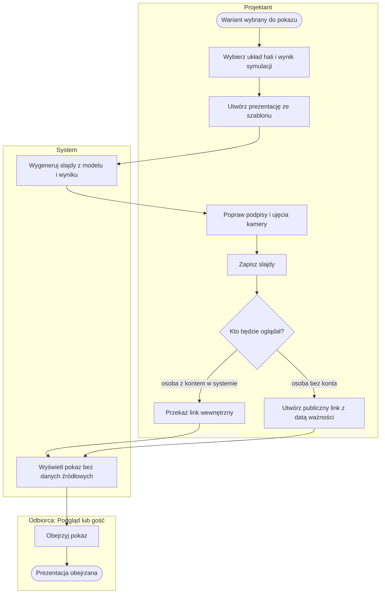
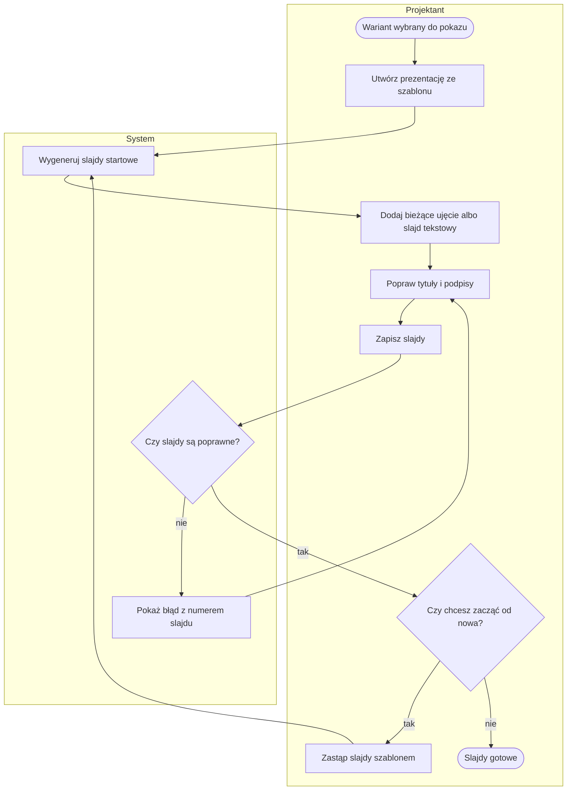
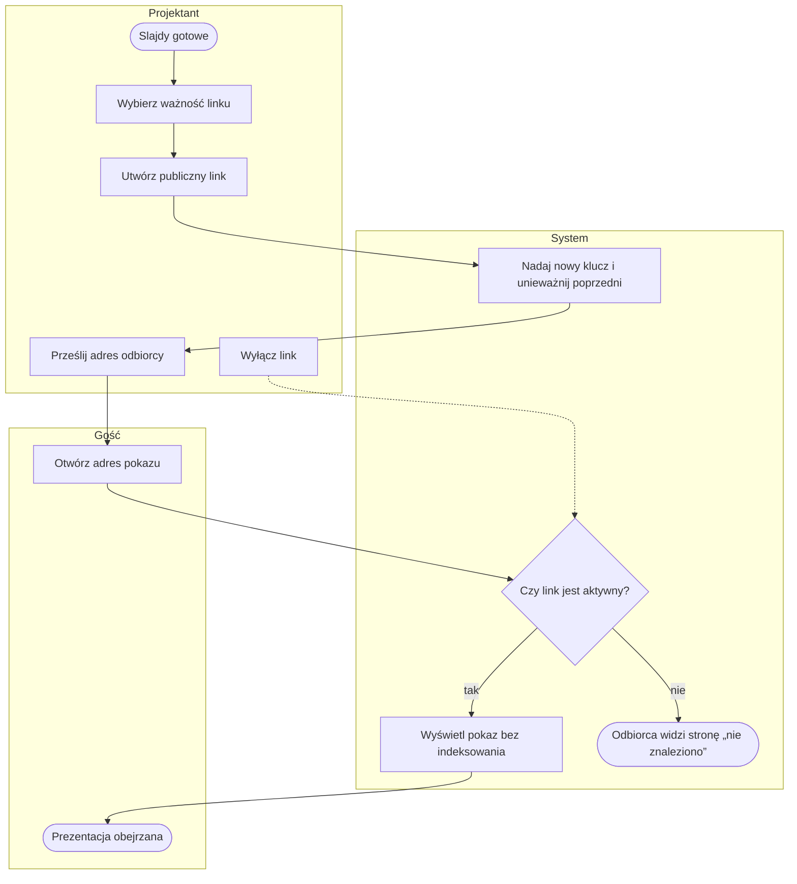
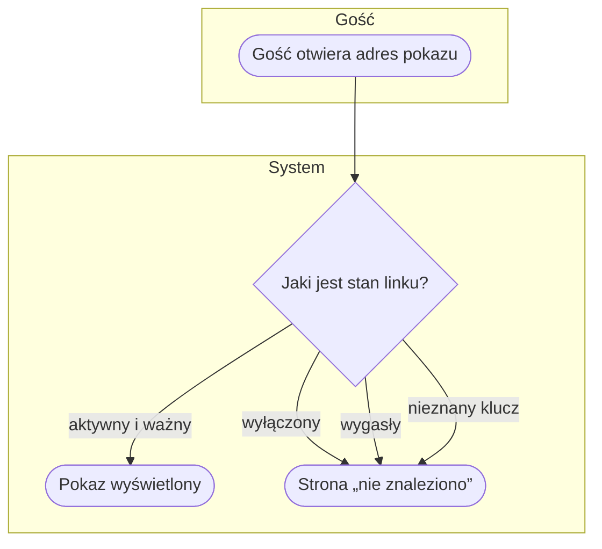

# P6. Prezentacja 3D dla zarządu i jej udostępnienie

| | |
|---|---|
| **Właściciel** | Projektant |
| **Cel biznesowy** | Pokazać decydentom projekt magazynu w przeglądarce — działkę, halę, strefy, doki, wyniki dnia, szczyt i wąskie gardła — bez udostępniania danych źródłowych i bez instalowania czegokolwiek. |
| **Zdarzenie inicjujące** | Wariant wybrany do pokazu (zapisany układ hali, opcjonalnie wynik symulacji — [P5](P5-scenariusz-i-symulacja.md)) |
| **Rezultat końcowy** | Prezentacja obejrzana przez odbiorcę: przez konto z rolą Podgląd albo przez publiczny link z datą ważności |
| **Procesy powiązane** | wejście: [P3](P3-model-hali.md), [P5](P5-scenariusz-i-symulacja.md); równoległy: [P7](P7-film-i-deck.md) (film i deck); [P8](P8-dostep-i-demo.md) (publiczne demo używa tej prezentacji) |

## Przebieg procesu

Diagram przedstawia przebieg główny: utworzenie prezentacji ze szablonu, poprawę slajdów i wybór sposobu udostępnienia — linkiem wewnętrznym albo publicznym. Szczegóły w podprocesach [P6.1](#p61-przygotowanie-slajdów) i [P6.2](#p62-udostępnienie-publicznym-linkiem).

## Tabela kroków

| Nr | Krok | Aktor | Wejście | Wyjście | Reguła biznesowa |
|---|---|---|---|---|---|
| 1 | Wybierz układ hali i wynik symulacji | Projektant | tytuł, model hali, opcjonalnie wynik | parametry prezentacji | BR-601 |
| 2 | Utwórz prezentację ze szablonu | Projektant | parametry prezentacji | nowa prezentacja | BR-601 |
| 3 | Wygeneruj slajdy z modelu i wyniku | System | układ, działka, wynik symulacji | slajdy startowe | BR-602 |
| 4 | Popraw podpisy i ujęcia kamery | Projektant | slajdy startowe, scena 3D | slajdy poprawione | BR-603 |
| 5 | Zapisz slajdy | Projektant | slajdy poprawione | zapisana prezentacja | BR-603, BR-604 |
| 6 | Zdecyduj o sposobie udostępnienia | Projektant | odbiorca | wybrany kanał | — |
| 7 | Przekaż link wewnętrzny | Projektant | adres prezentacji | odbiorca z rolą Podgląd otwiera pokaz | BR-605 |
| 8 | Utwórz publiczny link | Projektant | ważność: 1, 7, 14, 30 albo 90 dni | adres z losowym kluczem | BR-606, BR-607 |
| 9 | Wyświetl pokaz bez danych źródłowych | System | prezentacja | scena 3D, slajdy, karty wyników | BR-608 |
| 10 | Obejrzyj pokaz | Podgląd lub gość | adres | prezentacja obejrzana | BR-609 |

## Podprocesy

### P6.1. Przygotowanie slajdów

Obejmuje kroki 1–5. Szablon startowy powstaje z danych modelu i wyniku, a Projektant poprawia go
w edytorze obok sceny 3D.

Slajdy szablonu startowego, w tej kolejności: tytuł; działka i dojazd (jeśli model ma działkę); hala;
każda strefa regałów; doki; karty wyników (przepustowość, doki i pole odkładcze, obsada i flota,
pojemność, działka, koszty — jeśli jest wynik); szczyt dnia jako fragment animacji; każde wąskie gardło;
podsumowanie z liczbami.

Rodzaje slajdów: **ujęcie kamery**, **karty wyników**, **wąskie gardło**, **fragment animacji dnia**,
**tekst**.

### P6.2. Udostępnienie publicznym linkiem

Obejmuje kroki 8–10 dla odbiorcy bez konta.

## Ścieżki alternatywne i wyjątki

| Wyjątek | Warunek wystąpienia | Obsługa | Skutek dla procesu |
|---|---|---|---|
| W1. Wynik nie pasuje do hali | wybrany wynik symulacji dotyczy innego modelu hali | „Wynik symulacji musi dotyczyć wybranego modelu hali.” | prezentacja nie powstaje |
| W2. Błędne slajdy | ponad 60 slajdów, tytuł > 120 znaków, podpis > 400 znaków, nieznane ujęcie, zły fragment animacji | komunikat z numerem slajdu | zapis odrzucony, edycja trwa |
| W3. Za duży zapis | dane slajdów > 512 KB | „Za dużo danych (maks. 512 KB).” | zapis odrzucony |
| W4. Nieprawidłowa ważność | ważność spoza 1, 7, 14, 30, 90 dni | komunikat z listą dozwolonych wartości | link nie powstaje |
| W5. Link nieaktywny | link wyłączony, wygasły albo z nieznanym kluczem | strona „nie znaleziono” bez rozróżnienia przyczyny | odbiorca nie widzi pokazu ani powodu |
| W6. Utrata wyniku | wynik przypięty do prezentacji został usunięty (limit 20 wyników albo usunięcie scenariusza) | prezentacja działa bez wyniku | karty wyników, szczyt i wąskie gardła znikają bez ostrzeżenia |
| W7. Usunięcie hali | model hali usunięty | usunięcie kaskadowe | prezentacja przestaje istnieć |
| W8. Wygaśnięcie sesji w trakcie edycji | sesja Projektanta wygasła | komunikat „Brak połączenia z serwerem” | zapis nieudany; komunikat nie mówi o konieczności zalogowania |

## Reguły biznesowe

- **BR-601:** prezentacja wymaga modelu hali; wynik symulacji jest opcjonalny, ale jeśli jest wybrany, musi dotyczyć tego samego modelu.
- **BR-602:** utworzenie prezentacji → system generuje slajdy szablonu startowego z danych modelu, działki i wyniku (lista w P6.1).
- **BR-603:** prezentacja ma maksymalnie 60 slajdów; tytuł ≤ 120 znaków, podpis ≤ 400 znaków; fragment animacji w zakresie 0–48 h, tempo ×10, ×30, ×60, ×120 albo ×300.
- **BR-604:** zapis slajdów > 512 KB → odrzucony.
- **BR-605:** link wewnętrzny → otwiera pokaz każdej roli zalogowanej (Administrator, Projektant, Podgląd); edycja tylko dla Projektanta i Administratora.
- **BR-606:** publiczny link ważny 1, 7, 14, 30 albo 90 dni; utworzenie nowego linku unieważnia poprzedni; Projektant może link wyłączyć w każdej chwili.
- **BR-607:** link publiczny ma losowy klucz w adresie i nie wymaga logowania.
- **BR-608:** pokaz (wewnętrzny i publiczny) zawiera układ 3D, wyniki i slajdy, ale nie zawiera danych źródłowych (materiałów, stanów, kodów lokalizacji); pokaz publiczny zawsze jest tylko do oglądania.
- **BR-609:** strona pokazu publicznego nie jest indeksowana przez wyszukiwarki, nie przekazuje swojego adresu dalej i nie jest przechowywana w pamięci pośredników.

## Wymagania funkcjonalne

**WF-601.** Jako Projektant chcę utworzyć prezentację ze szablonu, aby w kilka minut mieć pokaz z liczbami z modelu i wyniku symulacji.
- *Given* model hali z wynikiem symulacji, *When* tworzę prezentację ze szablonu, *Then* powstają slajdy: tytuł, działka, hala, strefy, doki, karty wyników, szczyt dnia, wąskie gardła i podsumowanie.
- *Given* wybieram wynik innej hali, *When* tworzę prezentację, *Then* widzę komunikat, że wynik musi dotyczyć wybranego modelu, i prezentacja nie powstaje.

**WF-602.** Jako Projektant chcę dodać własne ujęcie kamery z bieżącego widoku, aby pokazać zarządowi konkretne miejsce hali.
- *Given* ustawiłem kamerę w scenie, *When* dodaję bieżące ujęcie i zapisuję, *Then* slajd odtwarza dokładnie to ujęcie.
- *Given* prezentacja ma 60 slajdów, *When* dodaję kolejny i zapisuję, *Then* zapis jest odrzucony z komunikatem o limicie.

**WF-603.** Jako Projektant chcę udostępnić pokaz osobie bez konta na określony czas, aby nie zakładać jej konta i nie zostawiać dostępu na zawsze.
- *Given* gotowa prezentacja, *When* tworzę publiczny link ważny 7 dni, *Then* dostaję adres, który działa bez logowania przez 7 dni.
- *Given* link utworzony wcześniej, *When* tworzę nowy link, *Then* stary adres przestaje działać.
- *Given* link wyłączony albo wygasły, *When* gość otwiera adres, *Then* widzi stronę „nie znaleziono”.

**WF-604.** Jako osoba z rolą Podgląd chcę oglądać pokaz bez danych źródłowych, aby ocenić projekt bez dostępu do danych magazynu.
- *Given* jestem zalogowany jako Podgląd, *When* otwieram prezentację, *Then* widzę scenę, slajdy i karty wyników, ale nie widzę edytora ani danych materiałów i lokalizacji.

## Podstawa w kodzie

`web/scenario/views_showcase.py` (tworzenie, zapis, szablon, link publiczny, nagłówki), `web/scenario/showcase.py`
(rodzaje slajdów, limity, szablon startowy), `web/scenario/models.py` (`Showcase`),
`web/scenario/templates/scenario/showcase.html`.
