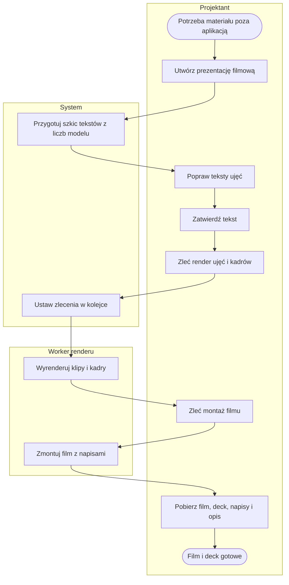
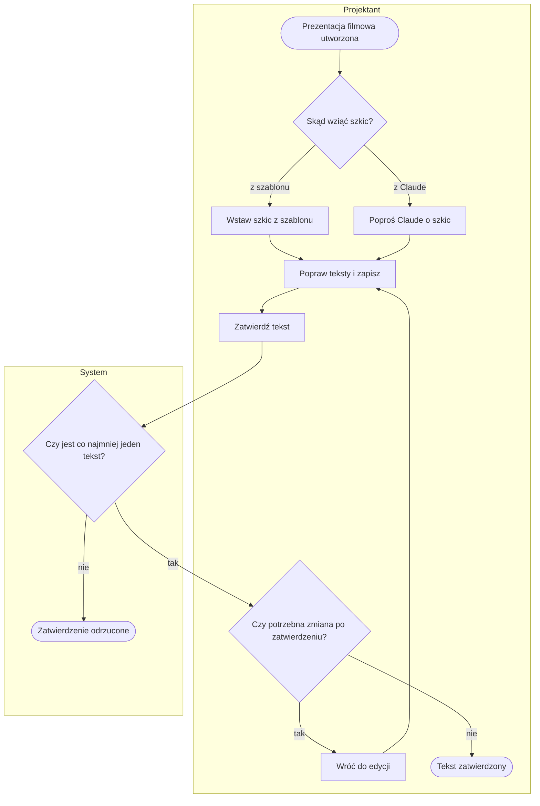
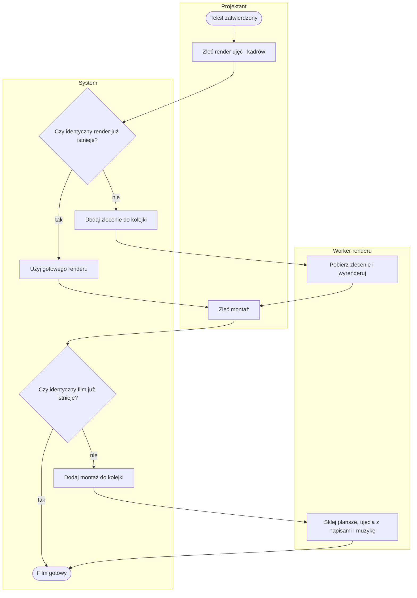
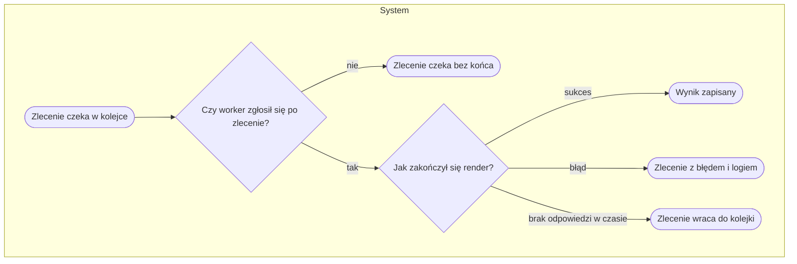

# P7. Film z napisami i deck PDF

| | |
|---|---|
| **Właściciel** | Projektant |
| **Cel biznesowy** | Przygotować materiał do pokazania projektu poza aplikacją: film MP4 z ujęciami hali z Blendera i napisami w obrazie (np. na YouTube) oraz deck PDF ze slajdami 16:9. |
| **Zdarzenie inicjujące** | Potrzeba materiału do pokazu poza aplikacją (zapisany model hali z regałami — [P3](P3-model-hali.md)) |
| **Rezultat końcowy** | Film zmontowany (MP4) i deck PDF gotowe do pobrania, razem z plikiem napisów i opisem na YouTube |
| **Procesy powiązane** | wejście: [P3](P3-model-hali.md); równoległy: [P6](P6-prezentacja-3d.md); usługi zewnętrzne: worker renderu, opcjonalnie Claude — [04-integracje](../04-integracje.md) |

Film nie ma lektora: tekst ujęcia jest wypalany w obrazie jako napis, a długość ujęcia to czas potrzebny
na jego przeczytanie ([decyzja D14](../05-decyzje-i-ograniczenia.md#d14-film-bez-lektora-napisy-w-obrazie-i-opcjonalna-muzyka)).

## Przebieg procesu

Diagram przedstawia przebieg główny: przygotowanie i zatwierdzenie tekstów, render ujęć na stanowisku renderującym, montaż z napisami i pobranie plików. Szczegóły w podprocesach [P7.1](#p71-przygotowanie-i-zatwierdzenie-tekstu) i [P7.2](#p72-render-i-montaż).

## Tabela kroków

| Nr | Krok | Aktor | Wejście | Wyjście | Reguła biznesowa |
|---|---|---|---|---|---|
| 1 | Utwórz prezentację filmową | Projektant | model hali, tytuł filmu | prezentacja w stanie „Szkic” | BR-701 |
| 2 | Przygotuj szkic tekstów z liczb modelu | System | wskaźniki modelu hali | 5 tekstów pod ujęcia kamery | BR-701 |
| 3 | Popraw teksty ujęć | Projektant | szkic | teksty: kolejność, ujęcie kamery, treść | BR-702, BR-703, BR-704 |
| 4 | Zatwierdź tekst | Projektant | teksty | prezentacja „Tekst zatwierdzony” | BR-705 |
| 5 | Zleć render ujęć i kadrów | Projektant | zatwierdzone teksty | zlecenia: klip do filmu i kadr do decku dla każdego ujęcia | BR-706, BR-707 |
| 6 | Ustaw zlecenia w kolejce | System | zlecenia | kolejka renderów; zlecenia identyczne z gotowymi są pomijane | BR-707 |
| 7 | Wyrenderuj klipy i kadry | Worker renderu | scena modelu, ujęcie, długość | klipy MP4 i kadry PNG | BR-708 |
| 8 | Zleć montaż filmu | Projektant | gotowe, aktualne klipy | zlecenie montażu | BR-709, BR-710 |
| 9 | Zmontuj film z napisami | Worker renderu | klipy, teksty z czasami | film MP4 | BR-711 |
| 10 | Pobierz film, deck, napisy i opis | Projektant lub Podgląd | prezentacja | MP4, PDF, SRT, opis na YouTube | BR-712, BR-713 |

Etapy prezentacji filmowej: **Szkic → Tekst zatwierdzony → Render ujęć → Montaż → Gotowe**.

## Podprocesy

### P7.1. Przygotowanie i zatwierdzenie tekstu

Obejmuje kroki 1–4.

Do Claude trafiają wyłącznie zdania z zagregowanymi liczbami modelu (powierzchnia, liczba miejsc
paletowych, droga, sprzęt, naruszenia alejek) — bez nazwy modelu, materiałów i lokalizacji.

### P7.2. Render i montaż

Obejmuje kroki 5–9.

Film składa się z planszy tytułowej (3 s), ujęć z napisami w obrazie i planszy końcowej (3 s). Dźwięk to
podkład muzyczny ustawiony u workera albo cisza.

## Ścieżki alternatywne i wyjątki

| Wyjątek | Warunek wystąpienia | Obsługa | Skutek dla procesu |
|---|---|---|---|
| W1. Szkic z Claude niedostępny | brak klucza usługi, odrzucony klucz, limit zapytań, przekroczony czas, odmowa, niepełna odpowiedź | komunikat z przyczyną; obecne teksty bez zmian | Projektant używa szkicu z szablonu albo pisze sam |
| W2. Pusty szkic z Claude | odpowiedź bez żadnego poprawnego tekstu | „obecne teksty bez zmian” | jak W1 |
| W3. Poprawki szkicu z Claude | nieznane ujęcie, za długi tekst, za dużo ujęć | ujęcie zamienione na widok ogólny, tekst przycięty na granicy zdania, ujęcia ponad 12 odrzucone; ostrzeżenia | szkic przyjęty z poprawkami |
| W4. Edycja zatwierdzonego tekstu | próba zmiany tekstu poza szkicem | „Tekst jest zatwierdzony — najpierw „Wróć do edycji”.” | zmiana zablokowana |
| W5. Render przed zatwierdzeniem | prezentacja w szkicu | „Najpierw zatwierdź tekst.” | render nie rusza |
| W6. Montaż przed renderami | nie każde ujęcie ma gotowy, aktualny klip | komunikat; przycisk montażu niedostępny | montaż nie rusza |
| W7. Brak workera | worker wyłączony albo API workera wyłączone | informacja na stronie; zlecenia czekają | film nie powstaje do czasu uruchomienia workera |
| W8. Błąd renderu lub montażu | worker zgłosił błąd | log błędu na stronie, przycisk „Zmontuj ponownie” | ponowienie przez Projektanta |
| W9. Worker zamilkł | zlecenie „w toku” dłużej niż 120 min | zlecenie wraca do kolejki przy kolejnym zgłoszeniu workera | opóźnienie |
| W10. Brak kadru do decku | kadr nie jest gotowy | w decku miejsce zastępcze | deck można pobrać na każdym etapie |

## Reguły biznesowe

- **BR-701:** utworzenie prezentacji filmowej → system wstawia szkic 5 tekstów z liczb modelu hali (przelot, plan, przejazd, orbita, widok ogólny).
- **BR-702:** teksty można edytować wyłącznie w stanie „Szkic”.
- **BR-703:** szkic z AI → do usługi idą wyłącznie zdania z zagregowanymi liczbami modelu; brak klucza usługi → funkcja wyłączona z komunikatem.
- **BR-704:** szkic z AI → 3–12 ujęć, każde z jednym z 5 ruchów kamery; tekst ≤ 600 znaków; łącznie 150–260 słów (cel, nie blokada).
- **BR-705:** zatwierdzenie wymaga co najmniej jednego niepustego tekstu; puste teksty są usuwane; „Wróć do edycji” cofa prezentację do szkicu z każdego etapu.
- **BR-706:** długość ujęcia = czas spokojnego przeczytania napisu: liczba słów / 2,2 + 1,5 s, w granicach 5–60 s; klip ma tyle pełnych sekund, ile trwa ujęcie.
- **BR-707:** dla każdego ujęcia powstaje klip MP4 (film) i kadr PNG (deck) w Full HD; ta sama scena, ujęcie, długość i rozdzielczość → użyty gotowy render zamiast nowego zlecenia; błędny render jest zlecany ponownie.
- **BR-708:** zmiana ujęcia kamery albo długości ujęcia → render nieaktualny, potrzebny nowy; zmiana tekstu bez zmiany długości → klip zostaje.
- **BR-709:** montaż jest możliwy dopiero, gdy każde ujęcie ma gotowy i aktualny klip.
- **BR-710:** ten sam tytuł, klipy i teksty → film z pamięci zamiast nowego montażu; poprawka tekstu → nowy montaż (napisy są w obrazie).
- **BR-711:** film = plansza tytułowa 3 s + ujęcia z napisami (≤ 2 linie po ≤ 42 znaki, ≤ 6 s na planszę) + plansza końcowa 3 s; podkład muzyczny, jeśli worker go ma, znormalizowany do −14 LUFS.
- **BR-712:** deck PDF 16:9: tytuł → liczby z modelu → ujęcie na slajd (kadr + tekst) → zakończenie; dostępny na każdym etapie.
- **BR-713:** napisy SRT i opis na YouTube (tytuł, opis, link do demo, rozdziały) liczone z tekstów i długości ujęć; rozdziały: pierwszy od 00:00, co najmniej 3, każdy ≥ 10 s.

## Wymagania funkcjonalne

**WF-701.** Jako Projektant chcę dostać szkic tekstów filmu z liczb modelu, aby nie pisać od zera i nie pomylić liczb.
- *Given* model hali z regałami, *When* tworzę prezentację filmową, *Then* mam 5 tekstów z powierzchnią, liczbą miejsc i drogą do miejsca paletowego.
- *Given* brak klucza usługi AI, *When* oglądam stronę prezentacji, *Then* przycisk „Szkic z Claude” jest nieaktywny z wyjaśnieniem.

**WF-702.** Jako Projektant chcę zatwierdzić tekst przed renderem, aby nie zlecać kosztownego renderu na wersji roboczej.
- *Given* prezentacja w szkicu, *When* zlecam render, *Then* widzę „Najpierw zatwierdź tekst.” i nic nie trafia do kolejki.
- *Given* prezentacja bez żadnego tekstu, *When* zatwierdzam, *Then* zatwierdzenie jest odrzucone.

**WF-703.** Jako Projektant chcę, aby poprawka jednego tekstu nie powtarzała całego renderu, aby oszczędzić czas workera.
- *Given* wszystkie klipy gotowe, *When* poprawiam tekst ujęcia tak, że jego długość się nie zmienia, *Then* klip jest użyty ponownie, a powstaje tylko nowy montaż.

**WF-704.** Jako Projektant chcę pobrać film, deck PDF, napisy i opis na YouTube, aby opublikować projekt poza aplikacją.
- *Given* film zmontowany, *When* otwieram prezentację, *Then* mogę pobrać MP4, PDF, SRT i opis z rozdziałami.
- *Given* kadry jeszcze się renderują, *When* pobieram deck, *Then* dostaję PDF z miejscami zastępczymi.

## Podstawa w kodzie

`web/studio/models.py` (etapy, długość ujęcia, aktualność renderu), `web/studio/views.py`, `web/studio/api.py`
(manifest montażu), `web/studio/captions.py` (długość ujęć i napisy), `web/studio/script.py`, `script_ai.py`
(szkic), `web/studio/deck.py`, `web/studio/youtube.py`, `web/render/` (kolejka i API workera),
`tools/render_worker.py`, `tools/twinema_montage.py`.
