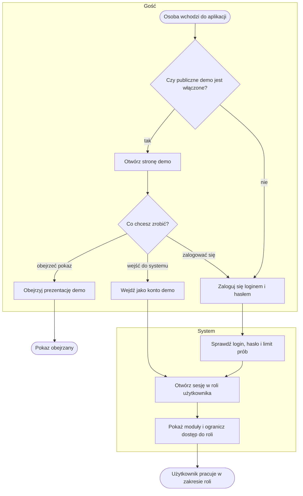
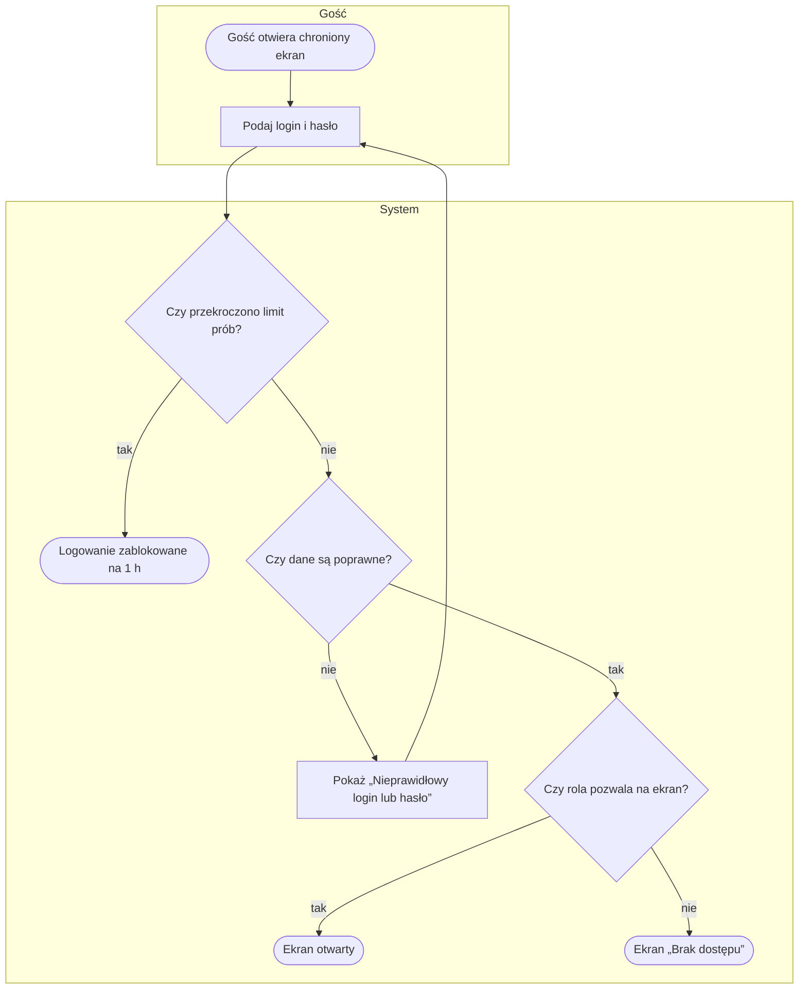
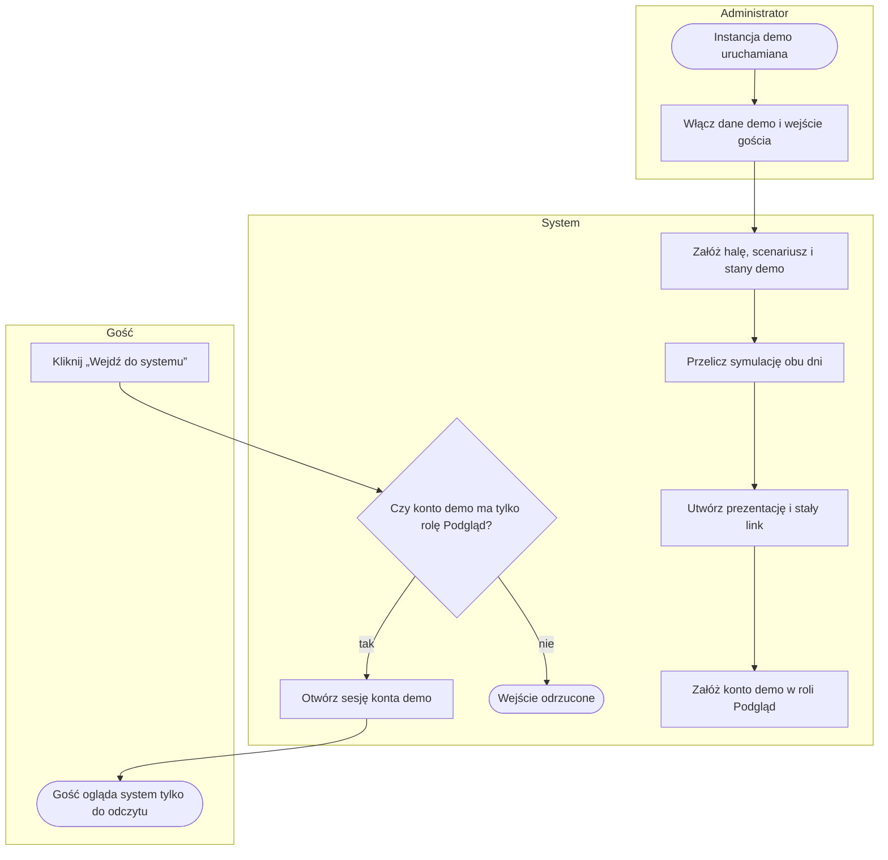
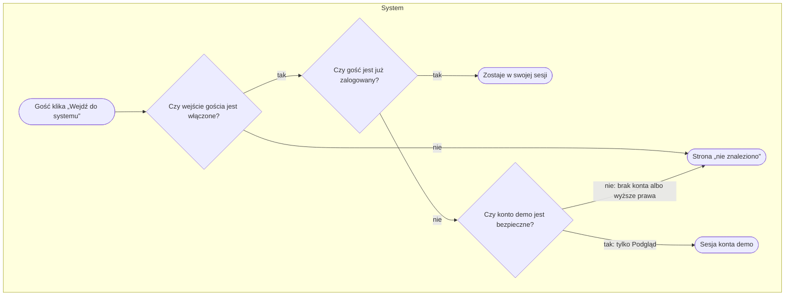

# P8. Dostęp, role i publiczne demo

| | |
|---|---|
| **Właściciel** | Administrator |
| **Cel biznesowy** | Zapewnić, że każdy użytkownik widzi tylko to, do czego ma prawo (dane źródłowe wyłącznie dla Projektanta), a osoba z zewnątrz może obejrzeć działające demo bez zakładania konta. |
| **Zdarzenie inicjujące** | Osoba chce skorzystać z systemu (wejście na dowolny adres aplikacji) albo instancja demo jest uruchamiana |
| **Rezultat końcowy** | Użytkownik pracuje w zakresie swojej roli albo gość ogląda demo w trybie tylko do odczytu |
| **Procesy powiązane** | wszystkie procesy P1–P7 korzystają z ról; demo używa prezentacji z [P6](P6-prezentacja-3d.md) i symulacji z [P5](P5-scenariusz-i-symulacja.md) |

## Role

| Rola | Co może | Czego nie może |
|---|---|---|
| **Administrator** | wszystko, co Projektant; edycja klas systemowych sprzętu; zarządzanie kontami w panelu administracyjnym | — |
| **Projektant** | importy danych, modele hal, scenariusze, symulacje, prezentacje, film, render | edytować klas systemowych sprzętu |
| **Podgląd** | ogląda wyniki, sceny 3D, scenariusze, animacje, prezentacje, filmy | zapisywać czegokolwiek; widzieć danych źródłowych (materiały, stany, kody lokalizacji, zadania magazynowe, raporty importu) |
| **Gość** (bez konta) | strona logowania; pokaz z publicznego linku; przy włączonym demo — strona demo i wejście jako konto demo | wszystko inne |

Superużytkownik ma uprawnienia wszystkich ról.

## Przebieg procesu

Diagram przedstawia dwie drogi wejścia: logowanie z kontrolą roli oraz publiczne demo bez hasła. Szczegóły w podprocesach [P8.1](#p81-logowanie-i-kontrola-dostępu) i [P8.2](#p82-przygotowanie-i-obsługa-publicznego-demo).

## Tabela kroków

| Nr | Krok | Aktor | Wejście | Wyjście | Reguła biznesowa |
|---|---|---|---|---|---|
| 1 | Wejdź na adres aplikacji | Gość | dowolny adres | strona logowania albo strona demo | BR-801, BR-809 |
| 2 | Zaloguj się | Gość | login, hasło | żądanie logowania | BR-802 |
| 3 | Sprawdź login, hasło i limit prób | System | dane logowania | wynik weryfikacji | BR-803 |
| 4 | Otwórz sesję w roli użytkownika | System | konto z rolą | sesja | BR-804 |
| 5 | Ogranicz dostęp do roli | System | rola, żądany ekran | ekran albo „Brak dostępu” | BR-805, BR-806 |
| 6 | Otwórz stronę demo | Gość | adres demo | strona z przyciskami pokazu, wejścia i filmu | BR-809, BR-810 |
| 7 | Obejrzyj prezentację demo | Gość | publiczny link prezentacji demo | pokaz 3D | BR-810 |
| 8 | Wejdź jako konto demo | Gość | przycisk „Wejdź do systemu” | sesja konta demo w roli Podgląd | BR-811, BR-812 |
| 9 | Przygotuj dane demo | System (przy starcie instancji) | ustawienie instancji | hala, scenariusz, stany, wyniki, prezentacja, konto demo | BR-813, BR-814 |
| 10 | Załóż konto użytkownika | Administrator | login, hasło, rola | konto | BR-807, BR-808 |

## Podprocesy

### P8.1. Logowanie i kontrola dostępu

Obejmuje kroki 2–5.

### P8.2. Przygotowanie i obsługa publicznego demo

Obejmuje kroki 6–9.

Przygotowanie danych demo jest powtarzalne: kolejne uruchomienie niczego nie dubluje, a istniejący link
prezentacji demo zachowuje swój klucz i odnawia ważność. Reset danych demo usuwa wyłącznie obiekty demo.

## Ścieżki alternatywne i wyjątki

| Wyjątek | Warunek wystąpienia | Obsługa | Skutek dla procesu |
|---|---|---|---|
| W1. Błędne dane logowania | login lub hasło niepoprawne | „Nieprawidłowy login lub hasło.” | ponowna próba |
| W2. Zbyt wiele prób | 5 nieudanych prób dla pary login + adres IP | blokada na 1 h, domyślna strona biblioteki | brak logowania do końca blokady |
| W3. Brak roli | zalogowany użytkownik bez wymaganej roli | ekran „Brak dostępu” (403) z powrotem na start | brak dostępu do modułu |
| W4. Konto bez żadnej roli | użytkownik nie należy do żadnej grupy | widzi stronę startową, każdy moduł zwraca „Brak dostępu” | konieczne nadanie roli przez Administratora |
| W5. Demo nieprzygotowane | brak prezentacji demo z aktywnym linkiem | strona demo bez przycisku pokazu, z informacją o przygotowaniu danych | gość nie zobaczy pokazu |
| W6. Konto demo z wyższymi prawami | konto demo jest superużytkownikiem, ma uprawnienia personelu albo inną rolę niż Podgląd | wejście gościa odrzucone („nie znaleziono”) | ochrona przed nadaniem gościowi uprawnień edycji |
| W7. Wygaśnięcie sesji | brak aktywności dłużej niż 8 h | przy kolejnym żądaniu przekierowanie na logowanie; zapis z edytora pokazuje „Brak połączenia z serwerem” | utrata niezapisanej pracy w edytorze |
| W8. Błędna konfiguracja instancji | brak klucza aplikacji poza trybem deweloperskim, za krótki token workera lub hasło demo, adres filmu bez https | instancja nie startuje, czytelny komunikat w logu | wymagana poprawka konfiguracji |

## Reguły biznesowe

- **BR-801:** gość wchodzący na chroniony ekran → strona logowania; wyjątki bez logowania: pokaz z publicznego linku, strona demo (gdy włączona), sprawdzenie stanu aplikacji.
- **BR-802:** konta zakłada Administrator; w aplikacji nie ma samodzielnej rejestracji ani odzyskiwania hasła.
- **BR-803:** 5 nieudanych prób logowania dla pary login + adres IP → blokada na 1 h; udane logowanie zeruje licznik.
- **BR-804:** sesja trwa 8 h i jest odświeżana przy każdym żądaniu.
- **BR-805:** dostęp do ekranu wymaga zalogowania i jednej z ról przypisanych do ekranu; brak roli → „Brak dostępu” (403); superużytkownik przechodzi zawsze.
- **BR-806:** rola Podgląd nie zapisuje danych i nie widzi danych źródłowych: listy materiałów, raportów importu, zadań magazynowych, wykrywania i zgodności z systemem magazynowym, eksportu segmentów; scena 3D dla Podglądu jest pozbawiona kodów materiałów, jednostek magazynowych, partii, ilości i kodów lokalizacji.
- **BR-807:** hasło ma co najmniej 10 znaków i nie może być zbyt proste ani podobne do loginu.
- **BR-808:** przy pierwszym starcie instancji może powstać konto administratora z ustawień instancji.
- **BR-809:** publiczne demo włączone → gość wchodzący na stronę główną trafia na stronę demo zamiast na logowanie; strona logowania pokazuje link do demo.
- **BR-810:** strona demo pokazuje przycisk pokazu tylko, gdy istnieje prezentacja demo z aktywnym linkiem; przycisk filmu tylko, gdy ustawiono adres filmu.
- **BR-811:** „Wejdź do systemu” działa tylko przy włączonym publicznym demo i tylko dla konta demo, które jest aktywne, nie jest superużytkownikiem ani personelem i ma wyłącznie rolę Podgląd; inaczej „nie znaleziono”.
- **BR-812:** zalogowany użytkownik klikający „Wejdź do systemu” zostaje w swojej sesji; gość w sesji demo widzi pasek „Wersja demo — tylko podgląd, dane syntetyczne”.
- **BR-813:** przygotowanie demo tworzy halę, scenariusz, stany (wypełnienie 70%), wyniki symulacji dnia typowego i szczytowego, prezentację 3D z dnia szczytowego i link ważny 10 lat; ponowne uruchomienie nie dubluje danych i odnawia ważność linku.
- **BR-814:** konto demo powstaje, gdy ustawiono hasło demo albo włączono wejście gościa; bez hasła konto nie ma możliwości logowania hasłem.

## Wymagania funkcjonalne

**WF-801.** Jako Administrator chcę, aby rola Podgląd nie widziała danych źródłowych, aby można było pokazać projekt zarządowi bez ujawniania danych magazynu.
- *Given* jestem zalogowany jako Podgląd, *When* otwieram listę materiałów albo raport importu, *Then* widzę „Brak dostępu”.
- *Given* jestem zalogowany jako Podgląd, *When* otwieram scenę 3D, *Then* nie widzę kodów materiałów, partii ani kodów lokalizacji.

**WF-802.** Jako Administrator chcę blokować logowanie po kilku nieudanych próbach, aby utrudnić zgadywanie haseł.
- *Given* 5 nieudanych prób dla mojego loginu z tego samego adresu, *When* próbuję szósty raz, *Then* logowanie jest zablokowane na 1 h.

**WF-803.** Jako gość chcę obejrzeć demo bez zakładania konta, aby szybko ocenić rozwiązanie.
- *Given* publiczne demo włączone, *When* wchodzę na stronę główną, *Then* trafiam na stronę demo z przyciskami „Obejrzyj prezentację 3D” i „Wejdź do systemu”.
- *Given* publiczne demo wyłączone, *When* wchodzę na stronę główną, *Then* trafiam na stronę logowania.

**WF-804.** Jako gość chcę wejść do systemu w trybie tylko do odczytu, aby zobaczyć moduły, scenariusze i animacje.
- *Given* publiczne demo włączone i konto demo w roli Podgląd, *When* klikam „Wejdź do systemu”, *Then* jestem zalogowany jako demo i widzę pasek „Wersja demo”.
- *Given* konto demo ma uprawnienia wyższe niż Podgląd, *When* klikam „Wejdź do systemu”, *Then* widzę stronę „nie znaleziono” i nie zostaję zalogowany.

**WF-805.** Jako Administrator chcę, aby dane demo przygotowywały się same przy starcie instancji, aby demo zawsze miało halę, wynik i prezentację.
- *Given* włączone przygotowanie demo, *When* instancja startuje drugi raz, *Then* liczba hal, scenariuszy, wyników i prezentacji demo się nie zmienia, a link prezentacji ma ten sam klucz.

## Podstawa w kodzie

`web/core/roles.py` (role i kontrola dostępu), `web/core/views.py` (strona startowa, demo, wejście gościa),
`web/core/demo.py`, `web/core/management/commands/seed_demo.py`, `create_roles.py`,
`web/core/context_processors.py`, `web/twinema/settings.py` i `config.py` (sesja, hasła, blokada logowania,
ustawienia demo), `docker-entrypoint.sh`, `web/core/tests/test_role_matrix.py`.
