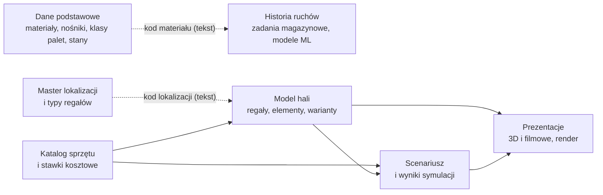
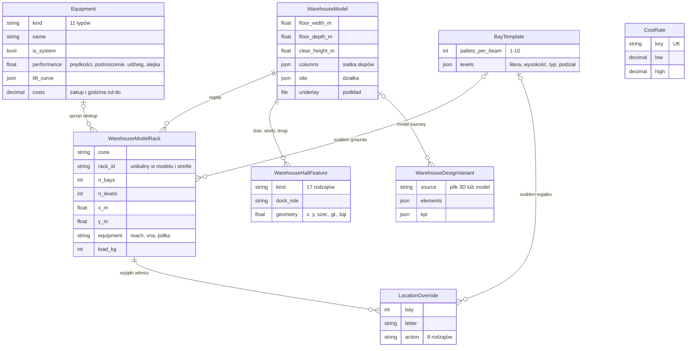
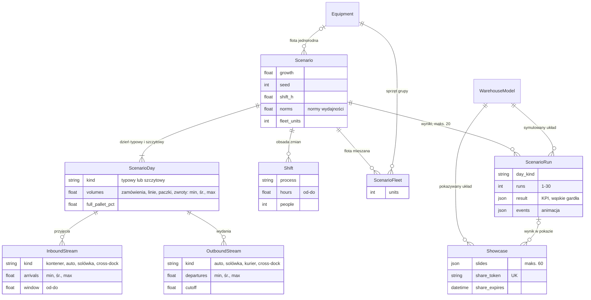
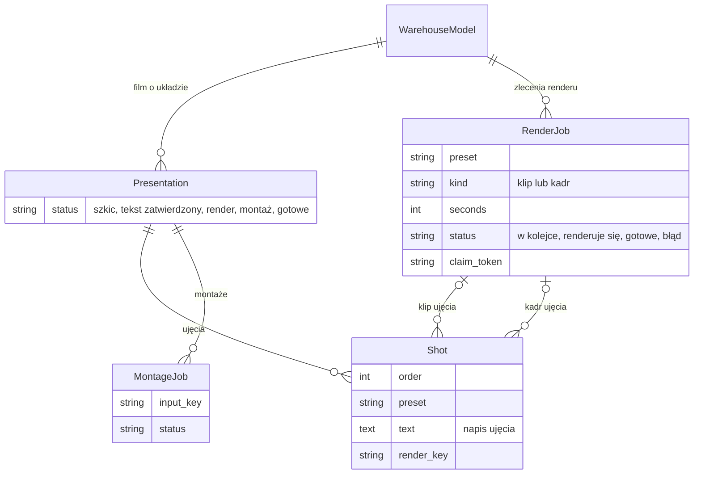

# Model danych

System przechowuje 31 encji biznesowych w 7 obszarach. Dodatkowo każda encja tworzona przez człowieka
wskazuje autora (konto użytkownika); usunięcie konta zostawia dane bez autora.

Diagramy podzielono na obszary, żeby żaden nie przekraczał 15 encji. Encja, która łączy obszary
(np. model hali, sprzęt), występuje na kilku diagramach — z atrybutami tylko w jednym miejscu.

Oznaczenia krotności: `||` dokładnie jeden, `|o` zero albo jeden, `o{` zero lub wiele, `|{` jeden lub wiele.

## Mapa obszarów

Linie przerywane to powiązania **przez kod tekstowy**, nie przez klucz w bazie
([decyzja D9](../05-decyzje-i-ograniczenia.md#d9-klucze-integracji-jako-tekst-zamiast-kluczy-obcych)): pliki można
wgrywać w dowolnej kolejności, ale baza nie pilnuje, czy wskazany materiał lub lokalizacja istnieje.

## ERD 1. Dane podstawowe, master lokalizacji i historia ruchów

```mermaid
erDiagram
    ImportLog ||--o{ StockItem : "partia stanów"
    Carrier |o--o{ Material : "nośnik"
    PalletClass |o--o{ Material : "klasa wysokości"
    PalletClass |o--o{ Material : "klasa wagi"
    WarehouseLocationMasterBatch ||--o{ WarehouseLocationMaster : "zawiera"
    WarehouseTaskBatch ||--o{ WarehouseTask : "zawiera"
    WarehouseTaskBatch ||--o{ ModelRun : "przebiegi ML"
    ImportLog {
        string kind "materiały, lokalizacje, stany"
        int rows_ok
        int rows_rejected
        json rejects "próbka odrzuceń"
    }
    Material {
        string code UK
        string group
        float dims_weights "sztuka, karton, paleta"
        int cartons_per_pallet
        string abc_manual "A, B, C lub puste"
        bool flags "temperatura, ADR, gabaryt, wysoka wartość"
    }
    StockItem {
        string location_code "tekst"
        string material_code "tekst"
        float qty
        string hu
        date expiry
    }
    Carrier {
        string name UK
        bool is_default
    }
    PalletClass {
        string kind "wysokość lub waga"
        float limit
    }
    WarehouseLocationMasterBatch {
        bool is_active
    }
    WarehouseLocationMaster {
        string location_code "unikalny w partii"
        string warehouse_type "kod typu regału (tekst)"
        int height_mm
        float max_weight_kg
        bool blocked
    }
    WarehouseRackType {
        string code UK
        string kind "regał lub strefa"
        json level_heights
    }
    WarehouseTaskBatch {
        string status "w kolejce, trwa, gotowe, błąd"
        string tz
        json kind_map
        json stats
    }
    WarehouseTask {
        string kind "przyjęcie, uzupełnienie, kompletacja, wydanie, przesunięcie"
        string src_location
        string dst_location
        string material
        datetime confirmed_at
    }
    ModelRun {
        string kind "prognoza lub segmentacja"
        string version
        json metrics
        json result
    }
```

`WarehouseRackType` łączy się z `WarehouseLocationMaster` tylko przez równość kodu typu (tekst), dlatego na
diagramie nie ma linii.

## ERD 2. Model hali i katalog sprzętu

Model hali składa się z regałów i elementów hali; regał może mieć szablon adresowania, wyjątki adresów i przypisany sprzęt z katalogu. Warianty projektu mogą wskazywać model bazowy.

## ERD 3. Scenariusz, wyniki i prezentacje

Scenariusz ma zawsze dzień typowy i szczytowy ze strumieniami przyjęć i wydań, obsadę zmian i flotę. Wynik symulacji łączy jeden scenariusz z jednym modelem hali; prezentacja 3D pokazuje model i opcjonalnie wynik.

## ERD 4. Prezentacja filmowa i render

Prezentacja filmowa dotyczy jednego modelu hali i składa się z ujęć; każde ujęcie może mieć klip i kadr ze zlecenia renderu. Montaż składa gotowe klipy w film.

## Skutki usuwania

| Usuwany obiekt | Co znika razem z nim | Co traci tylko powiązanie |
|---|---|---|
| Model hali | regały, elementy hali, wyjątki adresu, wyniki symulacji, prezentacje 3D, prezentacje filmowe z ujęciami i montażami, zlecenia renderu | warianty (tracą model bazowy) |
| Scenariusz | dni, strumienie, zmiany, grupy floty, wyniki symulacji | prezentacje 3D (tracą wynik) |
| Wynik symulacji (także automatycznie ponad 20 na scenariusz) | — | prezentacje 3D (tracą wynik bez ostrzeżenia) |
| Własny model sprzętu | **grupy floty mieszanej z tym sprzętem** | regały i flota jednorodna scenariusza |
| Partia zadań magazynowych | zadania, przebiegi ML | klasy ABC „z historii” w kartotece przestają być liczone |
| Partia stanów (import) | pozycje stanu z tej partii | — |
| Nośnik, klasa palety | — | materiały |
| Zlecenie renderu | — | ujęcia (tracą klip lub kadr) |
| Konto użytkownika | — | wszystkie obiekty z autorem |

## Słownik encji

| Encja | Znaczenie biznesowe | Kluczowe atrybuty | Cykl życia |
|---|---|---|---|
| Materiał (`Material`) | pozycja kartoteki z hierarchią opakowań | kod (unikalny), grupa, wymiary i wagi sztuki/kartonu/palety, liczba kartonów na palecie, ABC ręczne, cechy specjalne | tworzony lub aktualizowany importem po kodzie; edytowany ręcznie (cechy, klasy, ABC) |
| Nośnik (`Carrier`) | rodzaj palety (EUR, przemysłowa, półpaleta) | nazwa (unikalna), wymiary, domyślny | zakładany przy instalacji, edytowany w katalogu |
| Klasa palety (`PalletClass`) | próg wysokości lub wagi palety | rodzaj, limit | zakładana przy instalacji, edytowana w katalogu |
| Import danych (`ImportLog`) | jeden wczytany plik danych podstawowych z raportem | rodzaj, wiersze przyjęte i odrzucone, próbka odrzuceń | powstaje przy imporcie; dla stanów najnowszy import = stan bieżący |
| Pozycja stanu (`StockItem`) | ilość materiału w lokalizacji | kod lokalizacji, kod materiału, ilość, jednostka ładunkowa, data ważności | powstaje z importem stanów, znika z jego usunięciem |
| Partia mastera lokalizacji (`WarehouseLocationMasterBatch`) | jeden wczytany master lokalizacji | aktywna | nowy import staje się aktywny, poprzednie przestają być aktywne |
| Lokalizacja mastera (`WarehouseLocationMaster`) | adres magazynowy z systemu źródłowego | kod (unikalny w partii), typ, wysokość, nośność, blokady | powstaje z partią |
| Typ regału (`WarehouseRackType`) | wzorzec regału lub strefy łączony z typem lokalizacji | kod (unikalny), rodzaj, wysokości poziomów | tworzony ręcznie |
| Model hali (`WarehouseModel`) | projektowany albo obecny układ hali z działką | wymiary, wysokość w świetle, siatka słupów, działka, podkład | tworzony generatorem, z pliku albo jako kopia; edytowany w edytorze; usuwany kaskadowo |
| Regał (`WarehouseModelRack`) | rząd regałów w hali z adresowaniem | strefa, numer, liczba gniazd i poziomów, pozycja, rodzaj obsługi, nośność | tworzony w edytorze lub generatorze |
| Element hali (`WarehouseHallFeature`) | dok, strefa, droga, stanowisko, słup itp. | rodzaj (17), rola doku, geometria | tworzony w edytorze |
| Szablon gniazda (`BayTemplate`) | wzór adresowania poziomów gniazda | palet na belkę (1–10), poziomy | tworzony ręcznie lub przy odwzorowaniu mastera |
| Wyjątek adresu (`LocationOverride`) | odstępstwo od szablonu w jednym gnieździe | gniazdo, litera poziomu, działanie (8) | tworzony przy odwzorowaniu lub ręcznie; nie jest kopiowany do „przyszłego layoutu” |
| Wariant projektu (`WarehouseDesignVariant`) | wariant układu do porównania KPI | źródło, elementy, KPI | tworzony z modelu albo z pliku 3D |
| Partia zadań (`WarehouseTaskBatch`) | jeden wczytany eksport zadań magazynowych | status, strefa czasowa, mapowanie procesów, statystyki | w kolejce → trwa → gotowe albo błąd; usuwana z zadaniami i przebiegami ML |
| Zadanie magazynowe (`WarehouseTask`) | potwierdzony ruch z historii | rodzaj ruchu, lokalizacja źródłowa i docelowa, materiał, czas potwierdzenia | powstaje z partią |
| Przebieg ML (`ModelRun`) | zapis prognozy albo segmentacji | rodzaj, wersja, miary, wynik | tworzony na żądanie, usuwany z partią |
| Sprzęt (`Equipment`) | klasa systemowa albo własny model wózka / urządzenia | typ, nazwa, systemowy, parametry, krzywa udźwigu, osprzęt, koszty | klasy systemowe z instalacji; własne — ręcznie, kopią lub importem |
| Stawka kosztowa (`CostRate`) | widełki kosztu elementu bez ceny w katalogu | klucz (unikalny), od, do | zakładana przy instalacji, edytowana |
| Scenariusz (`Scenario`) | założenia wolumenów, obsady i floty niezależne od hali | wzrost, ziarno losowania, długość zmiany, normy, flota | tworzony i edytowany przez Projektanta; usuwany z wynikami |
| Dzień scenariusza (`ScenarioDay`) | dzień typowy albo szczytowy | rodzaj (unikalny w scenariuszu), wolumeny min/śr./max | tworzony ze scenariuszem |
| Strumień przyjęć (`InboundStream`) | rodzaj dostaw w dniu | rodzaj, liczba przyjazdów i palet min/śr./max, okno | edytowany w scenariuszu |
| Strumień wydań (`OutboundStream`) | rodzaj odjazdów w dniu | rodzaj, liczba odjazdów min/śr./max, godzina graniczna | edytowany w scenariuszu |
| Zmiana (`Shift`) | obsada procesu w godzinach | proces, godziny, liczba osób | edytowana w scenariuszu |
| Grupa floty (`ScenarioFleet`) | sprzęt × liczba sztuk we flocie mieszanej | sprzęt, sztuk | edytowana w scenariuszu; usuwana z usunięciem sprzętu |
| Wynik symulacji (`ScenarioRun`) | symulacja jednego dnia scenariusza na jednym układzie | rodzaj dnia, liczba przebiegów, KPI, wąskie gardła, zdarzenia animacji | tworzony obliczeniem; najstarsze ponad 20 na scenariusz usuwane automatycznie |
| Prezentacja 3D (`Showcase`) | pokaz w przeglądarce dla decydentów | slajdy (maks. 60), klucz linku, data ważności | tworzona ze szablonu, edytowana; link: brak → aktywny → wygasły lub wyłączony |
| Prezentacja filmowa (`Presentation`) | film o układzie z napisami | status | szkic → tekst zatwierdzony → render → montaż → gotowe; ponowne otwarcie wraca do szkicu |
| Ujęcie (`Shot`) | jedno ujęcie filmu z napisem | kolejność, ujęcie kamery, tekst, klucz renderu | edytowane w szkicu |
| Zlecenie renderu (`RenderJob`) | zlecenie dla zewnętrznego stanowiska renderującego | ujęcie, rodzaj (klip/kadr), czas, status, klucz przejęcia | w kolejce → renderuje się → gotowe albo błąd; „w toku” ponad 120 min wraca do kolejki |
| Montaż (`MontageJob`) | zlecenie złożenia filmu z klipów i napisów | klucz wejścia, status | jak zlecenie renderu |

## Glosariusz domeny

| Termin biznesowy | Odpowiednik w kodzie | Znaczenie |
|---|---|---|
| Materiał, pozycja kartoteki | `Material` | towar z kodem i hierarchią opakowań |
| Nośnik | `Carrier` | rodzaj palety |
| Klasa palety | `PalletClass` | przedział wysokości (100/140/180 cm) lub wagi (300/600/1000 kg) |
| Stan magazynu | `StockItem` z najnowszego `ImportLog` rodzaju „stany” | ilości w lokalizacjach |
| Master lokalizacji | `WarehouseLocationMasterBatch` / `WarehouseLocationMaster` | lista adresów z systemu magazynowego |
| Typ regału | `WarehouseRackType` | wzorzec regału łączony z typem lokalizacji |
| Model hali, układ, layout | `WarehouseModel` | projektowana lub obecna hala |
| Przyszły layout | kopia `WarehouseModel` | kopia modelu do zmian bez naruszania oryginału |
| Regał | `WarehouseModelRack` | rząd regałów z gniazdami i poziomami |
| Gniazdo, poziom | `bay`, `level` | kolumna regału i wysokość belki |
| Szablon gniazda | `BayTemplate` | wzór adresowania poziomów |
| Element hali | `WarehouseHallFeature` | dok, strefa, droga, stanowisko |
| Wariant | `WarehouseDesignVariant` | wariant do porównania KPI |
| Partia zadań, import zadań | `WarehouseTaskBatch` | jeden eksport zadań |
| Zadanie magazynowe | `WarehouseTask` | potwierdzony ruch |
| Dzień projektowy | percentyl P90/P95/P99 dziennej liczby zadań | dzień, na który projektuje się halę |
| Kalibracja | mediana czasu między zadaniami | norma wydajności z historii |
| Klasa sprzętu, klasa systemowa | `Equipment` z `is_system` | anonimowy, przybliżony wzorzec wózka |
| Własny model sprzętu | `Equipment` bez `is_system` | konkretny wózek z karty katalogowej |
| Osprzęt | `attachments` | wyposażenie zmieniające udźwig i czas obsługi |
| Alejka robocza (Ast) | `aisle_m` | szerokość korytarza wymagana przez wózek |
| Stawka kosztowa | `CostRate` | widełki kosztu |
| Scenariusz | `Scenario` | założenia dnia niezależne od hali |
| Dzień typowy / szczytowy | `ScenarioDay.kind` | dwa dni scenariusza |
| Flota jednorodna / mieszana | `Scenario.fleet_equipment` / `ScenarioFleet` | jeden typ wózka albo grupy typów |
| Wynik symulacji | `ScenarioRun` | KPI i wąskie gardła jednej pary scenariusz × układ |
| Przebieg | jeden z 1–30 losowań w `ScenarioRun.runs` | jedna symulowana wersja dnia |
| Wąskie gardło | `result` → lista z `scenario/sim/report.py` | ograniczenie z podpowiedzią poprawy |
| Prezentacja 3D, pokaz | `Showcase` | slajdy w przeglądarce |
| Publiczny link | `Showcase.share_token` + `share_expires` | dostęp bez logowania z datą ważności |
| Prezentacja filmowa, film | `Presentation` | film z napisami |
| Ujęcie | `Shot` | fragment filmu |
| Zlecenie renderu | `RenderJob` | zadanie dla stanowiska renderującego |
| Montaż | `MontageJob` | złożenie filmu |
| Stanowisko renderujące, worker | `tools/render_worker.py` | komputer z Blenderem i ffmpeg |
| Administrator / Projektant / Podgląd | grupy `Administratorzy` / `Projektant` / `Podgląd` | role użytkowników |
| Demo publiczne, gość | `core/demo.py`, konto demo z rolą Podgląd | wejście bez znajomości hasła |

## Reguły integralności: baza czy aplikacja

| Reguła | Pilnuje baza | Pilnuje tylko aplikacja |
|---|---|---|
| Unikalny kod materiału, nazwa nośnika, kod typu regału, klucz stawki | tak | |
| Unikalny regał w modelu i strefie; lokalizacja w partii; dzień w scenariuszu; wyjątek adresu | tak | |
| 0 ≤ min ≤ śr. ≤ max we wszystkich trójkach wolumenów | | tak |
| Okno godzin 0 ≤ od < do ≤ 24, procenty 0–100 | | tak |
| Jeden aktywny master lokalizacji, jeden domyślny nośnik | | tak |
| Stan wskazuje istniejący materiał i lokalizację | | nie — świadomie brak (D9) |
| Typ lokalizacji ↔ typ regału | | tylko równość kodów |
| Długość klipu 2–60 s; tekst ujęcia ≤ 600 znaków | | tak (formularz; tekst tylko w przeglądarce) |
| Unikalna nazwa własnego modelu sprzętu | | nie — import zakłada unikalność ([ograniczenia](../05-decyzje-i-ograniczenia.md#znane-ograniczenia)) |
| Nienakładanie się zmian tego samego procesu | | nie |

## Podstawa w kodzie

`web/masterdata/models.py`, `web/twin/models.py`, `web/twin/models_tasks.py`, `web/ml/models.py`,
`web/equipment/models.py`, `web/scenario/models.py`, `web/render/models.py`, `web/studio/models.py`,
`web/scenario/services.py` (limit 20 wyników).
