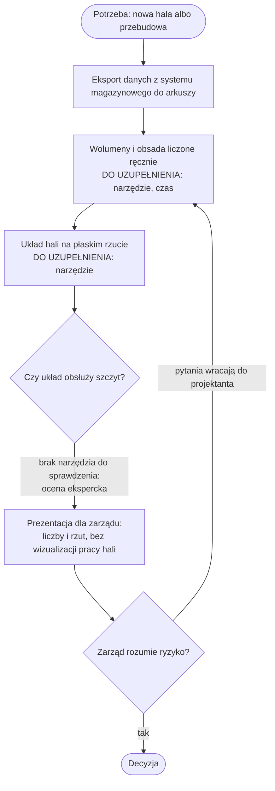
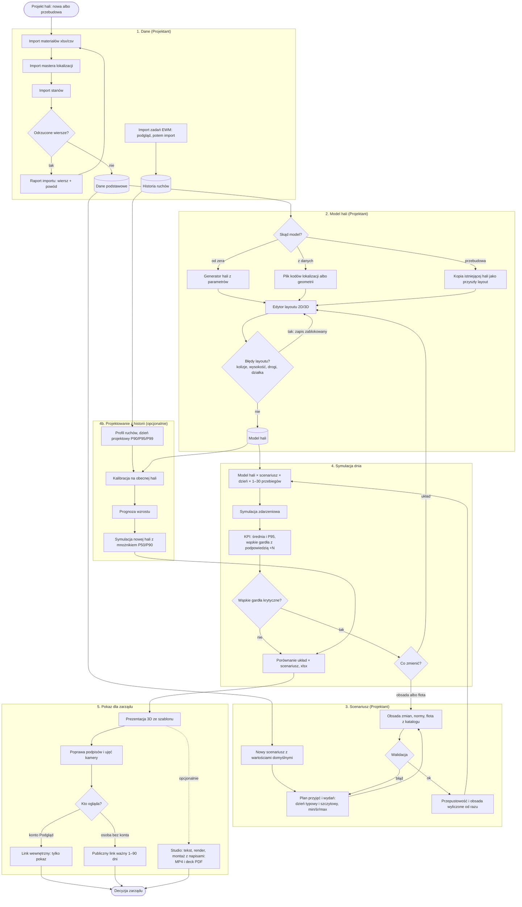

# 02. Proces biznesowy

Proces: **zaprojektowanie układu magazynu i uzasadnienie go przed zarządem.**

## Aktorzy

| Aktor | Typ | Udział w procesie |
|---|---|---|
| Projektant | człowiek (rola `Projektant`) | dane, model hali, scenariusz, symulacja, prezentacja |
| Zarząd | człowiek (rola `Podgląd` albo publiczny link) | ogląda pokaz, podejmuje decyzję |
| System magazynowy (WMS / SAP EWM) | system zewnętrzny | źródło plików: materiały, lokalizacje, stany, historia zadań — tylko eksport |
| Worker renderu | system (PC z Blenderem i ffmpeg) | renderuje ujęcia i montuje film (opcjonalnie) |
| Anthropic Claude | usługa zewnętrzna | szkic tekstów filmu (opcjonalnie) |

## PRZED — bez aplikacji

Stan przed: **brak narzędzia do wizualizacji i symulacji** (wywiad z autorem). Szczegóły kroków
i czasy są do uzupełnienia — diagram pokazuje tylko to, co wynika z problemu.

**Gdzie proces się sypie (z opisu problemu):**
- brak sposobu, by sprawdzić dzień szczytowy przed budową — ryzyko wychodzi dopiero w eksploatacji;
- każda zmiana układu = ręczne przeliczenie od nowa;
- zarząd ocenia liczby, nie widzi przepływu;
- \<DO UZUPEŁNIENIA: konkretny przykład z praktyki\>.

## PO — z aplikacją

## Punkty decyzyjne

| Punkt | Kto decyduje | Na podstawie czego | Co dalej |
|---|---|---|---|
| Czy odrzucenia importu są akceptowalne? | Projektant | raport: wiersz + powód ([R-06](05-wymagania.md)) | popraw plik i zaimportuj ponownie albo kontynuuj |
| Czy mapowanie procesów EWM na rodzaje ruchu jest poprawne? | Projektant | podgląd 2000 wierszy przed importem | nadpisz mapowanie (`kod = rodzaj`) albo importuj |
| Czy layout przechodzi walidację? | system | reguły kolizji, wysokości, dróg, działki ([R-13…R-18](05-wymagania.md)) | błąd blokuje zapis; ostrzeżenie nie |
| Czy obsada pokrywa potrzebę? | Projektant | „Obsada: zakładana vs potrzebna” | zmiana zmian albo norm |
| Co zmienić przy wąskim gardle? | Projektant | wąskie gardła z podpowiedzią (+N osób, doków, wózków) | wróć do layoutu albo do scenariusza |
| Komu i na jak długo udostępnić pokaz? | Projektant | — | link dla roli Podgląd albo publiczny link z datą ważności |
| Czy zatwierdzić tekst filmu? | Projektant | teksty ujęć (szablon albo szkic z Claude) | dopiero po zatwierdzeniu render i montaż |

## Wejścia i wyjścia

| Krok | Wejście | Wyjście |
|---|---|---|
| Dane | pliki xlsx/csv z systemu magazynowego | materiały, master lokalizacji, stany, raport importu |
| Historia ruchów | eksport zadań magazynowych (do 300 MB) | partia zadań, statystyki, profil dnia |
| Model hali | parametry, plik albo kopia | model z regałami, elementami hali, słupami, działką |
| Scenariusz | założenia wolumenów, obsady, norm | przepustowość, obsada potrzebna |
| Symulacja | model × scenariusz | KPI, wąskie gardła, zdarzenia do animacji |
| Pokaz | wynik symulacji, model | prezentacja 3D, link |
| Film | KPI modelu, zatwierdzony tekst | MP4, napisy SRT, deck PDF |
