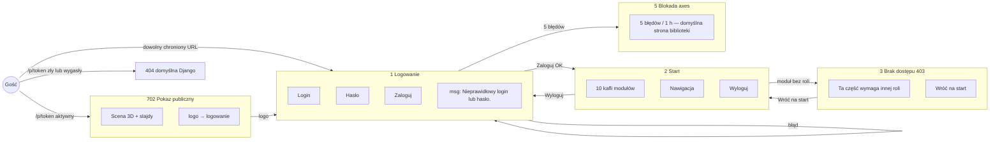
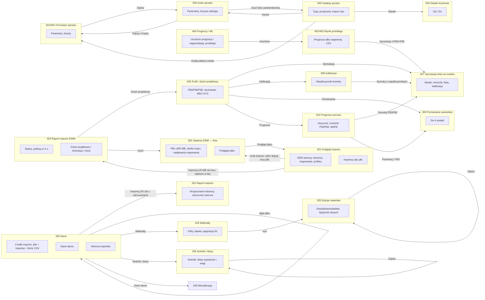
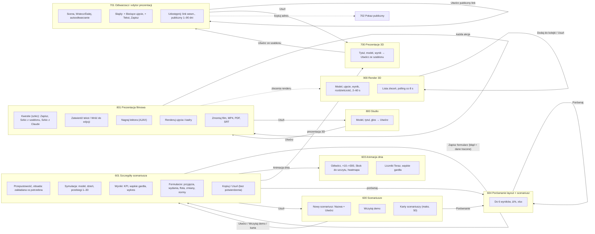

# 03. User flow — mapa ekranów i przejść

Mapa odtworzona z kodu (`*/urls.py`, widoki, szablony). Ścieżki względne do `web/`.

**Numeracja ekranów:** 1–9 wejście · 100+ modele hal · 200+ dane · 300+ zadania magazynowe i projektowanie ·
400+ prognozy i ML · 500+ sprzęt · 600+ scenariusze · 700+ prezentacje 3D · 800+ Studio · 900+ render.

Pasek nawigacji (10 modułów) jest taki sam dla każdej roli. Rola Podgląd widzi więc też moduły, które
dają jej 403 — opis w [Ścieżki ślepe](#ścieżki-ślepe).

Diagramy są podzielone na obszary — jeden diagram dla ~55 ekranów byłby nieczytelny. Każdy subgraf
to ekran z najważniejszymi elementami, strzałka to akcja użytkownika.

## Wejście, logowanie, role

## Modele hal (100+)

```mermaid
flowchart LR
    subgraph S100["100 Projektowanie (hub)"]
        a1["Kroki 1–7"]
        a2["kroki 3–7 aktywne po imporcie EWM"]
    end
    subgraph S101["101 Modele magazynu"]
        b1[Tabela modeli]
        b2["Generator hali / Nowy model"]
        b3["Wizualizacja · Edytor · Kopia · Współrzędne · Usuń"]
    end
    subgraph S102["102 Nowy model — plik lokalizacji"]
        c1["Nazwa, szer., głęb., plik CSV/TXT ≤5 MB"]
    end
    subgraph S103["103 Generator hali"]
        d1["13 parametrów, Przelicz"]
        d2[Utwórz model i pokaż w 3D]
    end
    subgraph S104["104 Współrzędne regałów"]
        e1["Tabela X, Y, kąt, szablon, numeracja"]
    end
    subgraph S105["105 Wklej adresy"]
        f1["Textarea adresów, orientacja, start X/Y"]
    end
    subgraph S106["106 Wizualizacja 3D / plan 2D"]
        g1[Scena 3D, legenda]
        g2[Animacja przepływów]
        g3["Eksport do Blendera (JSON)"]
    end
    subgraph S107["107 Elementy hali"]
        h1["Tabela: typ, rola doku, X, Y, wymiary"]
    end
    subgraph S108["108 Edycja stref"]
        i1["Przesuń X/Y, gniazda, poziomy, Usuń strefę"]
    end
    subgraph S109["109 Edytor layoutu"]
        j1["Plan 2D + podgląd 3D"]
        j2["KPI na żywo, Problemy"]
        j3["Cofnij / Ponów / Zapisz"]
        j4["Działka, słupy, podkład"]
    end
    subgraph S110["110 Usuń model"]
        k1["Tak, usuń model / Anuluj"]
    end
    subgraph S111["111 Wykryj z EWM"]
        l1["Propozycja szablonów i rzędów, Zapisz"]
    end
    subgraph S112["112 Zgodność z EWM"]
        m1["% zgodności per przejście, XLSX"]
    end
    subgraph S113["113 Typy regałów"]
        n1[Lista typów]
    end
    subgraph S114["114 Typ regału — formularz"]
        o1[Kod, wymiary, poziomy]
    end
    subgraph S115["115 Szablony gniazd"]
        q1[Lista, użycie]
    end
    subgraph S116["116 Szablon gniazda — formularz"]
        r1["Poziomy: litera, wysokość, typ, połówki"]
    end
    subgraph S117["117 Warianty projektu"]
        t1["Porównanie (maks. 6), import z Blendera"]
    end

    S100 -->|Generator hali| S103
    S100 -->|Modele hali| S101
    S100 -->|Warianty| S117
    S101 -->|Nowy model| S102
    S101 -->|Generator hali| S103
    S101 -->|Wizualizacja| S106
    S101 -->|Edytor layoutu| S109
    S101 -->|"Kopia (bez potwierdzenia)"| S109
    S101 -->|Współrzędne| S104
    S101 -->|Usuń| S110
    S101 -->|Typy regałów| S113
    S101 -->|Szablony gniazd| S115
    S102 -->|plik kodów| S104
    S102 -->|plik geometrii| S106
    S102 -->|błąd| S102
    S103 -->|Utwórz| S106
    S104 -->|Zapisz / Pomiń| S106
    S104 -->|Wklej adresy| S105
    S105 -->|Ustaw regały| S104
    S106 -->|Elementy hali| S107
    S106 -->|Edycja stref| S108
    S106 -->|Edytor layoutu| S109
    S106 -->|Wykryj z EWM| S111
    S106 -->|Zgodność z EWM| S112
    S106 -->|Symuluj scenariusz| S600[600 Scenariusze]
    S106 -->|Renderuj| S900[900 Render]
    S107 -->|Zapisz| S107
    S107 -->|Wróć| S106
    S108 -->|Zapisz| S106
    S109 -->|"Zapisz: 422 błędy / 409 konflikt"| S109
    S109 -->|Zobacz animację| S106
    S110 -->|Tak, usuń| S101
    S111 -->|Zapisz| S112
    S112 -->|Wykryj z EWM| S111
    S113 -->|Nowy / Edytuj| S114
    S114 -->|"Zapisz lub DOWOLNY błąd (dane tracone)"| S113
    S115 -->|Nowy / Edytuj| S116
    S116 -->|Zapisz OK| S115
    S116 -->|błąd| S116
```

## Dane, zadania EWM, projektowanie, ML, sprzęt (200–500)

## Scenariusze, prezentacje 3D, Studio, render (600–900)

## Tabela ekranów

| Nr | Ekran | Elementy | Akcja użytkownika | Prowadzi do |
|---|---|---|---|---|
| 1 | Logowanie | Login, Hasło, Zaloguj; „Nieprawidłowy login lub hasło.” | Zaloguj | 2 albo `next`; błąd → 1; 5 błędów → 5 |
| 2 | Start | 10 kafli modułów, nawigacja, Wyloguj | kafel / nav | moduł; brak roli → 3 |
| 3 | Brak dostępu (403) | „Ta część wymaga innej roli…”, Wróć na start | Wróć | 2 |
| 4 | Wylogowanie (akcja) | — | POST | 1 |
| 5 | Blokada logowania | domyślna strona django-axes | — | — (ślepa) |
| 100 | Projektowanie | kroki 1–7, warianty | kafel | 103, 300, 306–310, 101, 117 |
| 101 | Modele magazynu | tabela, Generator, Nowy model, akcje wiersza | Wizualizacja / Edytor / Kopia / Współrzędne / Usuń | 106 / 109 / 109 / 104 / 110 |
| 102 | Nowy model — plik | nazwa, wymiary, plik ≤5 MB | Wczytaj | 104 (kody) / 106 (geometria) / 102 (błąd) |
| 103 | Generator hali | 13 parametrów, podsumowanie | Przelicz / Utwórz | 103 / 106 |
| 104 | Współrzędne regałów | tabela X/Y/kąt/szablon/numeracja | Zapisz / Pomiń / Wklej | 106 / 106 / 105 |
| 105 | Wklej adresy | textarea, orientacja, start X/Y | Ustaw regały | 104; brak adresów → 105 |
| 106 | Wizualizacja | 3D/2D, legenda, animacja przepływów, eksport | przyciski nagłówka | 104, 105, 107–109, 111, 112, 600, 900, plik JSON |
| 107 | Elementy hali | tabela elementów | Zapisz / Wróć | 107 / 106 |
| 108 | Edycja stref | przesunięcia, gniazda, poziomy, usuń strefę | Zapisz / Anuluj | 106; ujemne X/Y → 108 |
| 109 | Edytor layoutu | plan 2D, 3D, KPI, Problemy, działka, słupy, podkład | Zapisz / Cofnij / Ponów | 109 (422 błędy, 409 konflikt); 106 |
| 110 | Usuń model | potwierdzenie | Tak / Anuluj | 101 |
| 111 | Wykryj z EWM | propozycja szablonów i rzędów | Zapisz | 112 |
| 112 | Zgodność z EWM | kafle, tabela per przejście | XLSX / Wykryj / Wróć | plik / 111 / 106 |
| 113 | Typy regałów | lista | Nowy / Edytuj / Usuń | 114 / 113 |
| 114 | Typ regału — formularz | kod, wymiary, poziomy, kolumny JSON | Zapisz | 113 (sukces i każdy błąd) |
| 115 | Szablony gniazd | lista, użycie | Nowy / Edytuj / Usuń | 116 / 115 |
| 116 | Szablon gniazda — formularz | pola + tabela poziomów | Zapisz | 115; błąd → 116 |
| 117 | Warianty projektu | porównanie, import JSON, wariant bazowy | Porównaj / Importuj / Usuń | 117 |
| 200 | Dane | kafle importu, demo, historia | Importuj / Wzór / Demo | 202 / plik / 106 |
| 202 | Raport importu | kolumny, odrzucone wiersze | okruszek | 200 |
| 204 | Materiały | filtry, tabela | kod | 205 |
| 205 | Edycja materiału | formularz, „Spójność danych” | Zapisz | 205 |
| 206 | Nośniki i klasy | dwa formularze | Zapisz | 206 |
| 300 | Zadania EWM | formularz pliku, lista importów | Podgląd pliku | 301 |
| 301 | Podgląd importu | kolumny, mapowanie, próbka 15 | Importuj cały plik / Wgraj inny | 303 / 300 |
| 303 | Raport importu EWM | status + polling, statystyki | Dzień projektowy / Usuń | 306 / 300 |
| 306 | Profil i dzień projektowy | percentyl, strumienie, wykresy | linki | 307–310 |
| 307 | Symulacja dnia na modelu | parametry, wynik floty | Symuluj | 307 |
| 308 | Kalibracja | model obecnej hali | Policz / Symuluj z współczynnikami | 308 / 307 |
| 309 | Porównanie wariantów hali | do 4 modeli | Porównaj | 309 |
| 310 | Prognoza wzrostu | horyzont, mnożnik | Przelicz / Symuluj P50/P90 | 310 / 307 / 309 |
| 400 | Prognozy i ML | formularze, przebiegi | Uruchom | 402/403 |
| 402/403 | Prognoza / Segmentacja | wynik, wykres, CSV | Symulacja ×P | 307 / plik |
| 500 | Katalog sprzętu | zakładki, import, tabela | nazwa / Dodaj / Stawki | 505 / 501 / 506 |
| 501/502 | Formularz sprzętu | parametry, koszty | Zapisz / Anuluj | 505 / 500 |
| 505 | Karta sprzętu | parametry, krzywa | Edytuj / Kopiuj / Usuń | 502 / 502 / 500 |
| 506 | Stawki kosztowe | tabela od–do | Zapisz | 506 |
| 600 | Scenariusze | nowy, demo, lista | Utwórz / demo / karta / Porównanie | 601 / 601 / 601 / 604 |
| 601 | Szczegóły scenariusza | przepustowość, obsada, symulacja, wyniki, formularze | Uruchom / Zapisz / Animacja / Kopiuj / Usuń | 601 / 601 / 603 / 601 / 600 |
| 603 | Animacja dnia | odtwarzacz 3D, liczniki, wąskie gardła | odtwarzanie | 603 |
| 604 | Porównanie layout × scenariusz | checkboxy (do 6), tabela Δ% | Porównaj / xlsx | 604 / plik |
| 700 | Prezentacje 3D | formularz, lista | Utwórz ze szablonu | 701 |
| 701 | Prezentacja — odtwarzacz i edytor | scena, slajdy, udostępnianie | Zapisz / link / Usuń | 701 / 701 / 700 |
| 702 | Pokaz publiczny | scena, slajdy | — | (logo → 1) |
| 800 | Studio | formularz, lista filmów | Utwórz | 801 |
| 801 | Prezentacja filmowa | kwestie, lektor, render, montaż, deck | etapy pipeline'u | 801 / pliki / 800 |
| 900 | Render 3D | formularz zlecenia, lista, worker | Dodaj / Usuń | 900 |

Pliki (bez ekranu): 203 wzór CSV, 404 segmenty CSV, 508 wzór sprzętu, 605/607 xlsx, 606 zdarzenia JSON,
802 MP4, 803 PDF, 804 SRT, 805 MP3, 901 PNG/MP4.

## Ścieżki alternatywne

| Sytuacja | Zachowanie |
|---|---|
| Gość | każdy URL → 1; wyjątek `/p/<token>/` (702) i `/health/` |
| Zalogowany bez grupy | widzi 2 (Start), każdy moduł → 403 |
| Podgląd | czyta wyniki; Dane-import, materiały, wszystkie ekrany 300–305, formularze → 403; scena 3D bez SKU/HU/kodów (`warehouse_blender.py:19-40`) |
| Modal vs pełna strona | **brak modali** — wszystkie ekrany to pełne strony; potwierdzenia przez `confirm()` JS tylko w 4 miejscach (import EWM, typy regałów, szablony gniazd, warianty) |
| Błąd walidacji | trzy różne wzorce: (a) ten sam ekran z danymi (102, 116, 205, 501), (b) redirect z komunikatem, dane tracone (601, 108, 114), (c) cicha korekta (104 pomija wiersz, 107 wartości domyślne) |
| Przerwanie procesu | edytor: ostrzeżenie `beforeunload`; prezentacja 3D: to samo; import EWM: brak anulowania (tylko „Wstrzymaj odświeżanie”) |
| Długie operacje | import EWM >5 MB w wątku + polling; render/montaż przez kolejkę + polling; symulacja, import Danych, ML, szkic z Claude — **synchronicznie** w żądaniu (limit gunicorna 120 s) |

## Ścieżki ślepe

1. **Przyciski widoczne dla Podglądu, które dają 403**: „Zadania EWM” w nawigacji; 106 „Wklej adresy / Elementy hali / Edytuj współrzędne” (`view.html:146,149,176`); 113 Nowy/Edytuj/Usuń (`rack_type_list.html:20,58,90`); 100 kafle 1–2 (`design_hub.html:31,34`); okruszki na 306–310 prowadzą do 300 (403).
2. **Puste stany instruują Podgląd do akcji, których nie może wykonać** (`warehouse_variants/list.html:104`, `bay_templates.html:66`, `warehouse_model/list.html:96`).
3. **Usuwanie bez potwierdzenia**: scenariusz, prezentacja 3D, prezentacja Studio, zlecenie renderu, sprzęt, slajd, „Zastąp slajdy szablonem”.
4. **Utrata wpisanych danych po błędzie**: formularze scenariusza (`scenario/views.py:306-364`), typ regału (`warehouse_racktype.py:28-108`), edycja stref (`warehouse_variant_edit.py:69`).
5. **Sukces mimo pominięcia**: 104 pomija wiersz nieliczbowy i pisze „Współrzędne zapisane.” (`warehouse_model.py:212,235`); 107 zamienia złe liczby na domyślne (`shared.py:150-154`); import sprzętu z samymi odrzuceniami pokazuje zielony sukces (`equipment/views.py:124`).
6. **Brak informacji zwrotnej przy błędzie sieci/sesji**: AJAX po wygaśnięciu sesji pokazuje „Brak połączenia z serwerem” (`showcase.js:221`, `studio/detail.html:263`); `play.html:141`, `showcase.js:13,26`, `layout-editor.js:235` bez `res.ok`/`catch`.
7. **Brak własnych stron 404/500** — wygasły link publiczny, partia nie-`done`, usunięty wynik → domyślna strona Django bez nawigacji.
8. **Strony 405** przy wejściu GET na URL tylko-POST (np. `uklad/zapisz/`).
9. **Zlecenia bez workera** czekają w kolejce bez końca — jest tylko tekst informacyjny (`render/jobs.html:67`).
10. **Import EWM „wiszący”** (restart serwera) — jedyne wyjście to Usuń i wgraj ponownie (`ewm_tasks/detail.html:48`).
11. **Nazwa modelu nie wyświetla się w potwierdzeniu usunięcia** — widok przekazuje `object`, szablon czyta `wm` (`warehouse_model.py:357` vs `confirm_delete.html:19`).
