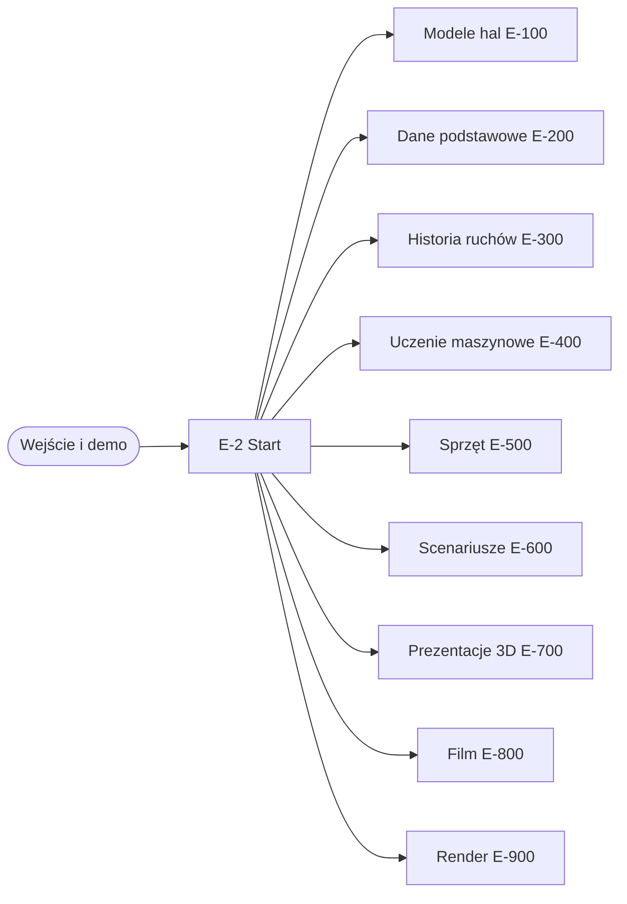
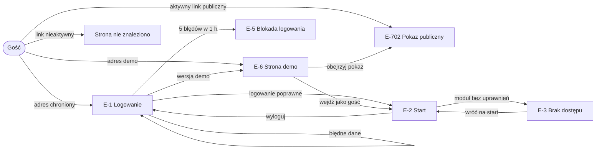
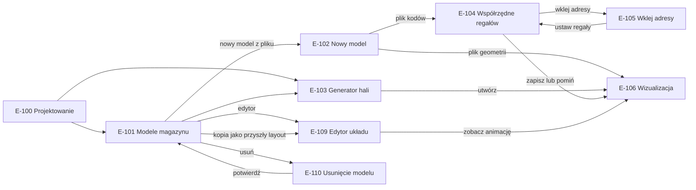
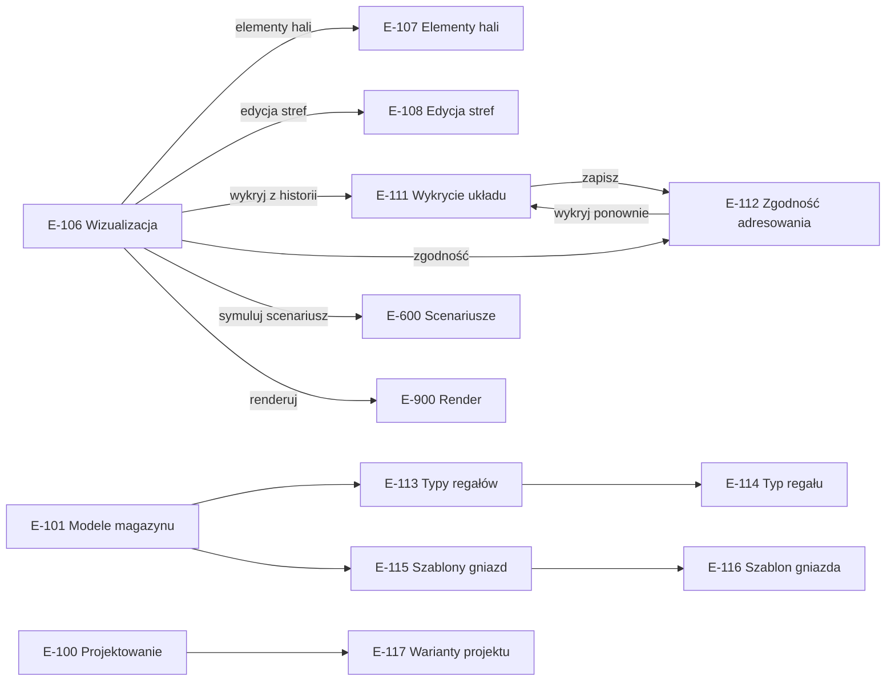
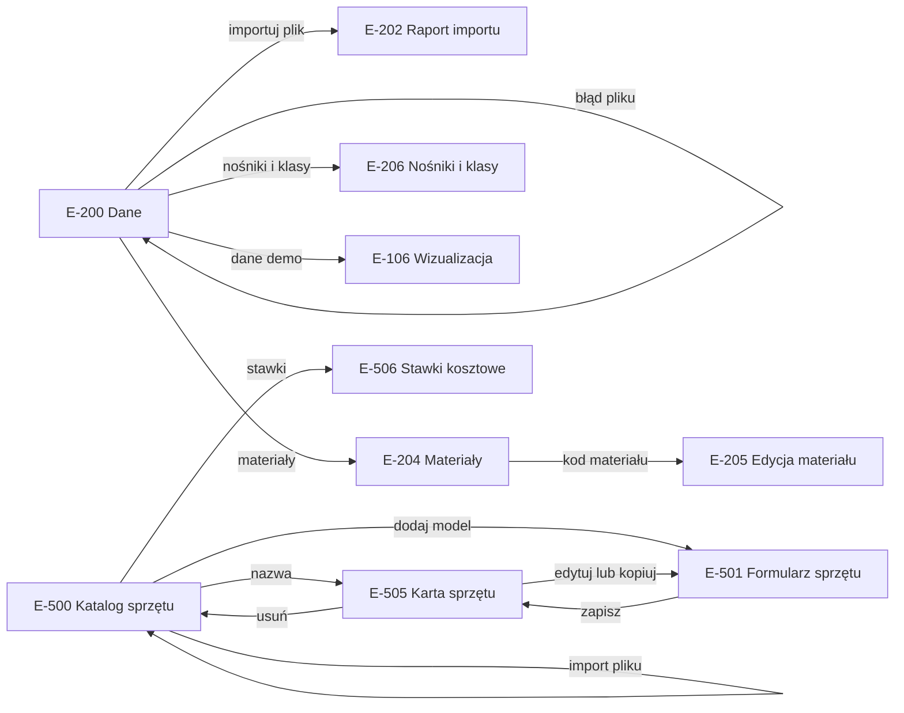
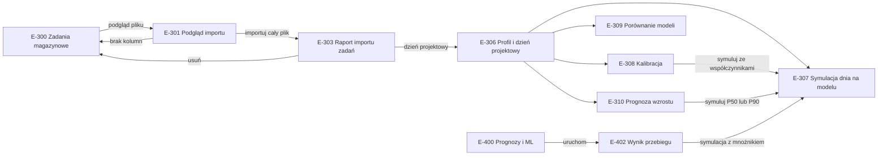
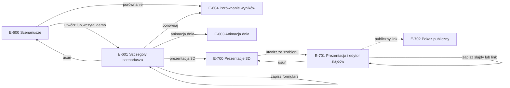
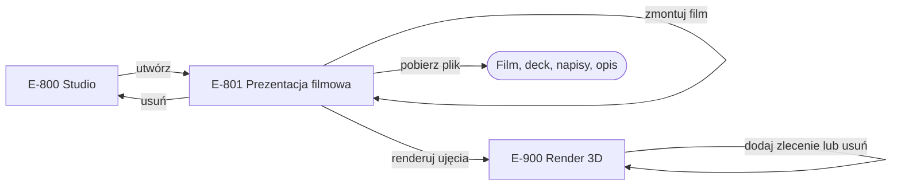

# User flow — mapa ekranów i przejść

Mapa ekranów odtworzona z adresów, widoków i szablonów aplikacji. Ekrany mają numery **E-n** pogrupowane
obszarami: E-1…E-9 wejście, E-100 modele hal, E-200 dane podstawowe, E-300 historia ruchów i projektowanie,
E-400 uczenie maszynowe, E-500 sprzęt, E-600 scenariusze, E-700 prezentacje 3D, E-800 film, E-900 render.

**Uprawnienia w skrócie:** „każda rola” = Administrator, Projektant i Podgląd; „Projektant” = Projektant
i Administrator. Szczegóły ról: [P8](../01-procesy/P8-dostep-i-demo.md).

**Wspólne zasady ekranów:**
- wszystkie ekrany są pełnymi stronami (bez okien modalnych);
- pasek nawigacji z 10 modułami jest taki sam dla każdej roli — rola Podgląd widzi też moduły, które
  dają jej stronę braku uprawnień ([ograniczenia](../05-decyzje-i-ograniczenia.md#znane-ograniczenia));
- strzałka na diagramie = akcja użytkownika; linia przerywana = przejście przez link skopiowany poza system.

## Mapa obszarów

Diagram pokazuje, że wszystkie obszary są dostępne ze strony startowej; szczegóły każdego obszaru — niżej.

## UF-1. Wejście, logowanie i demo publiczne

Gość bez konta ma trzy drogi: logowanie, publiczny pokaz z linku albo strona demo. „Wejdź jako gość” jest
widoczne tylko przy włączonym demo publicznym i loguje na konto demo z rolą Podgląd.

## UF-2. Modele hal — tworzenie i edycja

Model hali powstaje generatorem (E-103) albo z pliku (E-102). Plik kodów lokalizacji prowadzi przez
rozmieszczenie regałów (E-104, E-105), plik geometrii — od razu do wizualizacji. Edytor (E-109) przy zapisie
odrzuca plan z błędami albo zmieniony równolegle przez inną osobę.

## UF-3. Model hali — ekrany pomocnicze

Wizualizacja (E-106) jest węzłem, z którego Projektant przechodzi do szczegółowej edycji, odwzorowania
adresowania z mastera lokalizacji, symulacji i renderu. Typy regałów, szablony gniazd i warianty to
katalogi pomocnicze.

## UF-4. Dane podstawowe i katalog sprzętu

Import danych zawsze kończy się raportem (E-202). Import sprzętu wraca na listę katalogu z komunikatami.
Usunięcie sprzętu nie ma ekranu potwierdzenia.

## UF-5. Historia ruchów, projektowanie i uczenie maszynowe

Import zadań ma dwa kroki: bezpieczny podgląd (bez zapisu) i właściwy import. Duży plik importuje się w tle,
a raport (E-303) sam odświeża status.

## UF-6. Scenariusze i prezentacje 3D

Scenariusz (E-601) łączy definicję, uruchomienie i wyniki na jednym ekranie. Pokaz publiczny (E-702) otwiera
się z linku przekazanego poza system.

## UF-7. Film i render

Prezentacja filmowa (E-801) przechodzi wszystkie etapy na jednym ekranie; zlecenia renderu są widoczne
także na liście E-900. Ekran sam odświeża status zleceń.

## Opis ekranów

### Wejście

| Ekran | Cel | Wejścia | Akcje | Warunki dostępu |
|---|---|---|---|---|
| E-1 Logowanie | uwierzytelnić użytkownika | login, hasło | zaloguj; link do demo (gdy demo publiczne włączone) | wszyscy |
| E-2 Start | wybrać moduł | — | 10 kafli modułów, nawigacja, wyloguj | zalogowany |
| E-3 Brak dostępu | wyjaśnić brak roli | — | wróć na start | zalogowany bez wymaganej roli |
| E-5 Blokada logowania | zatrzymać zgadywanie hasła | — | brak (strona standardowa biblioteki) | po 5 nieudanych próbach (login + adres IP) przez 1 h |
| E-6 Strona demo | wpuścić osobę z zewnątrz bez hasła | — | obejrzyj pokaz 3D, wejdź jako gość, obejrzyj film | wszyscy; „wejdź jako gość” tylko przy włączonym demo publicznym |
| E-702 Pokaz publiczny | pokazać prezentację 3D bez konta | klucz w adresie | przewijanie slajdów, obrót sceny | aktywny i nieprzeterminowany link |

### Modele hal

| Ekran | Cel | Wejścia | Akcje | Warunki dostępu |
|---|---|---|---|---|
| E-100 Projektowanie | poprowadzić przez kroki projektu | — | kroki 1–7 (kroki 3–7 aktywne po imporcie zadań), warianty | każda rola |
| E-101 Modele magazynu | zarządzać modelami hal | — | generator, nowy model, wizualizacja, edytor, kopia, współrzędne, usuń | lista: każda rola; akcje zmieniające: Projektant |
| E-102 Nowy model | utworzyć model z pliku | nazwa, wymiary hali, plik kodów lokalizacji lub geometrii (≤ 5 MB) | wczytaj | Projektant |
| E-103 Generator hali | utworzyć model z parametrów | 13 parametrów | przelicz, utwórz | Projektant |
| E-104 Współrzędne regałów | rozmieścić regały | X, Y, kąt, szablon, numeracja | zapisz, pomiń, wklej adresy | Projektant |
| E-105 Wklej adresy | utworzyć regały z listy adresów | lista adresów, orientacja, punkt startu | ustaw regały | Projektant |
| E-106 Wizualizacja | obejrzeć model w 3D i 2D | — | animacja przepływów, eksport sceny, przejścia do edycji, symulacji i renderu | każda rola (Podgląd widzi scenę bez danych źródłowych) |
| E-107 Elementy hali | edytować doki, strefy i drogi tabelą | rodzaj, rola doku, położenie, wymiary | zapisz, wróć | Projektant |
| E-108 Edycja stref | przesunąć i przebudować strefy | przesunięcie, gniazda, poziomy | zapisz, usuń strefę | Projektant |
| E-109 Edytor układu | narysować i sprawdzić układ | plan 2D, działka, słupy, podkład | cofnij, ponów, zapisz; problemy i KPI na żywo | Projektant |
| E-110 Usunięcie modelu | potwierdzić usunięcie | — | potwierdź, anuluj | Projektant |
| E-111 Wykrycie układu | zaproponować szablony i rzędy z mastera lokalizacji | — | zapisz | Projektant |
| E-112 Zgodność adresowania | sprawdzić zgodność modelu z masterem | — | eksport xlsx, wykryj ponownie | Projektant |
| E-113 / E-114 Typy regałów | utrzymać wzorce regałów | kod, wymiary, poziomy | nowy, edytuj, usuń | lista: każda rola; zmiany: Projektant |
| E-115 / E-116 Szablony gniazd | utrzymać wzorce adresowania | poziomy: litera, wysokość, typ, podział | nowy, edytuj, usuń | lista: każda rola; zmiany: Projektant |
| E-117 Warianty projektu | porównać warianty KPI | plik wariantu (≤ 5 MB) | porównaj (do 6), importuj, utwórz z modelu, usuń | lista i porównanie: każda rola; zmiany: Projektant |

### Dane podstawowe i sprzęt

| Ekran | Cel | Wejścia | Akcje | Warunki dostępu |
|---|---|---|---|---|
| E-200 Dane | wczytać dane podstawowe | plik materiałów, lokalizacji lub stanów | importuj, pobierz wzór, dane demo, historia importów | ekran: każda rola; import i dane demo: Projektant |
| E-202 Raport importu | pokazać wynik importu | — | — | Projektant (raport zawiera dane źródłowe) |
| E-204 Materiały | przeglądać kartotekę | filtry | otwórz materiał | Projektant |
| E-205 Edycja materiału | poprawić dane materiału | wymiary, cechy, klasy, ABC | zapisz | Projektant |
| E-206 Nośniki i klasy | utrzymać słowniki palet | nośniki, klasy wysokości i wagi | zapisz | Projektant |
| E-500 Katalog sprzętu | przeglądać sprzęt | filtr typu i producenta, plik importu | otwórz, dodaj, importuj, stawki | lista: każda rola; dodawanie i import: Projektant |
| E-501 Formularz sprzętu | wpisać parametry | typ, nazwa, parametry, osprzęt, koszty | zapisz, anuluj | Projektant; edycja własnego modelu: jego autor albo Administrator; klasa systemowa: tylko Administrator |
| E-505 Karta sprzętu | obejrzeć parametry i krzywą udźwigu | — | edytuj, kopiuj, usuń | każda rola; kopiowanie: Projektant; edycja i usuwanie: autor modelu albo Administrator (klas systemowych nie da się usunąć) |
| E-506 Stawki kosztowe | utrzymać widełki kosztów | od, do | zapisz | Projektant |

### Historia ruchów, projektowanie i ML

| Ekran | Cel | Wejścia | Akcje | Warunki dostępu |
|---|---|---|---|---|
| E-300 Zadania magazynowe | wczytać eksport zadań | plik (≤ 300 MB), strefa czasowa, nadpisania mapowania | podgląd pliku, lista importów | Projektant |
| E-301 Podgląd importu | sprawdzić plik przed zapisem | — | importuj cały plik, wgraj inny | Projektant |
| E-303 Raport importu zadań | śledzić import i jego wynik | — | dzień projektowy, animacja, usuń | Projektant |
| E-306 Profil i dzień projektowy | wyznaczyć dzień, na który projektujemy | percentyl P90/P95/P99 | przejścia do symulacji, kalibracji, porównania, prognozy | każda rola |
| E-307 Symulacja dnia na modelu | sprawdzić układ na dniu projektowym | model, mnożnik, flota, kalibracja | symuluj | każda rola |
| E-308 Kalibracja | wyznaczyć normy z historii | model obecnej hali | policz, symuluj ze współczynnikami | każda rola |
| E-309 Porównanie modeli | porównać do 4 modeli na jednym dniu | modele | porównaj | ekran: każda rola; obliczenie: Projektant |
| E-310 Prognoza wzrostu | ocenić przyszły wolumen | horyzont | przelicz, symuluj P50/P90, porównaj | każda rola |
| E-400 Prognozy i ML | uruchomić modele ML | partia, parametry | uruchom prognozę lub segmentację | ekran: każda rola; uruchomienie: Projektant |
| E-402 Wynik przebiegu | obejrzeć prognozę albo segmenty | — | symulacja z mnożnikiem; eksport segmentów | każda rola; eksport segmentów: Projektant |

### Scenariusze, prezentacje, film i render

| Ekran | Cel | Wejścia | Akcje | Warunki dostępu |
|---|---|---|---|---|
| E-600 Scenariusze | zarządzać scenariuszami | nazwa | utwórz, wczytaj demo, porównanie | lista: każda rola; tworzenie: Projektant |
| E-601 Szczegóły scenariusza | zdefiniować dzień, uruchomić symulację, ocenić wynik | przyjęcia, wydania, flota, zmiany, normy, model, dzień, liczba przebiegów | zapisz, uruchom, animacja, kopiuj, usuń | podgląd: każda rola; zmiany i uruchomienie: Projektant |
| E-603 Animacja dnia | zobaczyć przebieg dnia w 3D | tempo ×10–×300 | odtwórz, skok do szczytu, mapa ciepła | każda rola |
| E-604 Porównanie wyników | porównać wyniki obok siebie | do 6 wyników | porównaj, eksport xlsx | każda rola |
| E-700 Prezentacje 3D | utworzyć pokaz | tytuł, model, wynik | utwórz ze szablonu | lista: każda rola; tworzenie: Projektant |
| E-701 Prezentacja i edytor slajdów | przygotować i udostępnić pokaz | slajdy, ujęcia kamery, ważność linku | zapisz, zastąp szablonem, utwórz lub wyłącz link, usuń | oglądanie: każda rola; edycja i link: Projektant |
| E-800 Studio | utworzyć film | model, tytuł | utwórz | lista: każda rola; tworzenie: Projektant |
| E-801 Prezentacja filmowa | przejść od tekstu do filmu | teksty ujęć | szkic z szablonu lub z AI, zatwierdź, wróć do edycji, renderuj, zmontuj, pobierz film, deck, napisy, opis | oglądanie i pobieranie: każda rola; etapy: Projektant |
| E-900 Render 3D | zlecić i śledzić render | model, ujęcie, wynik, rozdzielczość, długość 2–60 s | dodaj do kolejki, usuń, pobierz wynik | lista i pobieranie: każda rola; zlecanie i usuwanie: Projektant |

## Ścieżki alternatywne w nawigacji

| Sytuacja | Zachowanie |
|---|---|
| Gość otwiera dowolny chroniony adres | przekierowanie do E-1; wyjątki: E-6, E-702, adres kontroli działania serwera |
| Zalogowany bez roli | widzi E-2, każdy moduł kończy się E-3 |
| Podgląd otwiera ekran Projektanta | E-3 (także z przycisków i pozycji menu, które są dla niego widoczne) |
| Błąd walidacji formularza | trzy różne zachowania: ten sam ekran z danymi (E-102, E-116, E-205, E-501); powrót z komunikatem i utratą wpisanych danych (E-601, E-108, E-114); cicha korekta (E-104 pomija wiersz, E-107 wstawia wartości domyślne) |
| Opuszczenie ekranu z niezapisanymi zmianami | ostrzeżenie przeglądarki w E-109 i E-701 |
| Długa operacja | import zadań > 5 MB w tle z odświeżaniem statusu; render i montaż przez kolejkę z odświeżaniem; symulacja, import danych, ML i szkic z AI — w trakcie żądania ([Z-6](../00-przeglad.md#założenia-wymagające-potwierdzenia)) |
| Link publiczny nieaktywny albo usunięty obiekt | standardowa strona „nie znaleziono” bez nawigacji |

## Podstawa w kodzie

`web/*/urls.py`, `web/core/views.py` (start, demo), `web/core/roles.py` (role), `web/core/context_processors.py`
(nawigacja), widoki modułów `web/twin/views/`, `web/masterdata/views.py`, `web/equipment/views.py`,
`web/scenario/views*.py`, `web/studio/views.py`, `web/render/views.py`, `web/ml/views.py`.
