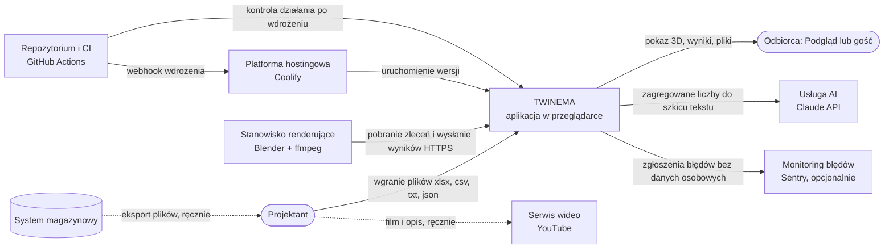

# Integracje

System **nie ma integracji na żywo z systemem magazynowym** — dane wchodzą wyłącznie przez pliki wgrywane przez
Projektanta ([decyzja D1](05-decyzje-i-ograniczenia.md#d1-dane-tylko-z-plików-bez-integracji-na-żywo)).
Jedynym interfejsem maszynowym w czasie pracy jest API dla stanowiska renderującego. Pozostałe punkty styku
to opcjonalna usługa AI, usługi wdrożeniowe i ręczna publikacja filmu.

## Diagram kontekstu

Linie przerywane to przepływy ręczne, poza systemem. Strzałka wskazuje stronę inicjującą połączenie.

## Tabela interfejsów

| Nr | Interfejs | Kierunek | Format | Częstotliwość | Obsługa błędów |
|---|---|---|---|---|---|
| I-1 | Import materiałów, mastera lokalizacji, stanów ([P1](01-procesy/P1-dane-podstawowe.md)) | plik → system | xlsx, xlsm, csv, txt; do 25 MB i 300 000 wierszy | na żądanie Projektanta | wiersze błędne odrzucane z powodem (próbka 200); brak kolumn wymaganych lub zły format → cały plik odrzucony; zapis w jednej transakcji |
| I-2 | Import zadań magazynowych ([P2](01-procesy/P2-historia-ruchow-i-prognoza.md)) | plik → system | xlsx, csv; do 300 MB | na żądanie; podgląd przed zapisem | brak kolumn → import zablokowany; wiersze błędne liczone i pokazane (do 50); plik > 5 MB w tle, status „błąd” z opisem; import zawieszony po restarcie oznaczany po 6 h |
| I-3 | Import kodów lokalizacji, geometrii hali, wariantu z pliku 3D ([P3](01-procesy/P3-model-hali.md)) | plik → system | csv/txt (kody, ≤ 5 MB), json (geometria, wariant, ≤ 5 MB), obraz podkładu (≤ 10 MB) | na żądanie | komunikat o błędzie formatu; model nie powstaje |
| I-4 | Import sprzętu ([P4](01-procesy/P4-katalog-sprzetu.md)) | plik → system | xlsx, csv; do 5 MB | na żądanie | wiersze odrzucane z powodem; nazwy klas systemowych pomijane |
| I-5 | Eksporty (wzory, wyniki, porównania, zgodność adresowania, segmenty, scena) | system → plik | xlsx, csv, json | na żądanie | — |
| I-6 | Pobranie zlecenia przez stanowisko renderujące ([P7](01-procesy/P7-film-i-deck.md)) | stanowisko → system | HTTPS, odpowiedź JSON; nagłówek z tokenem stanowiska (≥ 32 znaki) | odpytywanie co 10 s (domyślnie) | brak zleceń → pusta odpowiedź; zły token → odmowa; zlecenie przejmuje tylko jedno stanowisko (jednorazowy klucz przejęcia) |
| I-7 | Pobranie sceny i klipów do montażu | stanowisko → system | HTTPS, JSON (scena), MP4 (klipy) | przy każdym zleceniu | zły klucz przejęcia → odmowa (spóźnione stanowisko nie nadpisze wyniku) |
| I-8 | Odesłanie wyniku albo błędu | stanowisko → system | HTTPS, formularz z plikiem PNG/MP4 i dziennikiem | po zakończeniu zlecenia | plik > 500 MB albo bez sygnatury PNG/MP4 → odrzucony; zgłoszenie błędu zapisuje opis; zlecenie bez wyniku ponad 120 min wraca do kolejki przy kolejnym odpytaniu |
| I-9 | Szkic tekstów filmu z AI | system → usługa AI | HTTPS, zapytanie ze zdaniami z zagregowanymi liczbami; odpowiedź ustrukturyzowana | na żądanie Projektanta | brak klucza → funkcja wyłączona z komunikatem; klucz odrzucony → komunikat; limit 90 s, 1 ponowienie; tekst trafia do szkicu i wymaga zatwierdzenia |
| I-10 | Wdrożenie po scaleniu zmian | CI → platforma hostingowa | HTTPS webhook z tokenem | po każdym scaleniu do gałęzi głównej | 3 próby z odstępem; brak adresu → krok pominięty z ostrzeżeniem |
| I-11 | Kontrola działania po wdrożeniu | CI → system | HTTPS GET, JSON (status, baza, wersja, czas) | po wdrożeniu: do 20 prób co 12 s | baza niedostępna → odpowiedź 503; brak nowej wersji w oknie → ostrzeżenie |
| I-12 | Biblioteki przeglądarki (scena 3D, wykresy) | internet → obraz aplikacji | pliki JS z sumą SHA-256 | przy budowie obrazu | suma niezgodna → budowa przerwana; w czasie pracy brak zależności od CDN |
| I-13 | Kontrole bezpieczeństwa repozytorium | CI → repozytorium | skan sekretów, audyt zależności | przy zmianach i co tydzień | wynik w CI |
| I-14 | Zgłaszanie błędów aplikacji | system → monitoring | HTTPS, zdarzenia błędów i próbka 20% wydajności, bez danych osobowych, z wersją | przy wystąpieniu błędu | włączone tylko po podaniu adresu usługi; brak adresu → wyłączone |
| I-16 | Powiadomienie o nowym odwiedzającym demo | system → usługa ntfy | HTTPS POST, tekst „imię nazwisko (firma) wszedł do twinema” (≤ 300 znaków), opcjonalnie token Bearer | po każdym poprawnym przedstawieniu się w bramce demo; drugi raz (tytuł „Gosc oglada demo”, tekst „… obejrzał już N ekranów w twinema”), gdy gość obejrzy `NTFY_ENGAGED_VIEWS` ekranów (domyślnie 10, 0 = wyłączone); firma zawierająca frazę z `NTFY_WATCH_COMPANIES` → priorytet `urgent` i tytuł „UWAGA firma z listy” | wysyłka w tle, limit 5 s, błąd → ostrzeżenie w logach, gość wchodzi normalnie; brak `NTFY_URL` → wyłączone |
| I-15 | Publikacja filmu | Projektant → serwis wideo | MP4, napisy SRT, opis TXT z rozdziałami | ręcznie | poza systemem |

## Zasady wymiany danych

- **Do usługi AI trafiają tylko zagregowane liczby** (KPI modelu w zdaniach), bez nazwy modelu, materiałów,
  lokalizacji i danych źródłowych ([D13](05-decyzje-i-ograniczenia.md#d13-do-ai-tylko-zagregowane-liczby-tekst-zatwierdza-człowiek)).
- **Stanowisko renderujące łączy się samo z serwerem** — serwer nie potrzebuje otwartych portów ani kolejki
  zewnętrznej; wyłączone stanowisko = zlecenia czekają ([D5](05-decyzje-i-ograniczenia.md#d5-kolejka-renderów-bez-celery-worker-odpytuje-serwer)).
- **Montaż** stanowisko wykonuje tylko wtedy, gdy kolejka renderów jest pusta i ma ffmpeg ≥ 6.1 oraz czcionkę;
  muzyka jest opcjonalna.
- **Publiczne strony pokazu** nie są indeksowane i nie przekazują swojego adresu innym serwisom.

## Podstawa w kodzie

`web/render/api.py`, `web/studio/api.py` (API stanowiska), `tools/render_worker.py`, `tools/twinema_montage.py`,
`web/studio/script_ai.py` (usługa AI), `web/core/visitor_notify.py` (ntfy), `web/core/health_urls.py` (kontrola działania),
`.github/workflows/deploy.yml`, `ci.yml`, `security.yml`, `web/scripts/fetch_vendor.sh`, importery w
`web/masterdata/importers.py`, `web/twin/`, `web/equipment/importers.py`.
