# 04. Model danych

32 encje w 8 obszarach (Django ORM, PostgreSQL w produkcji, SQLite lokalnie). Ścieżki względne do `web/`.

## Diagram ERD

Atrybuty skrócone do kluczowych. Pole `created_by` / `uploaded_by` (FK do użytkownika, przy usunięciu
użytkownika `SET_NULL`) mają: ImportLog, Scenario, ScenarioRun, Showcase, Equipment, RenderJob,
Presentation, ModelRun, WarehouseTaskBatch — pominięte na diagramie.

```mermaid
erDiagram
    %% ── Dane podstawowe (masterdata) ──
    ImportLog ||--o{ StockItem : "partia stanów"
    Carrier |o--o{ Material : "nośnik"
    PalletClass |o--o{ Material : "klasa wys./wagi"
    ImportLog {
        string kind "materials|locations|stock"
        int rows_ok
        int rows_rejected
        json rejects "próbka odrzuceń"
    }
    Material {
        string code UK
        string group
        float carton_dims_kg "sztuka/karton/paleta"
        int cartons_per_pallet
        string abc_manual "A|B|C|''"
        bool temp_controlled_adr_oversize_high_value
    }
    StockItem {
        string location_code "string, bez FK"
        string material_code "string, bez FK"
        float qty
        string hu
        date expiry
    }
    Carrier {
        string name UK
        bool is_default "jeden? tylko w widoku"
    }
    PalletClass {
        string kind "height|weight"
        float limit
    }

    %% ── Master lokalizacji i typy (twin) ──
    WarehouseLocationMasterBatch ||--o{ WarehouseLocationMaster : "import"
    WarehouseLocationMasterBatch {
        bool is_active "jeden aktywny? tylko w kodzie"
    }
    WarehouseLocationMaster {
        string location_code "UK w partii"
        string warehouse_type "łączy się z RackType.code (string)"
        int height_mm
        float max_weight_kg
        bool blocked_pick_put
    }
    WarehouseRackType {
        string code UK
        string kind "rack|zone"
        json level_heights
    }

    %% ── Model hali (twin) ──
    WarehouseModel ||--o{ WarehouseModelRack : "regały"
    WarehouseModel ||--o{ WarehouseHallFeature : "doki, strefy, drogi"
    WarehouseModel |o--o{ WarehouseDesignVariant : "model bazowy (SET_NULL)"
    BayTemplate |o--o{ WarehouseModelRack : "szablon gniazda (SET_NULL)"
    WarehouseModelRack ||--o{ LocationOverride : "wyjątki adresu"
    BayTemplate |o--o{ LocationOverride : "szablon wyjątku (PROTECT)"
    Equipment |o--o{ WarehouseModelRack : "sprzęt obsługi (SET_NULL)"
    WarehouseModel {
        float floor_width_m
        float floor_depth_m
        float clear_height_m "null"
        json columns "siatka słupów"
        json site "działka"
        file underlay "podkład"
    }
    WarehouseModelRack {
        string zone
        string rack_id "UK z model+zone"
        int n_bays
        int n_levels
        float x_m "null"
        float y_m "null"
        string equipment "reach|vna|shelf"
        int load_kg
    }
    WarehouseHallFeature {
        string kind "17 typów"
        string dock_role
        float x_y_w_d_angle
    }
    BayTemplate {
        int pallets_per_beam "1-10"
        json levels "litera, wys., typ, split"
    }
    LocationOverride {
        int bay
        string letter
        string action "8 typów"
    }
    WarehouseDesignVariant {
        string source "blender|model"
        json elements
        json kpi
    }

    %% ── Zadania EWM i ML ──
    WarehouseTaskBatch ||--o{ WarehouseTask : "import (CASCADE)"
    WarehouseTaskBatch ||--o{ ModelRun : "przebiegi ML (CASCADE)"
    WarehouseTaskBatch {
        string status "queued|running|done|error"
        string tz
        json kind_map
        json stats
    }
    WarehouseTask {
        string process_type
        string kind "putaway|replenishment|picking|outbound|move"
        string src_location
        string dst_location
        string material
        datetime confirmed_at "null"
        string resource
    }
    ModelRun {
        string kind "forecast|segmentation"
        string version
        json metrics
        json result
    }

    %% ── Sprzęt ──
    Equipment {
        string kind
        string name "bez UK"
        bool is_system
        float speeds_lift_capacity
        json lift_curve
        decimal cost_min_max
    }
    CostRate {
        string key UK
        decimal low
        decimal high
    }

    %% ── Scenariusz i symulacja ──
    Scenario ||--|{ ScenarioDay : "typowy + szczytowy"
    ScenarioDay ||--o{ InboundStream : "przyjęcia"
    ScenarioDay ||--o{ OutboundStream : "wydania"
    Scenario ||--o{ Shift : "obsada"
    Scenario ||--o{ ScenarioFleet : "flota mieszana"
    Equipment ||--o{ ScenarioFleet : "CASCADE"
    Equipment |o--o{ Scenario : "flota jednorodna (SET_NULL)"
    Scenario ||--o{ ScenarioRun : "wyniki (maks. 20)"
    WarehouseModel ||--o{ ScenarioRun : "na layoucie (CASCADE)"
    Scenario {
        float growth
        int seed
        float shift_h
        float norms "14 norm wydajności"
        int fleet_units
    }
    ScenarioDay {
        string kind "UK z scenario"
        float orders_lines_parcels_returns "min/avg/max"
        float full_pallet_pct
    }
    InboundStream {
        string kind "container40|truck33|solo|crossdock"
        float arrivals_min_avg_max
        float pallets_min_avg_max
        float window_from_to
    }
    OutboundStream {
        string kind "truck33|solo|courier|crossdock"
        float departures_min_avg_max
        float window_cutoff
    }
    Shift {
        string process
        float start_end_h
        int people
    }
    ScenarioRun {
        string day_kind
        int runs "1-30"
        json result "KPI, wąskie gardła"
        json events "animacja"
    }

    %% ── Prezentacja 3D ──
    WarehouseModel ||--o{ Showcase : "CASCADE"
    ScenarioRun |o--o{ Showcase : "SET_NULL"
    Showcase {
        json slides "maks. 60"
        string share_token UK "null = wyłączony"
        datetime share_expires
    }

    %% ── Render i Studio ──
    WarehouseModel ||--o{ RenderJob : "CASCADE"
    WarehouseModel ||--o{ Presentation : "CASCADE"
    Presentation ||--o{ Shot : "ujęcia"
    Presentation ||--o{ MontageJob : "montaże"
    VoiceTrack |o--o{ Shot : "nagranie (cache po hashu)"
    RenderJob |o--o{ Shot : "klip / kadr (SET_NULL)"
    RenderJob {
        string preset
        string kind "video|still"
        int seconds "2-60 w formularzu"
        string status "queued|running|done|error"
        string claim_token
    }
    Presentation {
        string status "draft..done"
        string voice_id
    }
    Shot {
        int order
        string preset
        text text "600 znaków tylko w HTML"
        string render_key
    }
    VoiceTrack {
        string key UK
        float duration_s
        json alignment
    }
    MontageJob {
        string input_key
        string status
    }
```

Pole `created_by` / `uploaded_by` (FK do `User`, SET_NULL) mają: ImportLog, Scenario, ScenarioRun,

## Opis encji

| Obszar | Encje | Rola w procesie |
|---|---|---|
| Dane podstawowe | `Material`, `Carrier`, `PalletClass`, `StockItem`, `ImportLog` | SKU z hierarchią opakowań, klasy palet, stany w lokalizacjach. Import = `ImportLog`; najnowszy import stanów = aktualny stan |
| Lokalizacje | `WarehouseLocationMasterBatch`, `WarehouseLocationMaster`, `WarehouseRackType` | master lokalizacji z WMS; typ lokalizacji łączony z typem regału **po stringu** |
| Model hali | `WarehouseModel`, `WarehouseModelRack`, `WarehouseHallFeature`, `BayTemplate`, `LocationOverride` | geometria hali, regały z adresowaniem (szablon gniazda + wyjątki), elementy hali, działka i słupy w JSON |
| Warianty | `WarehouseDesignVariant` | wariant z Blendera albo z modelu — elementy i KPI w JSON, do porównania |
| Historia ruchów | `WarehouseTaskBatch`, `WarehouseTask` | zadania magazynowe z EWM → profil, dzień projektowy, kalibracja, prognoza |
| ML | `ModelRun` | zapis przebiegu prognozy/segmentacji (wersja, parametry, miary, wynik) |
| Sprzęt | `Equipment`, `CostRate` | katalog wózków/AGV (systemowe + własne), stawki kosztowe min–max |
| Scenariusz | `Scenario`, `ScenarioDay`, `InboundStream`, `OutboundStream`, `Shift`, `ScenarioFleet` | założenia wolumenów niezależne od layoutu: ten sam scenariusz testuje różne hale |
| Wynik | `ScenarioRun` | KPI średnia + P95, oś czasu, wąskie gardła, zdarzenia do animacji |
| Prezentacja | `Showcase` | slajdy 3D + publiczny link z wygaśnięciem |
| Film | `Presentation`, `Shot`, `VoiceTrack`, `RenderJob`, `MontageJob` | pipeline: tekst → lektor → render → montaż; cache po hashach |

## Reguły integralności: baza czy aplikacja

| Reguła | W bazie | Tylko w kodzie |
|---|---|---|
| Unikalny kod materiału, nośnika, typu regału, klucz stawki | ✅ `unique` | |
| (model, strefa, nr regału) unikalne | ✅ `unique_together` (`twin/models.py:223`) | |
| (partia, kod lokalizacji) unikalne | ✅ (`twin/models.py:98`) | |
| (scenariusz, rodzaj dnia) unikalne | ✅ `UniqueConstraint` (`scenario/models.py:172`) | |
| Wyjątek adresu unikalny | ✅ (`twin/models.py:261`) | |
| 0 ≤ min ≤ śr ≤ max we wszystkich trójkach | ❌ | `check_triples` w `clean()` (`scenario/models.py:46-52`) |
| Okno 0 ≤ od < do ≤ 24 h, procenty 0–100 | ❌ | `clean()` (`scenario/models.py:240-281`) |
| Jeden aktywny master lokalizacji | ❌ | `services.py:112` dezaktywuje poprzednie; odczyt ratuje się `order_by` |
| Jeden domyślny nośnik | ❌ | tylko widok katalogu (`masterdata/views.py:183`) |
| Stan wskazuje istniejący materiał i lokalizację | ❌ (stringi, świadomie) | brak — sieroty możliwe |
| Typ lokalizacji ↔ typ regału | ❌ (string `warehouse_type == code`) | implicit |
| Długość klipu 2–60 s | ❌ | formularz (`render/views.py:34`) |
| Kwestia lektora ≤ 600 znaków | ❌ | tylko `maxlength` w HTML (`studio/views.py:57-61`) |
| Statusy Studio „tylko do przodu” | ❌ | docstring (`studio/models.py:3`) — a `reopen` cofa z każdego stanu |

## Niespójności i brakujące ograniczenia

1. **Usunięcie sprzętu kasuje floty scenariuszy** — `ScenarioFleet.equipment` = CASCADE (`scenario/models.py:317`), a `Scenario.fleet_equipment` = SET_NULL (`:93`). Komunikat po usunięciu mówi, że scenariusze „wracają do ustawień ogólnych” (`equipment/views.py:187`) — dla floty mieszanej to nieprawda.
2. **Usunięcie modelu hali** kaskadowo kasuje: wyniki symulacji, prezentacje 3D, prezentacje Studio, zlecenia renderu (`scenario/models.py:293,365`, `studio/models.py:28`, `render/models.py:22`). Ekran potwierdzenia mówi tylko o „regałach i współrzędnych” (`confirm_delete.html:22`).
3. **Usunięcie importu zadań EWM** kasuje przebiegi ML (`ml/models.py:9`), a z nimi ABC „z historii” materiałów.
4. **`KEEP_RUNS = 20`** (`scenario/services.py:21`) usuwa starsze wyniki — także te przypięte do prezentacji 3D (`Showcase.run` SET_NULL), więc prezentacja cicho traci dane.
5. **`Equipment.name` bez unique**, a import robi `update_or_create(name=…)` (`equipment/importers.py:165`) → dwa modele o tej samej nazwie = błąd 500.
6. **`ScenarioFleet` bez unique (scenariusz, sprzęt)**, `InboundStream` / `OutboundStream` bez unique (dzień, rodzaj) — ten sam typ dostawy może wystąpić dwa razy.
7. **`WarehouseModelRack.x_m / y_m` nullable**, a edytor, symulacja i 3D potrzebują pozycji.
8. **`WarehouseModel.floor_width_m` bez minimum** w formularzu (`twin/forms.py:9`), edytor wymaga 1–5000 m (`layout.py:126`).
9. **Redundancja w `Material`**: `cartons_per_pallet` obok `cartons_per_layer × layers_per_pallet` — rozbieżność tylko ostrzega (`packaging.py:13-17,46-62`).
10. **Dwa „typy lokalizacji”**: `WarehouseRackType` (3D, mm) i — wg komentarza — `WarehouseLocationType` (symulacja pakowania, cm), którego w tym repo nie ma (`twin/models.py:50-51`). Pozostałość po kodzie źródłowym.
11. **JSON-y czytane bez sprawdzenia struktury**: `ScenarioRun.result["rep"]["seed"]` (`views_sim.py:43,113`), slajdy zapisane z pominięciem `clean_slides` (ORM/admin).
12. **`Shift`** — brak kontroli nakładania się zmian tego samego procesu.
