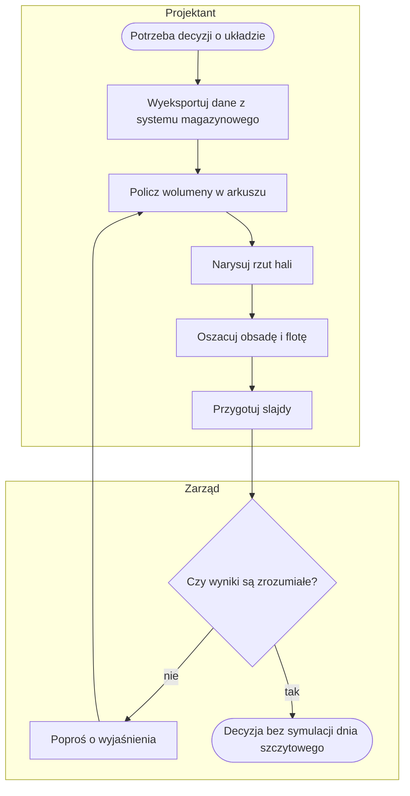
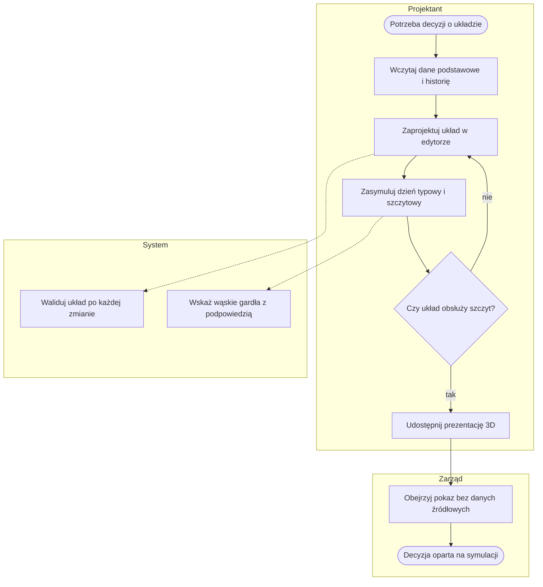

# Procesy AS-IS i TO-BE

**[BA]** · wersja 0.1

Szczegółowe procesy TO-BE (P1–P8 z diagramami, krokami, regułami i wymaganiami) są w
[docs/01-procesy/](../01-procesy/). Ten dokument zestawia stan przed wdrożeniem i po nim.

## AS-IS — przygotowanie decyzji o układzie magazynu bez systemu

Opis jest **założeniem do potwierdzenia** ([Z-1](../00-przeglad.md#założenia-wymagające-potwierdzenia)):
kod pokazuje tylko, że dane pochodzą z eksportów systemu magazynowego, a wyniki trafiają do zarządu.

Słabości AS-IS: brak symulacji dnia szczytowego, brak walidacji fizycznej układu, wiele ręcznych przeliczeń,
pokaz bez wizualizacji 3D, każdy wariant liczony od nowa.

## TO-BE — z systemem TWINEMA

| Aspekt | AS-IS | TO-BE | Proces |
|---|---|---|---|
| Dane | ręczny eksport i przeliczenia w arkuszach | import z raportem odrzuceń | [P1](../01-procesy/P1-dane-podstawowe.md), [P2](../01-procesy/P2-historia-ruchow-i-prognoza.md) |
| Układ | płaski rzut | model 2D/3D z walidacją | [P3](../01-procesy/P3-model-hali.md) |
| Sprzęt i koszty | szacunek | katalog z krzywą udźwigu i widełki kosztów | [P4](../01-procesy/P4-katalog-sprzetu.md) |
| Ocena dnia | brak symulacji | wiele przebiegów, P95, wąskie gardła | [P5](../01-procesy/P5-scenariusz-i-symulacja.md) |
| Pokaz | slajdy | prezentacja 3D, link publiczny, film | [P6](../01-procesy/P6-prezentacja-3d.md), [P7](../01-procesy/P7-film-i-deck.md) |
| Dostęp | — | role i demo publiczne | [P8](../01-procesy/P8-dostep-i-demo.md) |
