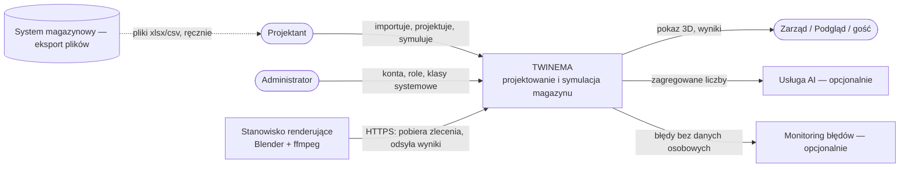
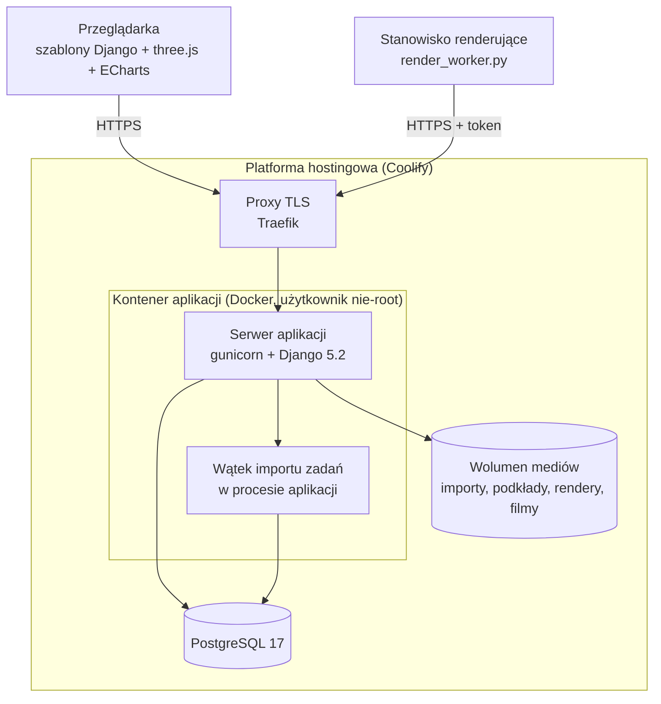

# Architektura

**[DEV]** · model C4: poziom 1 (kontekst) i 2 (kontenery). Decyzje: [adr/](adr/) i
[05-decyzje-i-ograniczenia.md](../05-decyzje-i-ograniczenia.md). Interfejsy: [04-integracje.md](../04-integracje.md), [API.md](API.md).

## C4 poziom 1 — kontekst

System nie łączy się z systemem magazynowym; dane wchodzą przez pliki wgrywane przez Projektanta.

## C4 poziom 2 — kontenery

Diagram pokazuje, że cały ruch — przeglądarki i stanowiska — wchodzi przez proxy TLS do jednego kontenera
aplikacji, a długie importy zadań działają w wątku tego samego procesu.

| Kontener | Technologia | Odpowiedzialność |
|---|---|---|
| Serwer aplikacji | Python 3.13, Django 5.2 LTS, gunicorn (2 procesy × 4 wątki, limit 120 s), whitenoise | widoki, logika, API stanowiska, pliki statyczne |
| Wątek importu zadań | `threading` w procesie gunicorna | import plików zadań > 5 MB w tle |
| Baza danych | PostgreSQL 17 (lokalnie i w testach SQLite) | wszystkie encje ([model danych](MODEL_DANYCH.md)) |
| Wolumen mediów | system plików kontenera | pliki od użytkowników i wyniki renderu, wydawane przez widoki z kontrolą roli |
| Przeglądarka | szablony Django, three.js, ECharts (dołączone do obrazu) | edytor 2D/3D, animacje, pokazy |
| Stanowisko renderujące | Python (biblioteka standardowa), Blender 4.x, ffmpeg ≥ 6.1 | render ujęć i montaż filmu |

## Moduły aplikacji

| Aplikacja Django | Zakres | Proces |
|---|---|---|
| `core` | logowanie, role, nawigacja, demo, kontrola działania, nagłówki bezpieczeństwa | P8 |
| `masterdata` | materiały, nośniki, klasy palet, stany, importy | P1 |
| `twin` | model hali, edytor, master lokalizacji, zadania magazynowe, dzień projektowy, warianty, scena 3D | P2, P3 |
| `ml` | prognoza i segmentacja | P2 |
| `equipment` | katalog sprzętu, stawki kosztowe | P4 |
| `scenario` | scenariusze, symulacja, porównanie, animacja dnia, prezentacje 3D | P5, P6 |
| `render` | kolejka renderu i API stanowiska | P7 |
| `studio` | prezentacja filmowa, montaż, deck, napisy | P7 |

Logika obliczeniowa (symulacja, ML, geometria, walidacja układu) jest napisana bez dostępu do bazy, a widoki
przygotowują dane i wywołują logikę ([D11](../05-decyzje-i-ograniczenia.md#d11-logika-obliczeniowa-bez-django)).

## Konfiguracja

Wyłącznie zmienne środowiskowe, walidowane przy starcie (`web/twinema/config.py`); lista bez wartości:
[.env.example](../../.env.example). Uruchomienie i wdrożenie: [README](../../README.md), [RUNBOOK](../operacje/RUNBOOK.md).
