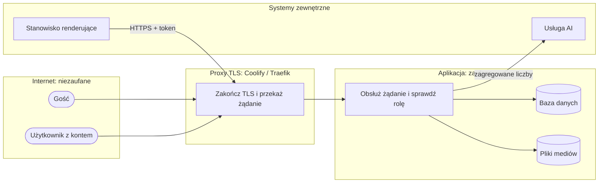

# Threat model (STRIDE)

**[SEC]** · wersja 0.1 · zakres: wszystkie przepływy danych przez granice zaufania

## Diagram przepływów danych i granic zaufania

Granice zaufania: internet ↔ proxy, proxy ↔ aplikacja, aplikacja ↔ systemy zewnętrzne. Diagram pokazuje,
że stanowisko renderujące wchodzi do aplikacji tą samą drogą co użytkownicy, a do usługi AI ruch wychodzi tylko z aplikacji.

Oznaczenia statusu: ✅ zabezpieczone · ⚠️ częściowo · ❌ brak. Pozycje ⚠️ i ❌ mają wpis w [rejestrze ryzyk](RYZYKA.md).

## F1. Logowanie i sesja

| STRIDE | Zagrożenie | Zabezpieczenie | Status |
|---|---|---|---|
| S | zgadywanie hasła | blokada po 5 próbach (login + IP) na 1 h; hasło ≥ 10 znaków i walidatory Django | ✅ |
| S | obejście blokady przez podmianę `X-Forwarded-For`, gdy aplikacja jest osiągalna z pominięciem proxy | IP z ostatniego wpisu nagłówka — poprawne tylko za jednym zaufanym proxy | ⚠️ R-05 |
| S | przejęcie sesji | ciasteczka `Secure`, `HttpOnly`, `SameSite=Lax`; HTTPS i HSTS w produkcji | ✅ |
| S | przejęcie konta Administratora | brak drugiego składnika | ⚠️ R-11 |
| R | brak śladu, kto się logował albo usunął dane | django-axes zapisuje próby logowania; dziennik operacji wrażliwych: usunięcia, importy, linki publiczne (US-008) | ✅ |
| E | ucieczka z kontenera przez proces root | obraz działa jako użytkownik `app` (`USER` w Dockerfile, US-014) | ✅ |
| E | podniesienie uprawnień przez wejście gościa | wejście gościa tylko na konto zwykłego Podglądu, bez praw personelu | ✅ |

## F2. Import plików (dane podstawowe, zadania, sprzęt, układ, podkład)

| STRIDE | Zagrożenie | Zabezpieczenie | Status |
|---|---|---|---|
| T | złośliwy XLSX (XXE, „billion laughs”) | openpyxl przez defusedxml | ✅ |
| D | bardzo duży plik albo bomba ZIP | limity rozmiaru (5–300 MB), limit wierszy; import zadań > 5 MB w kolejce zadań z limitem 3 prób (US-024) | ✅ |
| T | podmiana pliku obrazu | walidacja Pillow, limit 10 MB i 12 000 px | ✅ |
| I | pliki dostępne publicznie | media poza katalogiem publicznym, wydawane przez widoki z kontrolą roli | ✅ |
| E | import przez rolę bez uprawnień | importy tylko dla Projektanta | ✅ |
| T | import nadpisuje cudzy model sprzętu | autor albo Administrator (US-001) | ✅ |
| I | dane osobowe pracowników w historii zadań | login zastępowany pseudonimem przy imporcie i podglądzie; migracja danych istniejących (US-012) | ✅ |

## F3. Pokaz publiczny (link)

| STRIDE | Zagrożenie | Zabezpieczenie | Status |
|---|---|---|---|
| S | odgadnięcie linku | 24 bajty losowe (`secrets.token_urlsafe`), data ważności, unieważnienie przy nowym linku | ✅ |
| I | wyciek danych źródłowych | pokaz bez danych źródłowych; tylko odczyt | ✅ |
| I | wyciek linku przez nagłówek Referer, wyszukiwarki, pośredników | `no-referrer`, `noindex`, `no-store` | ✅ |
| I | link w logach dostępu | adres z kluczem trafia do logów serwera | ⚠️ R-12 |
| T | XSS przez podpisy slajdów | `textContent` i escapowanie; CSP wymuszana — skrypty tylko z serwera albo z nonce (US-005) | ✅ |

## F4. Demo publiczne (gość)

| STRIDE | Zagrożenie | Zabezpieczenie | Status |
|---|---|---|---|
| I | włączenie demo na instancji z danymi rzeczywistymi | flaga `DEMO_PUBLIC` domyślnie wyłączona; brak kontroli technicznej | ❌ R-02 |
| D | obliczenia uruchamiane przez gości | symulację i kalibrację uruchamia tylko Projektant; Podgląd i gość widzą wynik policzony wcześniej (Z-3) | ✅ |
| R | brak rozróżnienia gości | wszyscy goście na jednym koncie | ⚠️ R-13 |

## F5. API stanowiska renderującego

| STRIDE | Zagrożenie | Zabezpieczenie | Status |
|---|---|---|---|
| S | podszycie się pod stanowisko | token ≥ 32 znaki, porównanie w stałym czasie | ✅ |
| I | token otwartym tekstem | stanowisko wymaga HTTPS poza komputerem lokalnym (US-003) | ✅ |
| T | spóźnione stanowisko nadpisuje wynik | jednorazowy klucz przejęcia zlecenia | ✅ |
| T | złośliwy plik wyniku | sygnatura PNG/MP4, limit 500 MB | ✅ |
| D | zlecenie odrzucane w kółko | po 3 próbach zlecenie kończy się błędem (US-015) | ✅ |

## F6. Usługa AI

| STRIDE | Zagrożenie | Zabezpieczenie | Status |
|---|---|---|---|
| I | wyciek danych do dostawcy | tylko zagregowane liczby; bez nazw i kodów | ✅ |
| T | prompt injection przez dane | do modelu nie trafia tekst od użytkownika poza liczbami; odpowiedź jest szkicem, który zatwierdza człowiek | ✅ |
| D | koszt i czas | limit 90 s, jedno ponowienie, funkcja na żądanie Projektanta | ⚠️ brak limitu kosztów (R-15) |

## F7. Łańcuch dostaw i wdrożenie

| STRIDE | Zagrożenie | Zabezpieczenie | Status |
|---|---|---|---|
| T | podatna zależność | przypięte wersje, pip-audit blokujący, Dependabot | ✅ |
| T | podmieniona biblioteka JS | pobranie przy budowie z sumą SHA-256 | ✅ |
| T | zmiana trafia na produkcję bez akceptacji człowieka | auto-merge usunięty z CI; wymagane zatwierdzenie w ochronie gałęzi — ustawia PO | ⚠️ R-09 |
| T | podmieniony tag akcji CI albo przejęte wydanie zależności | akcje przypięte skrótem commita; Dependabot z karencją 7 dni (US-018) | ✅ |
| I | sekret w repozytorium | gitleaks w CI i pre-commit | ✅ |
| I | dane rzeczywistego obiektu w historii repozytorium | procedura czyszczenia gotowa ([CZYSZCZENIE_HISTORII](../operacje/CZYSZCZENIE_HISTORII.md)), wykonuje PO | ⚠️ R-01 |
| A | utrata danych | brak mechanizmu kopii zapasowych w projekcie | ❌ R-10 |
